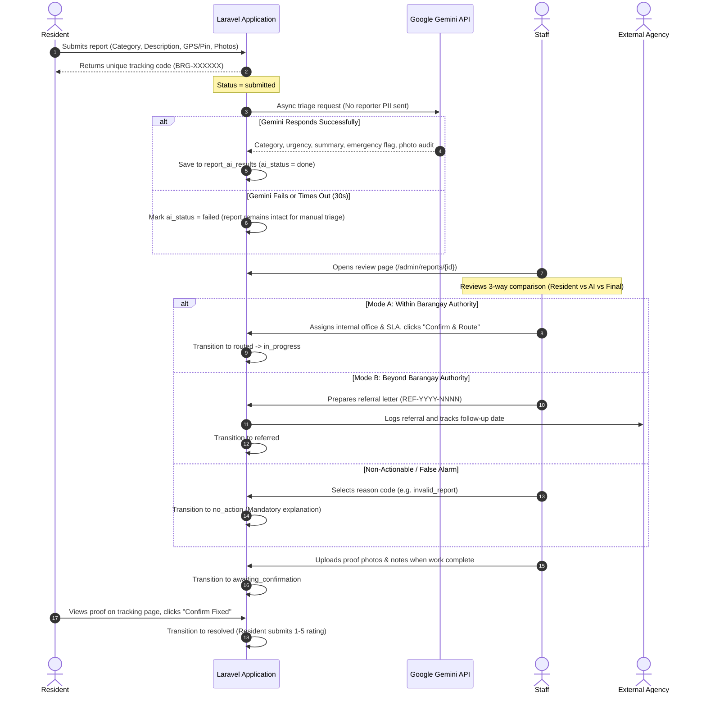

# System Architecture & Technical Design

Architectural specification, service layer boundaries, data flow pipelines, and security trust models for the **Barangay Problem Reporting and Management System**.

---

## 1. Architectural Overview

The application follows a **Modular Monolithic MVC Pattern** built on Laravel 13, augmented with an explicit Domain Service Layer. Controller actions remain thin, delegating domain decisions, state transitions, external AI queries, and routing logic to dedicated service classes.

```
       +-------------------------------------------------------------+
       |                     Resident / Public UI                   |
       |  (Report Form, Tracking Status, Confirmation, Public Map)   |
       +------------------------------+------------------------------+
                                      | HTTP Requests / CSRF
                                      v
       +-------------------------------------------------------------+
       |                  Laravel Routing & Middleware               |
       |  (routes/resident.php, routes/staff.php, routes/admin.php)  |
       +------------------------------+------------------------------+
                                      |
                                      v
       +-------------------------------------------------------------+
       |                 Controller Presentation Layer               |
       |        (ReportController, TrackController, Admin/*)         |
       +------------------------------+------------------------------+
                                      | Calls Domain Services
                                      v
       +-------------------------------------------------------------+
       |                       Domain Service Layer                  |
       |  - GeminiService (Async AI Classification & Photo Auditing) |
       |  - ReportStatusService (Finite State Machine Transitions)    |
       |  - RoutingService (Jurisdiction Rules & Office Assignment)  |
       |  - PriorityService (Risk Weights, SLA & Score Calculation)  |
       |  - ReferralService (External Agency Transmission & Letters) |
       |  - ProofPhotoService (Multi-image Resolution Evidence)      |
       |  - DashboardAnalyticsService & HotspotService               |
       +------------------------------+------------------------------+
                                      | Eloquent ORM
                                      v
       +-------------------------------------------------------------+
       |                 Data Storage & External Services            |
       |  - Database: SQLite (Dev/Test) / MySQL (Production Target)  |
       |  - AI API: Google Gemini REST API (gemini-2.5-flash)        |
       |  - Mapping: OpenStreetMap Tile Servers (via Leaflet.js)     |
       |  - Mail: Laravel Mail (Log Driver / SMTP) & NotificationLog |
       +-------------------------------------------------------------+
```

---

## 2. Service Layer Responsibility Map

| Service Class | Location | Primary Responsibilities |
| :--- | :--- | :--- |
| **`GeminiService`** | `app/Services/GeminiService.php` | Handles prompt serialization, HTTP timeouts (30s), fallback model failover, photo description, and response sanitization. |
| **`ReportStatusService`** | `app/Services/ReportStatusService.php` | Enforces state transition matrix integrity, database transactions, and dispatches `ReportStatusChanged` events. |
| **`RoutingService`** | `app/Services/RoutingService.php` | Evaluates category rules against jurisdiction authority (Mode A internal dispatch vs. Mode B external referral). |
| **`PriorityService`** | `app/Services/PriorityService.php` | Computes dynamic numerical priority score based on risk weights, sensitivity proximity, and situational flags. |
| **`ReferralService`** | `app/Services/ReferralService.php` | Generates unique `REF-YYYY-NNNN` referral records, tracks follow-up dates, formats printable letters, and manages agency communication logs. |
| **`ProofPhotoService`** | `app/Services/ProofPhotoService.php` | Validates, optimizes, and stores multiple resolution photos (up to 5 images, max 5 MB each). |
| **`DuplicateService`** | `app/Services/DuplicateService.php` | Performs Haversine distance calculations (100–150m) and text similarity comparisons against open reports. |
| **`HotspotService`** | `app/Services/HotspotService.php` | Groups coordinates into geospatial grid clusters to identify high-density incident locations. |
| **`NotificationService`** | `app/Services/NotificationService.php` | Wraps mail dispatches in robust exception handling and logs delivery status to `notification_logs`. |
| **`SettingsService`** | `app/Services/SettingsService.php` | Dynamic typed configuration store, cached key lookups, and setup placeholder confirmation auditing. |
| **`FiscalYearService`** | `app/Services/FiscalYearService.php` | Fiscal year lifecycle, active year resolution, boundary enforcement, and annual transition management. |
| **`FiscalYearContext`** | `app/Services/FiscalYearContext.php` | Session-scoped viewing year context for multi-year review, archival auditing, and global filters. |
| **`FiscalYearGuard`** | `app/Services/FiscalYearGuard.php` | Security gate preventing mutations on records belonging to locked/closed fiscal years. |
| **`NumberingService`** | `app/Services/NumberingService.php` | Format mask compiler (tokens `{YEAR}`, `{YY}`, `{MM}`, `{SEQ:n}`; default case format `{MM}-{SEQ:3}-{YEAR}`) and atomic database-locked sequence generator. |
| **`PermissionService`** | `app/Services/PermissionService.php` | Granular permission registry, user syncing, and role preset application (`staff_full`, `case_encoder`, etc.). |
| **`AuditLogger`** | `app/Services/AuditLogger.php` | Centralized audit logger recording administrative overrides, setting adjustments, and security events. |
| **`PersonnelService`** | `app/Services/PersonnelService.php` | Official roster management, term tracking, signatory eligibility, and deactivation safeguards. |
| **`SignatoryResolver`** | `app/Services/SignatoryResolver.php` | Document signatory resolution mapping document types to active position holders. |
| **`CaseStatusService`** | `app/Services/CaseStatusService.php` | State transition machine for Katarungang Pambarangay dispute conciliation cases. |
| **`SummonsCounterService`** | `app/Services/SummonsCounterService.php` | Counts non-voided summons per case for display only. No threshold is enforced: the barangay counts days, not summons (Secretary Q20). Deadlines are handled by `OverdueService`. |
| **`OverdueService`** | `app/Services/OverdueService.php` | SLA calculation identifying overdue reports and pending external referrals, plus case mediation and conciliation deadlines in working days (`App\Support\WorkingDays`). |
| **`GlobalSearchService`** | `app/Services/GlobalSearchService.php` | Cross-entity universal search indexing reports, cases, parties, and referrals. |

> **Planned services (Revision 2):** `WorkingDays` (helper), `PartyMatchingService` and a case duplicate check (WS3), `LegacyImportService` (WS6, stretch). See `REVISION_2.md`.

---

## 3. Fiscal Year Context, Guard & Numbering Pipeline

### Fiscal Year Context & Guard
The application enforces strict annual fiscal year isolation:
- **`FiscalYearService::forNewRecord()`**: Attaches the currently active fiscal year to every new report, case, or referral.
- **`FiscalYearContext`**: Allows staff to switch viewing context via the `<x-year-switcher />` component without altering the default active year.
- **`FiscalYearGuard::assertWritable()`**: Rejects edits to finalized records in locked fiscal years, throwing `FiscalYearLocked`.

### Atomic Numbering Pipeline
Numbering sequences are tracked in `number_sequences` with a composite unique key `['fiscal_year_id', 'type']`:
1. `NumberingService::next($type, $fiscalYear)` parses format masks (e.g. `{MM}-{SEQ:3}-{YEAR}` for cases and blotter entries, `REF-{YEAR}-{SEQ:4}`, `SUM-{YEAR}-{SEQ:4}`).
2. Uses `lockForUpdate()` within an atomic database transaction.
3. Automatically rolls sequence numbering back to 1 when a new fiscal year starts.

---

## 4. Role, Permission & Preset Architecture

Security is layered across three tiers:
1. **Roles**: High-level actor classification (`admin`, `staff`, `agency`).
2. **Granular Permissions**: 18 slugs currently built in Phase 0 (target 22 plus `imports.manage` in Phase 0.5/Revision 2) covering discrete capabilities (e.g. `cases.view`, `cases.summons`, `settings.manage`, `reports_center.export`).
3. **Role Presets**: Pre-configured permission bundles defined in `config/permission_presets.php`:
   - `staff_full`: Complete staff operational rights across cases, reports, and referrals.
   - `case_encoder`: Lupon clerk role restricted to dispute case docketing and summons issuance.
   - `reports_analyst`: Read-only reporting and dashboard analytics access.
   - `case_reviewer` (Revision 2): view all cases including confidential ones, plus reports; for the Kagawad (Peace & Order), kagawads on minors' cases and the VAW focal person.
4. **Admin Exemption**: Users with role `admin` implicitly satisfy all permission checks via `User::hasPermission()`.

---

## 5. End-to-End Data Flow



---

## 6. Trust Boundaries & AI Operational Limits

1. **Strict Advisory Mandate**: The AI is completely isolated from binding state modifications. It has zero authority to execute database writes to final columns on `reports`, transition statuses, merge duplicates, or close reports.
2. **Human-in-the-Loop Review Gate**: Staff must explicitly review and confirm category and urgency before routing an incident. AI values are rendered with clear visual badges (`AI Suggested`, `Matches`, `Differs`).
3. **Emergency Containment**: The AI cannot contact emergency services (police, fire, CDRRMO). It only sets an advisory `emergency_flagged` status, which triggers on-screen 911 dialing guidance for the resident and sends priority alerts to local officials.

---

## 7. Security & Network Architecture

- **Session Authentication**: Staff and Administrator access is guarded by Laravel's built-in session authentication and `role` middleware (`EnsureRole:staff` or `EnsureRole:admin`).
- **Throttling & Abuse Prevention**:
  - Public submission routes are rate-limited (`throttle:10,1`).
  - Staff login endpoint is throttled (`throttle:5,1`).
- **CSRF & Input Sanitization**: Every HTML form includes `@csrf` verification tokens. All rich text and descriptions are escaped before rendering in Blade templates.
- **File Upload Hardening**: Uploaded photos are verified by MIME type (`image/jpeg`, `image/png`, `image/webp`), sanitized on write, and stored in isolated storage disks (`storage/app/public/reports/`).
