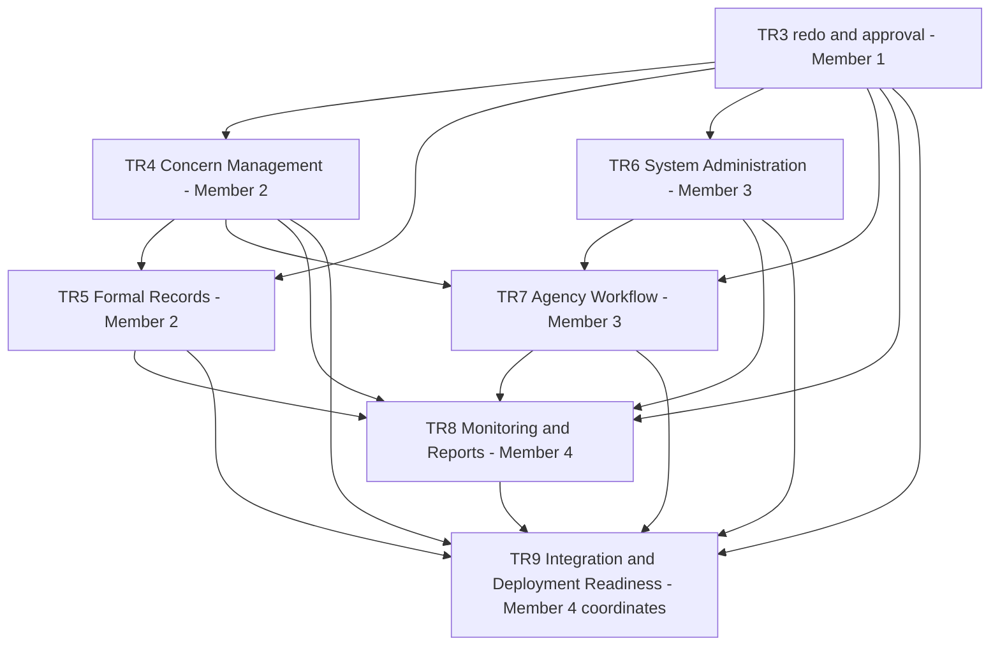

# Barangay Problem Reporting and Management System
# Workflow Improvement — Master Specification (Source of Truth)

| Field | Value |
|---|---|
| Structure | **Part 1** Resident Side → **Part 2** Admin / Barangay Staff Side → **Part 3** Implementation Roadmap by TR |
| Supersedes | The earlier "Decision Summary", chat-derived roadmaps, and any conflicting documents |
| Current position | TR1 ✅ · TR2 ✅ prototype (official GIS pending) · **TR3 🔄 reopened for re-audit, corrections, and full re-verification** · TR4–TR9 planned/in progress only where explicitly stated |
| Last consolidated | 2026-11-28 |

---

## How to Use This Document

1. **Parts 1 and 2 describe WHAT the system should do** (flows, information, frontend expectations, rules). **Part 3 describes WHEN and IN WHAT ORDER it is built** (TR1–TR9, with clean task lists).
2. **This document is the source of truth for intent. The code is the source of truth for what currently exists.** If they disagree, do not silently pick one. Record it in the Open Items and Discrepancy Log (end of Part 3).
3. Every flow uses the same template: **Purpose → Information → Steps → Flow → Frontend → Backend → Rules → Acceptance**.
4. Markers:
   - **[AUDIT FIRST]**: verify in the real codebase before designing or changing anything.
   - **[CONFIRM WITH BARANGAY]**: legal or procedural rule; validate with barangay personnel before automating.
5. Status legend: ✅ Done · 🟡 Partial · ⏭ Next · 🔲 Planned · ⏸ Deferred (blocked on external input).

### Corrections applied to the source material

| # | Issue in the source | Resolution |
|---|---|---|
| 1 | Stray image captions and site names (street.co.uk, nilam.io, khaleejtimes.com, lguss.dilg.gov.ph, Dribbble) | Removed; they were embedded-image artifacts. |
| 2 | Conversational text ("Yes. I would…", "I recommend…", "What should we do next?") | Converted into definitive requirements. |
| 3 | Admin-side geographic verification had been placed under TR2.5 | Corrected: TR2 is resident-only; it is **TR3.4**. |
| 4 | Staff audit called "TR2.5.1-R0" | Renamed **TR3.1-R0**. |
| 5 | Two admin structures (Concern Management A–E vs. "Concern Intake" navigation) | Reconciled: **Concern Intake = TR3; Concern Management = TR4** (see Part 2-A). |
| 6 | Messy task lists (TR2.4.x sub-IDs mixed with TR2.x; TR3 tasks mixed with scenarios and scope; TR6–TR9 had no tasks) | Rebuilt in Part 3: one table per TR with ID, task, type, deliverable, status. TR2.4.x kept only as a history map. |
| 7 | Blotter/Complaint/Case described as new while existing Cases/Blotter may already exist | Marked **[AUDIT FIRST]** (TR5.1). |
| 8 | Legal references (LGC §§408–410) appeared as unattributed links | Kept as reference, marked **[CONFIRM WITH BARANGAY]**. |
| 9 | Trailing "WHAT IF'S" chat link | Removed; its questions are covered in Part 2-A (jurisdiction scenarios). |

---

## Goal, Principles, Glossary

### Goal
Improve the **existing** system so that residents can report concerns more easily (AI assistance, automatic location detection), while barangay personnel receive properly classified, located, organized information to review, route, manage, and convert into official records when appropriate.

### Non-goals
- No new system. Reuse the existing form, Gemini AI infrastructure, Leaflet map, Purok records, referral workflow, and submission process.
- No removal or unnecessary change of working features or validation.
- No renaming of routes, tables, models, controllers, form field names, or internal identifiers when only wording changes.

### Principles
1. **Residents describe. AI assists. Staff decide.** AI never makes official legal or administrative decisions.
2. **Preserve originals.** Original description, location, and submission are never overwritten.
3. **No automatic escalation.** A submission never automatically becomes a blotter entry, formal complaint, or Barangay Case.
4. **Graceful degradation.** AI, GPS, or boundary data unavailable → manual fallback; submission still works. Emergency never waits for AI.
5. **Separate records, explicit links.** Blotter, Complaint, and Barangay Case have their own IDs, statuses, permissions, and audit trails.
6. **Reuse before build.** Audit first, extend second, create new only when nothing suitable exists.
7. **Never silently guess.** Uncertain location or classification is shown as uncertain.

### Glossary

| Term | Meaning |
|---|---|
| **Concern** | Any resident submission through *Report a Concern* (formerly "Report a Community Problem"). |
| **Community Problem** | AI intake class: community conditions/services (garbage, streetlight, drainage). |
| **Incident** | AI intake class: an event that happened and may need investigation. |
| **Possible Formal Complaint** | AI intake class: may need formal complaint handling (suggestion only). |
| **Uncertain / Needs Clarification** | AI intake class: not enough information. |
| **Blotter Entry** | Official record that an incident was reported to the barangay. |
| **Complaint** | Record of a grievance and request for formal barangay action; goes through intake and acceptance. |
| **Barangay Case** | Official file for formal Katarungang Pambarangay (KP) proceedings, created only after complaint acceptance. |
| **Referral** | Existing workflow handing a concern to an external office/agency; stays linked to its parent. |
| **Point-in-Polygon (PiP)** | Determines which supplied boundary contains a coordinate; it does not create boundaries. |

AI intake classes are **intake guidance, not official classifications.** Staff classification is the official one.

---
---

# PART 1 — RESIDENT SIDE

## 1.1 Reporting Entry Point (Flow R1)

**Purpose:** One general entry for all concerns. Residents should not have to decide whether something is a problem, incident, or complaint.

**Why "Report a Concern":** the system accommodates more than community problems: garbage accumulation, damaged streetlights, noise disturbances, neighbor disputes, physical altercations, suspicious activities, and other incidents requiring barangay attention.

**Information shown on the home screen**
- **Report a Concern** (primary entry)
- **File a Complaint** (separate; for residents who already intend to formally bring a complaint)
- **Emergency guidance** (always available)

**Flow**
```
Home ─┬─► Report a Concern ─► Step 1 ► Step 2 ► Step 3 ► Tracking code
      ├─► File a Complaint (existing, unchanged)
      └─► Emergency guidance (never gated by AI)
```

**Frontend: terminology changes**

| Old | New |
|---|---|
| Report a Community Problem (home card) | Report a Concern |
| Submit Problem Report (button) | Report a Concern |
| Report a Problem (form title) | Report a Concern |
| What is the problem? (label) | What is your concern? |
| Public map reporting button | Report a Concern |
| Navigation labels | Updated to match |

Update English and Filipino translations. **Do not change** route names, table names, model names, controller names, form field names, or internal identifiers used by the admin workflow.

**Acceptance:** no resident-facing screen still says "Community Problem/Problem Report"; existing routes and tests still pass.

---

## 1.2 The Three-Step Reporting Form

The existing three-step structure is **retained**, not replaced.

### Step 1 — Describe Your Concern (AI-assisted) (Flow R2)

**Purpose:** Residents describe what happened in their own words and optionally receive AI help.

**AI assists by:** understanding the description; recommending a classification; suggesting a category; generating a concise summary; asking follow-up questions when important information is missing; identifying whether a different workflow (e.g., formal complaint) may be needed.

**Classification guidance:** Community Problem · Incident · Possible Formal Complaint · Uncertain / Needs Clarification. The resident can review and correct all suggestions.

**Information**

| Item | Source | Notes |
|---|---|---|
| Original description | Resident (typed or voice) | Always preserved verbatim |
| Voice transcript | Existing Gemini voice analysis | Preserved and integrated |
| Suggested classification / category | AI | Advisory only |
| AI summary | AI | Concise; never replaces the original |
| Clarification questions | AI | Only when important info is missing |
| Complaint-workflow hint | AI | Points to the separate File a Complaint entry |
| Confidence / failure state | AI service | Failure never blocks submission |
| Resident decision | Resident | Accepted / corrected / dismissed |

**Steps**
1. Resident types or dictates the concern.
2. Optionally taps **Analyze Concern**; a loading indicator appears.
3. Suggestions appear (classification, category, summary, questions, complaint hint).
4. Resident accepts, edits, or dismisses suggestions and answers questions if desired.
5. Resident may proceed to Step 2 at any time, with or without AI.

**Flow**
```
Describe ─► [Analyze Concern] ─► POST pre-submission analysis (rate-limited)
                                   ├─ success ─► suggestion panel ─► accept / edit / dismiss
                                   └─ failure ─► neutral notice; form fully usable
          └─► Next (always allowed) ─► Step 2
```

**Frontend expectations**
- "Analyze Concern" button, disabled while loading or when the description is empty or too short.
- Non-blocking loader; the textarea stays editable.
- Suggestion panel: classification badge, editable category dropdown, summary with use/dismiss, clarification questions with inline answers.
- If classification is Possible Formal Complaint: inline banner suggesting **File a Complaint** (link); the resident may still continue.
- Original description always visible and unchanged.
- Voice reporting and emergency guidance remain available.
- EN/FIL strings.

**Backend**
- New pre-submission method in `GeminiService`; new action in `ReportController`; rate-limited route in `routes/resident.php`. (The existing queued `ProcessNewReport` runs after submission and cannot serve interactive Step 1, so it stays unchanged.)
- Validate the description; **send only the description** to the AI (no name, phone, email, coordinates).
- Structured response: classification, category, summary, clarification_questions[], suggests_formal_complaint, confidence, emergency_flag.
- Reuse existing Gemini configuration (per audit: Gemini 3.1 Flash-Lite) and suitable complaint-detection logic.

**Acceptance:** valid recommendations; rate limiting enforced; AI failure still allows submission; no contact data reaches Gemini; voice reporting unaffected.

### Step 2 — Location (Flow R3)

**Purpose:** Capture an accurate location and detect Barangay and Purok automatically from official geography.

**Residents can:** use current GPS location; manually place a pin; move the pin to correct inaccurate GPS.

**Information**

| Item | Notes |
|---|---|
| Latitude / longitude | From GPS or pin |
| Detected Barangay | Must be Calarian to count as inside |
| Detected City | Zamboanga City (illustrative display) |
| Detected Purok | From boundary polygons, never from a bounding box |
| Street / nearby address | Optional, when available (reverse geocoding is a separate optional enhancement) |
| Landmark / extra details | Resident free text |
| Resident-confirmed/corrected Purok | Stored alongside the detected value |
| Detection status | exact / near-boundary / inside-no-purok / outside / unavailable |

Example display (illustrative, not an actual detected address): Barangay Calarian · City Zamboanga City · Purok 5 · GPS coordinates.

**Steps**
1. Resident uses GPS or places/moves the pin.
2. Frontend sends coordinates to the detection endpoint.
3. Backend: validate coordinates → inside Calarian? → which Purok polygon contains the point? → return structured result.
4. Frontend shows the detected location for confirmation.
5. Resident confirms, corrects the Purok, moves the pin, or adds a landmark.
6. On final submission the backend **revalidates** the coordinates and Purok independently.

**Flow**
```
GPS / pin ─► detect ─► result
  ├─ exact Purok match ────────────► show + confirm
  ├─ near shared boundary ─────────► show ambiguity; ask resident to verify
  ├─ inside Calarian, no Purok ────► resident selects Purok / adds landmark
  ├─ outside Calarian ─────────────► warning (not a rejection)
  ├─ GPS denied / unavailable ─────► manual pin + manual Purok fallback
  └─ boundary data missing/invalid ► manual fallback; no silent assignment
Submit ─► backend revalidates
```

**Frontend expectations**
- Leaflet + OpenStreetMap; draggable marker; Barangay boundary and Purok polygons rendered.
- Detected-location card (Barangay, City, Purok, coordinates) with plain-language confirmation.
- Distinct, non-alarming states for each result; clear outside-Calarian warning.
- Purok dropdown for manual correction; landmark field.
- UI does not claim official accuracy while boundary data is provisional.
- Mobile-friendly; GPS denial handled gracefully.

**Backend**
- `app/Services/BoundaryService.php`: validate coordinates; Calarian check; Purok match; ambiguity/unmatched detection; structured result.
- Pure PHP geometry (no SpatiaLite dependency); GeoJSON as target format.
- Server-side validation on submission, with Purok validation and deduplication.

**Rules:** uncertain results **never silently assign a Purok**. Outside Calarian → warning, not rejection. Detected and resident-selected Purok are stored separately so staff can compare.

**Acceptance:** correct Purok for test coordinates; ambiguous points handled safely; outside points warn; submitted coordinates independently validated; manual fallback works.

### Step 3 — Photo and Contact Information (Flow R4)

**Preserve existing functionality exactly:** optional photo upload; name; mobile number; email; anonymous reporting; data privacy consent; existing validation; tracking-code generation; submission confirmation; queued post-submission AI processing.

**Steps:** add optional photo → provide contact (or anonymous per existing rules) → accept privacy consent → submit → receive tracking code.

**Frontend:** layout and behavior unchanged apart from terminology.

**Acceptance:** submission succeeds even when AI assistance and location detection are unavailable (subject to existing required-field rules); tracking code and confirmation work.

---

## 1.3 Resident-Side Safeguards

| AI and location functionality | Rule |
|---|---|
| AI classification | Recommendation only |
| AI summary | Preserves original description |
| AI clarification | Resident can answer or correct |
| Possible complaint | Does not automatically create a formal case |
| Possible blotter | Does not automatically create an official blotter |
| Purok detection | Based on official geographic boundaries |
| Location outside Calarian | Show warning |
| AI/GPS unavailable | Provide a manual fallback |
| Emergency | Must not wait for AI |
| Privacy | Personal contact details never sent to Gemini |

## 1.4 Purok Boundary Preparation (Flow R5)

Barangay Calarian has Purok boundaries that can be obtained, so real geographic data replaces manual Purok selection.

**Responsibilities:** Barangay provides official boundaries → authorized administrator manages/imports → backend performs detection → resident sees and confirms.

**Steps when official data arrives**
1. Obtain official records (GeoJSON, KML, Shapefile, or maps needing digitization).
2. Convert to GeoJSON if needed.
3. Verify the coordinate reference system.
4. Check for missing, overlapping, or invalid boundaries.
5. Match official Purok identifiers to existing canonical database records.
6. Import without breaking existing report references.
7. Deactivate provisional geometries safely.
8. Re-run detection and regression tests.

**Rules:** point-in-polygon uses supplied boundaries and does not create them. **Never invent polygon coordinates or use the current map bounding box as a substitute.** The prototype's provisional data is for demonstration only.

---
---

# PART 2 — ADMIN / BARANGAY STAFF SIDE

**Main principle:** Residents describe what happened. AI assists with understanding and classification. Barangay personnel review the information, determine the action, and create official records when necessary.

The admin side has a unified process for submissions from *Report a Concern*, but **keeps separate official workflows** for blotter recording, complaint intake, and Barangay Case processing.

**Naming reconciliation**
- **Concern Intake** (TR3): the existing Community Reports module, improved. Initial staff review, verification, classification, and routing.
- **Concern Management** (TR4): lifecycle handling of concerns that stay under ordinary barangay handling.
- **Blotter / Complaint / Barangay Case** (TR5): separate official records.

**Proposed admin navigation** (names are proposals; **inspect existing navigation before changing labels or routes**)
```
Dashboard
Concern Intake            ← TR3 (Incoming · Under Review · Needs Clarification · Needs Verification · Awaiting Next Action)
Referrals and Routing     ← existing module (TR3 integrates, TR7 extends)
Cases and Blotter         ← TR5
Monitoring and Reports    ← TR8
System Administration     ← TR6 (includes Purok Management)
```
Queue states are filters/tabs, not a page per status. Intake sub-states may be derived views rather than new database statuses **[AUDIT FIRST]**.

---

## 2-A. Concern Management (Concern Intake and Handling)

Handles submissions from *Report a Concern*: garbage, damaged streetlights, drainage, noise, stray animals, neighbor disputes, physical altercations, suspicious activities, and other incidents. All enter a common receiving and review process; classification then determines handling.

### Existing functionality to preserve (verify in TR3.1-R0)

| Existing capability | Treatment |
|---|---|
| Community Reports page | Retain; improve; consider renaming to Concern Intake |
| Incoming report queue | Preserve; improve filters/organization |
| AI classification and analysis | Preserve; clarify advisory role |
| AI failure indicators | Preserve |
| AI comparison/review | Preserve |
| Duplicate suggestions (ranked; dismiss; merge with **mandatory note**; merge controls hidden for emergency reports) | Preserve all safeguards |
| Proof and attachment handling | Preserve |
| Resolution proposal | Preserve |
| Manual report closure (authorization limits) | Preserve |
| Referrals and routing | Preserve and integrate |
| Cases and Blotter | Leave for TR5 |

### Flow S1 — Incoming Concerns Queue

**Purpose:** let staff see what needs attention without opening every report.

**Information per row:** tracking code; submitted time; AI classification and category; urgency/emergency flag; detected Purok; location verification state; jurisdiction state; assignee; referral state; **Next Action** (retain if present); AI-failure indicator; duplicate indicator.

**Frontend:** tabs/filters: New · Under Review · Needs Clarification · Unverified Location · Uncertain Jurisdiction · Awaiting Assignment/Action · Referred. Emergency items prioritized. Role-aware visibility.

**Acceptance:** every listed condition is filterable; existing filters and counts still work.

### Flow S2 — Individual Concern Review

**Purpose:** one organized page where staff verify and decide.

| # | Section | Contents |
|---|---|---|
| 1 | Concern Information | Tracking code; **original description (immutable)**; submitted date/time; photos/attachments; voice transcript; AI summary, suggested classification, confidence, failure info |
| 2 | Reporter Information | Name or anonymous status; contact (permission-gated); available residence info; residence verified? **Never assume incident Purok = reporter's residential Purok** |
| 3 | Incident Information | What happened; people/property involved; incident date/time; reported location; supporting evidence |
| 4 | Geographic Verification | Map with reported pin; Barangay boundary and Purok polygons; detected Purok; resident-selected Purok; landmark; coordinates; staff verification result |
| 5 | Classification and Jurisdiction | AI-suggested vs staff-selected classification; reporter residence assessment; incident jurisdiction assessment; staff decision and explanation |
| 6 | Related Records and Activity | Duplicate suggestions; existing referrals; related reports; staff notes; review history |

**Steps**
1. Open the concern; review sections 1–3.
2. Verify location (section 4); correct Purok/pin if needed (logged).
3. Verify, or leave pending, the reporter's residence.
4. Confirm or override classification (reason required on override).
5. Record the jurisdiction assessment.
6. Choose a next action (Flow S4).
7. Everything is written to the review history.

**Frontend:** original description always visible and read-only; AI content labeled "AI suggestion" and visually separate from staff determinations; overrides/corrections require a reason (saved with user and timestamp); sensitive fields permission-gated; referral panel embedded (Flow S5).

### Flow S3 — Geographic and Jurisdiction Verification

Keep **four separate** pieces of information: (1) reporter residence verification, (2) incident location verification, (3) jurisdiction assessment, (4) administrative handling decision.

| Scenario | Staff UI shows | Expected staff action |
|---|---|---|
| Calarian resident, incident inside Calarian | Residence and incident both inside | Verify and assess for local handling |
| Outside resident, incident inside Calarian | Residence outside; incident inside | Continue reviewing the incident |
| Calarian resident, incident outside Calarian | Residence inside; incident outside | Assess assistance or referral |
| Uncertain incident location | Missing/ambiguous evidence | Request clarification or keep verification pending |
| Outside incident involving a Calarian resident | Incident outside; Calarian connection | Assess local assistance vs referral |

**Rules:** never auto-reject based on reporter residence or detected location. The final jurisdiction decision is made by authorized personnel; the system records who, when, and why **[CONFIRM WITH BARANGAY who is authorized]**. The staff view *displays and verifies* Purok via the existing GIS; Purok CRUD and boundary import belong to TR6.

### Flow S4 — Staff Decisions, Assignment, and Routing

Possible actions (each recorded with actor, timestamp, reason):

| Action | Result |
|---|---|
| Handle as community-related concern | Goes to ordinary handling (TR4) |
| Handle as incident requiring attention | Ordinary handling with incident classification |
| Request additional information | Needs-clarification state; resident notified |
| Assign responsible personnel | Assignment recorded |
| Refer to external office/agency | Existing referral workflow (Flow S5) |
| Refer for blotter recording | Handoff only; blotter created by authorized staff in TR5 |
| Endorse for formal complaint intake | Handoff only; complaint created in TR5 |
| Other action allowed by procedure | Free text with reason |

A concern may need more than one related process (e.g., incident recorded in the blotter while its complaint is separately assessed). Until TR5 exists, handoff actions record intent only **[AUDIT FIRST]** whether existing blotter/complaint features can receive them.

### Flow S5 — Referrals Integration (preserve existing)

**Existing process (verify):** staff initiates a referral → Referral record created → report gets assigned office and status *referred* → referral appears in the referral queue → staff manages letter, marks sent, records updates → agency processes, updates, closes.

**Improvements:** the review page shows whether referred, receiving office/agency, reason, initiated date, letter sent?, latest agency update, current status, and whether barangay action is still required. Staff can initiate a referral from the review page under **existing permission rules**.

**Known issue to investigate [AUDIT FIRST]:** agency closure may leave the parent report in *referred* and not notify the resident. Trace `ReferralService::close()` and its notifications **before** changing any referral lifecycle behavior.

### Flow S6 — Review History and Audit Trail

Record classification changes, location/Purok corrections, residence/jurisdiction assessments, decisions, assignments, referrals initiated, notes, and duplicate dismiss/merge. Each entry: actor, role, timestamp, old value, new value, reason.

### Flow C1–C5 — Concern Handling (Concern Management, TR4)

| Flow | Information | Steps | Frontend |
|---|---|---|---|
| **C1 Assignment** | Assignee, office, priority, due date (if used) | Assign → assignee notified → reassignments logged | Assignee selector; workload; assignment history |
| **C2 Status and progress** | Status, updates, investigation/inspection notes, proof uploads | Update status per existing transition rules → resident tracking updates | Status timeline; proof upload (preserve existing); transition buttons |
| **C3 Staff notes** | Internal notes | Add/view; never exposed to residents | Attributed, timestamped notes panel |
| **C4 Resident notifications** | Status changes, clarification requests, referral outcomes, proposed resolution | Notify through existing channels | Resident tracking page stays current |
| **C5 Resolution and closure** | Action taken; proposed resolution; resident response | Staff records → resident confirms or disputes (existing workflow) → closure per authorization rules | Resolution form; confirm/dispute states |

**Rule:** concerns endorsed to blotter, complaint, or case keep a link to those records and are **not** shown as ordinary "resolved" reports.

---

## 2-B. Blotter, Complaint, and Barangay Case Management

**Start with an audit [AUDIT FIRST]:** determine whether the existing `BarangayCase` and KP workflow already cover the formal case stage, and whether current complaint intake is separate enough to support three records without duplicating functionality. **No new tables or migrations until that audit is approved.**

A resident submission does **not** automatically become a blotter entry, accepted complaint, or Barangay Case. Authorized personnel decide, based on applicable law and barangay procedure.

### The three records

| Record | Answers | Created when |
|---|---|---|
| Blotter Entry | What incident was reported and recorded? | Authorized staff decide to record an incident (referred from Concern Intake or reported at the office) |
| Complaint | What grievance was submitted and what was decided at intake? | Resident uses File a Complaint, staff endorse a concern, or complaint received at the office |
| Barangay Case | What happened during the formal proceedings? | **Only** after the complaint passes intake and acceptance |

These are not mandatory steps for every matter:
- Noise issue: blotter only, or community handling only.
- Neighbor dispute: blotter → complaint → case if accepted.
- A complaint may exist without any blotter (unless approved barangay procedure requires one).
- A complaint outside Lupon authority stays a complaint intake record, is referred, and creates **no** case.

### Flow B1 — Blotter Management

- **Information:** blotter number; date/time reported; date/time of incident (if known); reporting person; persons involved; description; location; receiving/recording personnel; supporting documents; actions taken; related-record links.
- **Steps:** (a) receive incident (from Concern Intake or office) → (b) authorized staff decide whether to record it → (c) create the entry → (d) record actions taken (e.g., referral to Punong Barangay, further assessment) → (e) link related complaint/case → (f) maintain: search, view, add permitted supplements, review history.
- **Frontend:** blotter list with search/filters; create form; detail view with actions log and related-records panel.
- **Rules:** the blotter is an incident record, **not** a substitute for complaint intake or case proceedings; no mediation/hearing workflow inside it; the original entry and its history are preserved.

### Flow B2 — Complaint Management

- **Sources:** File a Complaint (resident), concern endorsed from Intake, complaint received at the office.
- **Information:** complainant; respondent; nature; supporting details/documents; incident/dispute location; related blotter entries; intake status; assessment notes; acceptance decision and reason.
- **Steps:** (a) receive → (b) review → (c) assess jurisdiction, venue, subject-matter exclusions (**staff decision, not AI**) → (d) determine action: request corrections / proceed with intake and acceptance / refer elsewhere / record why it cannot proceed / other permitted action → (e) once intake and acceptance are complete, an **authorized officer endorses it for case creation**.
- **Frontend:** intake queue; review page with party details; assessment panel with required reason; endorse-for-case action restricted by role. AI may organize information but never decides.
- **Rules:** the complaint record and its intake history stay preserved after a case is created. **[CONFIRM WITH BARANGAY]** exact intake rules and forms before automating (LGC §§408–410 are the reference basis).

### Flow B3 — Barangay Case Management

- **Creation:** create and docket the case; generate/assign case number; link originating complaint; carry over verified party information; link related blotter entries; record responsible officials and dates; set initial status.
- **Procedural workflow** (illustrative; follow actual law and barangay procedure):
  1. Docketing and verification
  2. Mediation before the Punong Barangay: summons/notices, schedules, attendance, records, outcomes
  3. Pangkat constitution when required: members, notices, schedules, attendance
  4. Conciliation proceedings: hearings, minutes, settlement attempts
  5. Outcome: amicable settlement, arbitration award, repudiation, failed settlement, certification to file action
  6. Disposition and closure, plus post-proceeding actions
- **Frontend:** case file with tabs (Overview · Parties · Proceedings · Notices/Summons · Pangkat · Documents · Outcome · Related Records · Audit); stage indicator.
- **Rules:** close a case only per its procedural outcome; closing never deletes the source complaint or blotter; all documents, agreements, proceedings, and audit history remain accessible to authorized personnel.

### Flow B4 — Relationships Between the Records

```
Blotter ──(optional)──► Complaint ──(accepted)──► Barangay Case
   └────────────── optional link ───────────────────┘
Concern (resident submission) ──► may link to any or all of the above
```
- A blotter may exist without a complaint; a complaint may exist without a blotter; neither automatically creates the other; a complaint is never automatically accepted.
- A blotter entry may link to more than one related record when circumstances require.
- Each record keeps its own identifier, status, permissions, and audit history, and staff can navigate between related records.
- Example (illustrative numbers only): BL-2026-0012 → CMP-2026-0008 → BC-2026-0004. Real numbering follows barangay procedure and the Numbering Schemes setting (TR6).

**Conceptual data model** (not a migration instruction; adapt to the audit findings)
```
BlotterEntry: blotter_number, incident_details, reporting_person, persons_involved, incident_location, recorded_by
Complaint:    complaint_number, complainant_details, respondent_details, complaint_details,
              intake_status, acceptance_decision, related_blotter_entry_id (optional)
BarangayCase: case_number, complaint_id, parties, case_status, proceedings,
              summons_and_notices, agreements_and_awards, disposition
```

---

## 2-C. System Administration

| Area | Responsibility |
|---|---|
| Barangay Information | Configure official barangay details |
| Purok Management | Register Puroks; manage geographic boundaries |
| Geographic Data | Import, validate, update official boundary datasets |
| Personnel | Staff, positions, assignments |
| User Accounts | Resident, staff, and agency accounts |
| Roles and Permissions | Access to functions and official records |
| Categories | Concern categories and classifications |
| Offices and Departments | Responsible offices |
| Routing Rules | Where concerns should be directed |
| Numbering Schemes | Official numbering for blotters, complaints, cases, documents |
| Agency Configuration | External agency accounts and information |

### Flow A1 — Purok Management (new; an extension of System Administration, not a separate application)

- **Information:** Purok name/ID; boundary geometry; source; import batch; validation results; modified-by/at; change history.
- **Steps:** view registered Puroks → import official dataset → display boundaries on a map → validate (missing, overlapping, invalid) → activate → update when officially revised → deactivate provisional geometry.
- **Frontend:** Purok list; map of boundaries; import wizard (upload → validate → preview → confirm); validation report; history of changes and who made them.
- **Rules:** only authorized personnel may modify official boundaries; important changes are historized; import must not break existing report references; backend PiP uses whatever active data is registered.

---

## 2-D. Agency Accounts and Referral Workflow

**Flow:** staff reviews a concern → determines external assistance is needed → selects agency and prepares referral → agency receives it through its designated account → authorized agency personnel review and respond → staff monitor progress and record the outcome.

**Three roles stay distinct:** barangay personnel (manage concerns and referrals) · barangay administrators (configure agency accounts and permissions) · agency personnel (receive and respond to assigned referrals).

**Frontend:** agency directory; referral creation with reason and supporting information; agency inbox showing only its own referrals; update/response forms; referral history and status timeline.

**Rules:** agency accounts see only what their role authorizes; every referral stays linked to its originating concern or other official record; parent and referral statuses stay synchronized (see the closure issue in Flow S5).

---

## 2-E. Monitoring and Reports

| Information | What administrators monitor |
|---|---|
| Concerns | Submitted, pending, ongoing, referred, resolved |
| Concern classifications | Community-related, incidents, other categories |
| Blotter entries | Recorded incidents and related actions |
| Complaints | Received, under review, accepted, referred, otherwise concluded |
| Barangay Cases | Docketed cases, ongoing proceedings, dispositions |
| Referrals | Agency assignments, responses, progress |
| Geographic distribution | Concerns and incidents grouped by Purok |
| Personnel | Workload and processing activity |
| Performance | Processing time, resolution time, statistics |
| Audit logs | Who performed important actions and when |

**Counting rule:** concerns, blotter entries, complaints, and Barangay Cases are counted **separately**. One concern can link to several official records, so they are never presented as separate resident submissions. Monitoring gives a connected view without merging records or statuses.

---

## 2-F. Roles and Permissions (proposed; align to existing roles after TR3.1-R0)

| Role | Main responsibility |
|---|---|
| Receiving staff | Register submissions, prepare records |
| Blotter personnel | Create and maintain blotter entries |
| Complaint intake personnel | Review and process complaint intake |
| Punong Barangay / authorized Lupon personnel | Designated KP functions |
| Lupon / Pangkat Secretary | Maintain assigned procedural records and documents |
| Administrator | Accounts, permissions, numbering, configuration |
| Authorized supervisor | Review records, monitor workflow |
| Agency personnel | Respond only to assigned referrals |

An administrator does **not** automatically gain authority to decide the substance of a complaint just because they administer the software.

## 2-G. Cross-Cutting Requirements

| Area | Requirement |
|---|---|
| Privacy | Contact details never sent to AI; sensitive fields permission-gated; consent preserved |
| AI | Advisory only; failures visible to staff but never blocking; rate-limited |
| Audit | Important actions logged with actor, time, old/new value, reason |
| Preservation | Originals never overwritten; closing never deletes source records |
| Localization | EN and FIL for all resident-facing text |
| Mobile/accessibility | Resident flow works on mobile with GPS fallback |
| Testing | Existing tests keep passing; each phase adds regression tests |
| Legal | KP rules validated by the barangay before automation |

---
---

# PART 3 — IMPLEMENTATION ROADMAP BY TR

This part converts Parts 1 and 2 into an executable, gated implementation plan. It preserves the original TR1–TR9 structure. It does not authorize rebuilding working modules or implementing legal procedures that have not been confirmed by the barangay.

## 3.1 How to use this roadmap

- Parts 1 and 2 define the intended resident and administrative behavior.
- Part 3 defines the order, scope, deliverables, dependencies, and verification requirements.
- The codebase is the source of truth for what currently exists. This document is the source of truth for approved intent. When they disagree, record the discrepancy; do not silently overwrite either.
- Every implementation task must begin with a focused audit of the relevant existing code, routes, models, permissions, tests, and UI.
- Keep implementation instructions tool-independent: do not require or name a particular AI coding assistant, CLI agent, IDE, or development tool. Give clear, actionable instructions that can be followed in the user’s chosen environment. Preserve the current branch and working tree. Do not reset, clean, revert, or overwrite unrelated work. Do not commit or push unless explicitly authorized.
- A task is not complete merely because code was changed. Its tests, manual/browser verification where relevant, documentation, and limitations must be reported.
- Do not begin a later task until the preceding task's exit criteria are met and the user approves continuation.

### Required task execution protocol

For each TR task, the implementation/audit instructions must require:

1. **Baseline:** report repository path, branch, HEAD, working-tree status, and pre-existing modified/untracked files.
2. **Audit:** inspect the actual implementation and identify reusable code. List relevant routes, controllers, services, models, migrations, policies/permissions, views, JS, tests, and documentation.
3. **Scope confirmation:** state what will change and what must remain unchanged. Stop and ask if a required decision is missing or a legal/procedural rule is unconfirmed.
4. **Design before build:** for tasks marked Design, produce a proposal and wait for approval. Do not implement during a design task.
5. **Small implementation:** make only changes needed for the current task. Avoid unrelated refactors, speculative schema fields, duplicate modules, and unnecessary personal-data collection.
6. **Verification:** run focused tests first, then related regression suites. Use browser verification for UI behavior. Report commands and actual results; never claim a test passed if it timed out, was skipped, or was not run.
7. **Documentation:** update the relevant project/API/current-state/workflow documents when behavior or architecture changes.
8. **Diff review:** inspect the complete diff, run formatting/static checks applicable to the project, and confirm no unrelated files were changed.
9. **Final report:** include baseline, findings, files changed, behavior implemented, tests and results, documentation, limitations, Git state, and a verdict: COMPLETED / COMPLETED WITH CAVEATS / NEEDS CORRECTION.
10. **Stop:** do not proceed to the next task automatically.

### Shared implementation rules

- Reuse existing Laravel routes, models, services, policies, status transitions, notification infrastructure, and Blade components where suitable.
- Do not create a parallel concern queue, duplicate referral system, duplicate KP workflow, or second source of truth for a record.
- Do not create migrations until the audit proves a data-model gap and the proposed schema is reviewed.
- Preserve original resident-submitted descriptions, coordinates, selected Purok, attachments, and submission timestamps. Staff corrections must be stored separately or historized; never silently overwrite the source.
- Keep AI output advisory. Only authorized personnel make official classification, jurisdiction, complaint acceptance, blotter, case, referral, and closure decisions.
- Keep resident residence, incident location, geographic detection, jurisdiction assessment, and administrative handling decision distinct.
- Preserve anonymous-report privacy. Do not expose contact information to users or roles that do not need it.
- Every important administrative action must be attributable to an actor and timestamp. Record old/new values and a reason where the action changes a consequential decision.
- Avoid leaking internal notes, sensitive audit metadata, or restricted attachments to residents or external agencies.
- Use EN/FIL for resident-facing changes where applicable. Admin terminology should be clear and consistent.
- Provisional GIS data must never be described as official. No guessed coordinates, synthetic official boundaries, or centroid fallback.
- A concern, blotter entry, complaint, Barangay Case, and referral are distinct records with explicit links and independent status/history.

## 3.2 Four-Member Ownership, Continuous TR Allocation, and Dependencies

The work from TR3 through TR9 is divided into **four continuous ranges**. Do not distribute isolated TRs across members in a way that breaks continuity. Each member owns the implementation, tests, documentation, and completion report for the entire assigned range.

| Member | Continuous assignment | Relative workload | Primary responsibility |
|---|---|---|---|
| **Member 1** | **TR3** | Very high; one TR only | Reopen, re-audit, correct, and fully re-verify Staff Intake and Classification. TR3 is foundational and has known caveats, so it is intentionally a single-TR assignment. |
| **Member 2** | **TR4–TR5** | Very high | Complete Concern Management, then audit/design/implement/test Complaint, Blotter, and Barangay Case Management. Keep the distinction and handoff between ordinary concerns and formal records explicit. |
| **Member 3** | **TR6–TR7** | Very high | Complete System Administration, then Agency Workflow. Coordinate shared configuration, office/agency eligibility, permissions, GIS, and referral integration with Members 1 and 2. |
| **Member 4** | **TR8–TR9** | Very high; TR9 is integration-heavy | Complete Monitoring and Reports, then coordinate Full-System Verification and Deployment Readiness. Member 4 coordinates TR9 but does not take ownership of fixing defects in other members' modules. |

**Why this split:** it keeps ownership continuous (3 / 4–5 / 6–7 / 8–9), groups related work, and avoids splitting one TR among multiple owners. TR3 is intentionally assigned alone because its redo is foundational and uncertain in effort. TR4–TR5 and TR6–TR7 each form related operational groups. TR8–TR9 are grouped because metric/report verification feeds final system verification. The workload is not assumed to be numerically equal; each member must report actual effort and blockers.

### Task-level ownership

| TR/task range | Accountable owner | Notes |
|---|---|---|
| TR3.1-R0 through TR3.8-R1, including any evidenced TR3 corrections | Member 1 | Owns the entire TR3 redo and its acceptance evidence. |
| TR4.1 through TR4.7 | Member 2 | TR4.1 is already approved; preserve it. Reconcile existing TR4.2 work after TR3 redo, then complete remaining TR4 tasks. |
| TR5.1 through TR5.9 | Member 2 | TR5.1 is a mandatory read-only audit/design gate before implementation. |
| TR6.1 through TR6.8 | Member 3 | Official GIS activation remains dependent on authorized official data; other admin work may proceed independently. |
| TR7.1 through TR7.7 | Member 3 | Audit and extend existing referrals; do not rebuild the referral system. |
| TR8.1 through TR8.8 | Member 4 | Metric definitions depend on stable record/status definitions from TR3–TR7. |
| TR9.1 through TR9.9 | Member 4 coordinates; all four members own fixes in their respective TRs | Final integration cannot be signed off by the coordinator alone. |

### Dependency and handoff rules

| Downstream work | Must wait for / depend on | Work that can proceed before the dependency is complete | Required handoff before implementation is considered ready |
|---|---|---|---|
| TR3 redo | TR1 and TR2 foundations | Member 1 can begin immediately; other members may read the spec and inspect their own future areas without changing shared workflows. | Verified current-state audit, caveat register, corrected TR3 workflows, regression evidence, updated docs, and user-approved TR3 exit. |
| TR4 | Approved TR3 redo | Member 2 may preserve TR4.1 design and inspect/prepare TR4.2–TR4.7; do not advance dependent implementation or claim TR4.2 complete until TR3 is reconciled. | Stable report lifecycle/status meanings, intake decision and routing behavior, permission assumptions, and TR3 regression baseline. |
| TR5 | TR3 redo; relevant TR4 lifecycle and handoff rules | Member 2 may perform TR5.1 read-only audit and draft designs; no schema/build work before TR5.1 findings and design approval. | Stable concern-to-formal-record handoff, assignment/authorization conventions, and approved TR5.1 design. |
| TR6 | TR2 GIS prototype and TR3 location/jurisdiction behavior | Member 3 may audit existing admin/configuration and build non-conflicting admin screens after audit/approval. Official boundary activation cannot proceed without authoritative data. | Agreed canonical Purok/office/agency references, permission model, GIS import format, and data provenance/approval. |
| TR7 | TR3 referral handoff; TR4 responsibility/notification rules; relevant TR6 agency/office configuration | Member 3 may perform TR7.1 read-only audit and prepare UI/state diagrams while upstream work proceeds. | Approved referral lifecycle/state mapping, office ownership/eligibility, agency account isolation, parent-report synchronization contract, and notification ownership. |
| TR8 | Stable source records/status definitions from TR3–TR7 | Member 4 may do TR8.1 metric dictionary and report mockups using clearly labeled provisional definitions. | Signed-off metric definitions, source model/status map, role visibility rules, and sample reconciled data. |
| TR9 | TR3–TR8 implementation and module-level verification | Member 4 may prepare test matrix, UAT scripts, deployment checklist, and test data plan early. | Each member's completion report, focused test results, known limitations, documentation, and stable integration interfaces. |

### Dependency map



**Important interpretation:** an arrow is a dependency for final implementation/acceptance, not necessarily a prohibition on all preparatory work. A member may perform read-only audits, draft designs, create isolated test plans, and prepare mockups while waiting. They must not change shared contracts or finalize dependent behavior before the handoff is approved.

### Parallel-work and coordination rules

1. One accountable owner per TR range. The owner maintains the task checklist, implementation report, test evidence, and documentation for that range.
2. Do not split a TR's ownership between members. Helpers may contribute, but the assigned owner reviews and accepts all changes in that TR.
3. Members must agree on shared interfaces before implementation: model relationships, status names/transitions, permission slugs, service contracts, events, notification ownership, audit fields, and route/API behavior.
4. Avoid simultaneous edits to shared files. Agree on file ownership or sequence the edits, especially for shared models, migrations, status services, policies, routes, navigation, and master documentation.
5. Each member must preserve the existing Git branch and working tree, inspect the baseline before work, and never reset/revert/discard another member's changes. No commit/push without authorization.
6. A member who is blocked must report the exact dependency, evidence needed, and safe independent work they can continue. Do not silently bypass a dependency with temporary hard-coded behavior.
7. A TR is complete only when its owner reports implementation, tests, browser/manual verification where relevant, docs, limitations, and Git diff. The next owner reviews the handoff before relying on it.
8. TR9 is shared verification: Member 4 coordinates the matrix and evidence collection; Members 1–3 must reproduce and fix issues in their own ranges. No one member may certify another member's work without evidence.
9. If a task reveals a cross-TR defect, log it and route it to the owning member. Make only the minimum safe correction needed to unblock work, with the owner reviewing it.
10. Official GIS data and barangay/legal decisions remain external gates; no member may fabricate official data or encode unconfirmed legal procedure to avoid waiting.

### Recommended execution sequence

1. **Stage A — TR3 redo:** Member 1 re-audits, corrects, and re-verifies TR3. Other members may read specifications and perform read-only audits of their assigned future TRs, but must avoid conflicting changes to shared workflow contracts.
2. **Stage B — TR4:** Member 2 reconciles existing TR4.1/TR4.2 work with the approved TR3 result and completes TR4.2–TR4.7. Member 3 may complete TR6.1/TR7.1 read-only audits and interface proposals in parallel.
3. **Stage C — TR5, TR6, and TR7:** Member 2 proceeds through TR5 after TR4 handoff and TR5.1 approval. Member 3 proceeds through TR6 and TR7 as their explicit dependencies are approved. TR6 tasks not requiring official GIS can proceed while official boundary activation waits.
4. **Stage D — TR8:** Member 4 finalizes metrics and reports after the source records/status definitions and access rules from TR3–TR7 are stable. Preparatory metric design may happen earlier.
5. **Stage E — TR9:** Member 4 coordinates final integration, UAT, security, regression, performance, backup/restore, deployment, and handover. All members participate and fix issues in their own ranges.

Do not force strict serial execution where a dependency does not require it. Conversely, do not call parallel work independent if it changes a shared status, schema, permission, or service contract.

---

## 3.3 Roadmap overview and current position

| TR | Name | Current status | Dependency | Main outcome |
|---|---|---|---|---|
| TR1 | Existing System Audit and Implementation Planning | COMPLETE | — | Resident/AI/GIS architecture understood |
| TR2 | Resident Reporting Improvements | PROTOTYPE COMPLETE; official GIS pending | TR1 | Report a Concern, AI assistance, location workflow |
| TR3 | Staff Intake and Classification | REOPENED — redo audit, corrections, and re-verification required | TR1, TR2 | Verified staff intake, classification, jurisdiction, assignment/routing, and audit |
| TR4 | Concern Management | TR4.1 approved; TR4.2 work exists but must be reconciled after TR3 redo; do not advance to TR4.3 yet | TR3 redo approval | Manage ordinary concerns through resolution/closure |
| TR5 | Complaint, Blotter, and Barangay Case Management | PLANNED; audit gate required | TR3 redo approval and relevant TR4 lifecycle/handoff rules; TR5.1 audit/approval gates implementation | Distinct official records and formal proceedings |
| TR6 | System Administration | PLANNED | TR2 GIS foundation and TR3 location/jurisdiction behavior; official GIS data gates final geographic activation | Configuration, accounts, roles, Puroks, boundaries |
| TR7 | Agency Workflow | PLANNED; existing referral workflow must be audited/reused | TR3, relevant TR4 responsibility/notification rules, and TR6 agency configuration | Reliable external referral coordination |
| TR8 | Monitoring and Reports | PLANNED | Relevant records from TR3–TR7 | Accurate operational statistics and reports |
| TR9 | Full-System Verification | PLANNED | TR1–TR8 | End-to-end readiness and deployment checks |

**Current TR3 position:** TR3 was previously marked complete with caveats, but is deliberately reopened. The redo must start with TR3.1-R1 and finish with TR3.8-R1. Known caveats include the full-suite timeout, the `DuplicateReviewInterfaceTest.php` baseline failure, TR3.5 test coverage caveats, TR3.6 caveats, and TR3.7 timeline/audit enrichment deferred from implementation. Do not describe the entire suite as passing.

**Current TR4 position:** TR4.1 audit/design is completed and approved. TR4.2 implementation work has been prepared/reported in the ongoing project, but its final acceptance must be checked against the redone TR3 baseline. Preserve existing TR4.2 work; do not discard it. Pause progression to TR4.3 until TR3 redo is approved and TR4.2 has been independently verified.

**Official GIS dependency:** TR2's resident prototype can continue to operate with provisional data. Official boundary import and final verification remain dependent on records supplied/validated by Barangay Calarian. This does not block unrelated TR4, TR5, TR7, or TR8 development.

---

## TR1 — Existing System Audit and Implementation Planning — COMPLETE

**Objective:** understand the existing resident reporting workflow, AI architecture, and location system before implementation.

| ID | Task | Type | Deliverable | Status |
|---|---|---|---|---|
| TR1.1 | Resident reporting and AI integration audit | Audit | Architecture map and pre-submission AI recommendation | Complete |
| TR1.2 | Geographic boundary and Purok detection audit | Audit | Existing GIS/Purok findings and PiP recommendation | Complete |

Retain the historical findings in the existing project documentation. Do not repeat TR1 unless a later implementation discovers a material architectural discrepancy.

## TR2 — Resident Reporting Improvements — PROTOTYPE COMPLETE

**Objective:** implement Part 1: Report a Concern, AI-assisted Step 1, automatic location in Step 2, and preservation of Step 3.

| ID | Task | Type | Deliverable | Status |
|---|---|---|---|---|
| TR2.1 | Change resident-facing terminology | Build | Report a Concern terminology and EN/FIL updates | Complete |
| TR2.2 | Pre-submission AI classification backend | Build | Dedicated, rate-limited analysis endpoint | Complete |
| TR2.3 | AI assistance interface in Step 1 | Build | Analyze button, suggestions, clarification, complaint hint | Complete |
| TR2.4 | Prepare official Purok boundary data | Data | Official dataset validation/import; provisional data retained meanwhile | Official data pending |
| TR2.5 | Backend Point-in-Polygon detection | Build | BoundaryService and safe detection states | Prototype complete |
| TR2.6 | Integrate detection into Step 2 | Build | Map polygons, detection display, resident correction/fallback | Prototype complete |
| TR2.7 | Preserve Step 3 and submission behavior | Build/Test | Existing photos, contact, anonymity, consent, validation, tracking | Complete |
| TR2.8 | Testing and regression verification | Test | Resident/browser/backend/AI failure-mode verification | Prototype complete |

### Remaining TR2.4 official-data work

1. Obtain official Calarian barangay and Purok boundary records from an authorized source.
2. Record the source, date received, coordinate reference system (CRS), and any official approval/metadata.
3. Convert to GeoJSON only where needed; retain an untouched copy of the source dataset.
4. Validate geometry, CRS, feature identifiers, missing Puroks, invalid rings, overlaps, gaps, and topology issues.
5. Compare official Purok identifiers/names with canonical Purok database records.
6. Preview the proposed import against the current map before activation.
7. Back up current geographic configuration and retain a reversible import batch/history.
8. Activate official geometry only after authorized confirmation.
9. Deactivate provisional geometry without deleting historical report location values or breaking references.
10. Re-run known-point, shared-boundary, outside-boundary, no-match, and regression tests.

Import UI/tooling belongs to TR6.2/TR6.3. The official data itself is an external dependency. Do not invent or digitize authoritative boundaries without explicit authorization.

**Exit criteria:** resident reporting remains usable when AI/GPS/boundary detection is unavailable; no contact data is sent to Gemini; original report details remain preserved; official GIS completion is tracked separately from prototype completion.

## TR3 — Staff Intake and Classification — REOPENED; REDO AND RE-VERIFICATION REQUIRED

**Objective:** re-establish confidence in the existing Community Reports workflow by re-auditing, correcting verified gaps, and re-running the complete TR3 acceptance checks. TR3 was previously marked complete with caveats, so the prior completion label must not be treated as final approval. Preserve working implementation and correct only evidenced defects or omissions.

| ID | Task | Type | Deliverable | Status |
|---|---|---|---|---|
| TR3.1-R0 | Original existing staff/admin workflow audit | Audit | Historical read-only implementation audit | Previously completed; re-check findings |
| TR3.1-R1 | Re-audit current staff/admin workflow against this specification | Audit | Updated route/service/model/UI/test map, gap list, and regression baseline | REQUIRED |
| TR3.2 | Staff concern review interface design | Design/Build | Existing review workspace organized and responsive | Complete |
| TR3.3 | Concern verification and classification | Build | Advisory AI comparison and reasoned staff override | Complete |
| TR3.4 | Incident location and jurisdiction verification | Build | Staff location/jurisdiction assessment and history | Complete |
| TR3.5 | Reporter and incident information verification | Build | Reporter and incident facts kept distinct | Complete with test caveats |
| TR3.6 | Staff decisions, assignment, and routing | Build | Existing internal assignment and referral integration | Complete with caveats |
| TR3.7 | Review history and audit trail | Audit/Build | Existing operational timeline and audit coverage assessed | Audit complete; enrichment deferred |
| TR3.8 | Original staff workflow testing and regression | Test | Historical targeted regression verification | Previously completed with caveats |
| TR3.8-R1 | Full TR3 re-verification and regression closure | Test | Evidence-based results for all TR3 acceptance scenarios, with failures and caveats resolved or explicitly accepted | REQUIRED |

### TR3 preservation and acceptance rules

- Preserve the existing `/admin/reports` queue, review workspace, AI comparison, failure indicators, duplicate suggestions, duplicate dismissal/merge safeguards, emergency restrictions, evidence, proof, resolution proposal, and manual closure controls.
- Preserve the existing Referrals and Routing module. TR3 integrates referral initiation and visibility; it does not rebuild the agency portal.
- AI classification remains advisory. Staff overrides require a meaningful reason and audit record.
- Keep original resident location and Purok values. Staff verification/correction must not erase the submitted values.
- Never infer reporter residence from incident Purok.
- Never automatically reject an incident based only on reporter residence or a provisional boundary.
- No blotter, complaint, or Barangay Case is created automatically.
- Agency referral closure is not equivalent to barangay-verified report resolution. A resolved agency outcome must not silently close the parent concern without the barangay's required verification/proof process.

**Why TR3 is reopened:** the previous TR3.8 full suite timed out, targeted suites passed only a subset of the system, and `DuplicateReviewInterfaceTest.php` had a known baseline failure. TR3.5 had test caveats, TR3.6 had caveats, and TR3.7's audit identified possible timeline enrichment deferred from implementation. These are not proof that the whole workflow is broken, but they mean the previous completion was not fully verified.

**Mandatory redo sequence**
1. Record the current Git baseline and preserve all existing work. Do not reset, revert, clean, or discard changes.
2. Re-audit current code against TR3.1–TR3.8 and Parts 1–2 of this specification. Do not rely solely on the old TR3 report.
3. Reproduce and classify each known caveat: full-suite timeout, duplicate-review baseline failure, missing/dedicated TR3.5 coverage, TR3.6 integration caveats, and TR3.7 timeline/audit coverage.
4. Separate genuine TR3 defects from environment limitations and pre-existing failures. Record reproducible evidence and baseline comparisons.
5. Correct only confirmed TR3 gaps. Do not expand into TR4 progress/notification work, TR5 formal records, TR6 administration, TR7 agency enhancements, or TR8 analytics.
6. Re-run focused tests, the full relevant TR3 regression set, and the broader suite where practical. If the full suite still times out, report the exact command, duration, last output, and alternative evidence; do not call it passed.
7. Re-check browser workflows for queue, review, classification override, jurisdiction, reporter/incident verification, assignment/routing, referrals, timeline, emergency, duplicate safeguards, and resolution handoff.
8. Update `CURRENT-STATE.md`, `PROJECT.md`, `API.md` where applicable, and this master specification with verified results.
9. Produce a TR3 redo report with pass/fail/skipped/not-run labels, known limitations, and a clear completion verdict.

**TR3 exit gate:** TR3 can be marked complete again only after the user reviews the redo report and accepts any remaining explicitly documented caveats. TR4 implementation may be prepared in parallel, but work that relies on TR3 behavior must not be advanced or declared complete until this gate is approved.

---

## TR4 — Concern Management

**Objective:** manage concerns that, after staff intake/verification, remain under ordinary barangay handling. TR4 improves the existing Community Reports lifecycle; it must not create a second concern module.

**Entry condition:** staff has completed the relevant intake decision. Assignment alone is not acceptance. Current agreed semantics: `routed` means accepted for internal handling; `referred` means accepted for external handling; `under_review` remains intake review. A concern awaiting resident clarification remains distinguishable from an accepted active work item according to the actual transition history.

**Expected overall flow**

```text
Concern Intake (TR3)
    |
    +--> Request clarification --> resident responds --> staff resumes review
    |
    +--> Internal handling decision
    |       |
    |       v
    |   Accept / route internally
    |       |
    |       v
    |   Assign responsible office and staff
    |       |
    |       v
    |   Work / inspect / investigate / update progress
    |       |
    |       +--> Need resident information --> clarification request
    |       |
    |       +--> Need external assistance --> existing referral workflow
    |       |
    |       v
    |   Record action taken + evidence/proof
    |       |
    |       v
    |   Propose resolution
    |       |
    |       +--> Resident confirms --> resolve/close under existing rules
    |       |
    |       +--> Resident disputes --> reopen / follow-up
    |       |
    |       +--> Authorized manual closure only under approved policy
    |
    +--> Separate formal process required --> handoff/link to TR5
```

**Shared UI expectation:** use the existing reports queue and concern detail workspace. Provide clear responsibility, status, next action, due/overdue state, and history without duplicating existing tabs or hiding essential review context. Queue tabs/filters should be preferred over one page per status.

### TR4.1 — Existing Concern Management Audit and Unified Workflow Design — COMPLETE / APPROVED

**Purpose:** establish the existing lifecycle and design the unified management workflow before implementation.

**Audit expectations**
- Trace `/admin/reports`, report detail workspace, canonical statuses/transitions, assignment, due dates, next-action derivation, progress updates, internal notes, clarification requests, referrals, proof uploads, resident confirmation/dispute, reopen, manual closure, and notification services.
- Identify existing reusable services and tests; do not assume a new module or schema is needed.
- Identify status/transition ambiguities and permission boundaries.
- Map the handoff between TR3 intake and TR4 accepted handling.

**Deliverables**
- Current-state map and gap list.
- Approved lifecycle diagram and status semantics.
- Task boundaries for TR4.2–TR4.7.
- Discrepancy/open-items list for policy questions.

**Acceptance:** audit is read-only; lifecycle does not invent statuses; design is approved before build.

### TR4.2 — Concern Assignment and Responsibility — EXISTING WORK TO RECONCILE AFTER TR3 REDO

**Purpose:** make it clear who is responsible for each concern, record assignment changes, and provide scoped workload visibility.

**Expected user flow**
1. Authorized staff opens a concern that is eligible for assignment.
2. The UI shows current responsible office, assigned staff member, assignment date, and whether the concern has been accepted for internal handling.
3. Authorized user selects an eligible active staff member and, where applicable, a valid internal office.
4. Initial assignment is saved and attributed to the actor.
5. Reassignment requires a meaningful reason when an existing assignee/office changes, unless an approved exception is documented.
6. The new responsibility appears in the concern header, queue, and workload counts.
7. Assignment history remains visible to users with report-view permission; sensitive audit details remain restricted to audit permission.
8. Failed/unauthorized changes leave the original assignment and history unchanged.

**UI expectations**
- Assignment controls appear only to authorized users.
- Show unassigned state clearly; do not imply that an assigned but `submitted`/`under_review` concern is already accepted.
- Display office and staff separately.
- Display assignment history with actor, old/new assignee, old/new office, timestamp, and reason where applicable.
- Workload summary should be compact and derived from existing concerns; avoid a separate workload module unless later evidence requires it.
- Admins may see all relevant staff/office workloads. Staff see their own and relevant office workload only.

**System/backend expectations**
- Audit every assignment/reassignment path: individual assign, assign-to-me, bulk assignment, and assignment changes made during review/routing.
- Do not create duplicate audit events for unchanged values.
- Validate active user, eligible account type/role, office membership/eligibility, active office, and correct internal-vs-external office use at the server boundary.
- Apply permission checks to direct requests and bulk actions, not just hide UI controls.
- Use the narrowest suitable existing permission after inspecting the permission system. Do not invent a permission slug without justification.
- Keep assignment distinct from acceptance/status transition.
- Derive workload counts efficiently; do not add a workload table or cache without demonstrated need.
- Define counts consistently: intake-stage assignments are not accepted active handling; referred concerns remain visible as barangay follow-up responsibility; closed concerns are excluded from active workload unless a separate historical count is explicitly shown.

**Required tests**
- Initial assignment, reassignment, old/new values, actor, timestamp, reason.
- Office change and assign-to-me.
- Bulk assignment and all direct endpoints.
- Unchanged assignment creates no misleading duplicate event.
- Inactive/ineligible user and inactive/wrong-type office rejected.
- External agency account cannot be assigned as internal staff.
- Unauthorized assignment/reassignment/bulk request rejected.
- Failed operation creates no partial audit event.
- Workload scoping for admin vs staff; unassigned and closed counts correct.
- Assignment does not change acceptance status; `routed`/`referred` semantics remain correct.

**Out of scope:** resident email notifications (TR4.5), status/progress timeline enrichment (TR4.3), new workload module, new assignment schema without audit proof, full agency changes (TR7).

**Acceptance:** all assignment paths are secured and audited; workload is accurate and role-scoped; assignment does not silently accept a concern.

### TR4.3 — Concern Status and Progress Tracking

**Purpose:** make the lifecycle understandable to staff and residents while preserving canonical status-transition rules.

**Expected user flow**
1. Staff opens an accepted concern and sees current status, responsible office/person, latest update, next action, due date, and pending party.
2. Staff chooses an action allowed from the current status.
3. The system validates the transition server-side.
4. Staff enters a progress update appropriate to the action. The UI distinguishes resident-visible updates from internal-only information.
5. Staff may enter an expected completion date when the workflow supports it; the system records who set/changed it.
6. The timeline shows status changes, progress updates, clarification events, referral events, assignments, resolution events, and relevant audit events in chronological order.
7. Resident tracking shows only resident-visible events and permitted information.

**UI expectations**
- Existing queue: preserve filters and stage tabs; add only useful derived filters such as overdue, awaiting resident, awaiting agency, or awaiting staff action when not already available.
- Concern header: tracking code, status label, responsible office, assigned staff, priority/emergency marker, next action/owner, due/overdue indicator, latest activity.
- Status action controls show only valid transitions and explain why an action is unavailable.
- Timeline entries use human-readable labels; show actor, timestamp, action, and visibility.
- Distinguish status transition from progress note; do not make a free-text note appear to be an official status change.
- Show expected completion date separately from a guaranteed deadline.
- Referral events link to the referral record; closed referral outcomes remain visible in parent history.
- Mobile layout remains usable; long history should not break the page.

**System/backend expectations**
- Audit existing `ReportStatusService` and canonical status constants before changing any transition.
- Use one authoritative transition path; do not duplicate transition logic in controllers/views.
- Validate actor permission, current state, target state, and required fields server-side.
- Preserve `StatusLog` visibility semantics and existing resident tracking behavior.
- Integrate relevant `AuditLog` events without leaking restricted metadata. De-duplicate events that already appear in StatusLog/InfoRequest/ReferralUpdate.
- Preserve original and corrected values. Label AI suggestion, resident-submitted value, and staff-verified value distinctly.
- Keep due-date/next-action calculations consistent with existing `getNextAction()` and referral follow-up logic.
- Never mark a report resolved merely because an agency referral was closed.

**Required tests**
- Allowed and disallowed status transitions.
- Correct actor/time and resident visibility.
- Internal-only update not visible to resident.
- Expected completion date validation and overdue calculation.
- Timeline ordering, duplicate suppression, referral history inclusion.
- Permission denial for unauthorized transitions.
- Parent report remains in correct state after agency closure.

**Out of scope:** new email notification behavior (TR4.5), internal-note redesign (TR4.4), manual closure policy changes (TR4.6).

**Acceptance:** staff can understand current responsibility and next action at a glance; all transitions are validated; residents see only appropriate updates.

### TR4.4 — Staff Notes and Internal Communication

**Purpose:** support staff coordination without confusing private operational notes with messages or updates visible to residents/agencies.

**Expected user flow**
1. Authorized staff opens the concern's internal notes panel.
2. Staff adds a note with relevant operational context.
3. System stores author, timestamp, parent concern, and note content.
4. Other authorized staff can read the note according to report access.
5. The note appears in the internal activity/timeline area with an unmistakable Internal label.
6. Resident and agency views never expose internal notes.

**UI expectations**
- Clearly separate three communication types: internal staff notes, resident clarification/messages, and resident-visible progress updates.
- Internal note composer should not resemble the resident message composer.
- Show author, role where appropriate, timestamp, and edit/history indicator.
- Empty state explains that notes are staff-only.
- Confirm before destructive deletion if deletion is permitted; prefer append/correction history over silent editing.
- Do not display internal notes in resident tracking, email templates, agency portal, public maps, or exports intended for residents/agencies.

**System/backend expectations**
- Audit existing `InternalNote`, `InfoRequest`, `StatusLog`, and referral communication models before adding anything.
- Reuse the existing internal note model if it meets requirements.
- Enforce authorization on read, create, update, and delete endpoints.
- Keep internal note data out of resident and agency serializers/resources, notifications, exports, and API responses.
- Preserve note history/attribution. If edits/deletes are allowed, record them according to the existing audit design.
- Do not use internal notes as a substitute for formal decisions, status transitions, or resident clarification records.

**Required tests**
- Authorized staff can create/read notes.
- Unauthorized staff cannot access notes.
- Resident cannot read notes through page, API, export, or notification.
- Agency cannot read notes.
- Notes remain attributed and ordered.
- Internal note does not alter report status or resident-visible timeline.

**Out of scope:** resident messaging redesign, email notifications, formal case notes in TR5.

**Acceptance:** staff-only notes remain private across every delivery path and are clearly distinguished from other communication.

### TR4.5 — Resident Notifications and Updates

**Purpose:** notify residents of meaningful concern lifecycle events using existing notification infrastructure, without leaking private staff information.

**Expected user flow**
1. A qualifying event occurs: report received, clarification requested, resident-visible status/progress update, referral outcome requiring resident awareness, resolution proposed, resident dispute/reopen, or other approved event.
2. The system determines whether the report has a reachable, consented notification destination.
3. For anonymous reports or reports without a valid email, do not attempt email delivery; the resident tracking page remains the authoritative channel.
4. For eligible residents, enqueue a concise notification.
5. Record notification outcome (queued/sent/failed) using existing notification logging.
6. Resident follows the tracking link or signs in through the existing secure process to view current details.

**UI expectations**
- Resident tracking page remains the canonical live status view.
- Show a clear status, latest public update, relevant date, and next expected action where known.
- Email content is concise, accessible, and avoids sensitive personal/incident details beyond what is necessary.
- Provide a neutral failure behavior; email failure must not roll back the underlying report update.
- Do not show internal notes, private audit details, or staff-only commentary.
- EN/FIL wording should be consistent with existing resident language.

**System/backend expectations**
- Audit existing notification events, listeners, mailables, `NotificationService::log()`, anonymous-report behavior, and queue configuration first.
- Reuse existing notification infrastructure; do not create a parallel notification framework.
- Define an event-to-notification matrix before coding: event, recipient, channel, eligibility, content, and suppression rules.
- Avoid duplicate notifications on retries or repeated saves; use idempotency/deduplication appropriate to existing architecture.
- Queue delivery where the project already uses queued mail; record failure without failing the underlying transaction.
- Never send internal notes, restricted contact details, unnecessary incident details, or AI private diagnostics.
- Verify email addresses and existing consent/communication rules. Do not infer consent from a provided email address.
- Avoid exposing tracking codes in public or guessable URLs; use existing secure access/token behavior.

**Required tests**
- Eligible resident receives each approved event notification.
- Anonymous/no-email/invalid-email cases are safely suppressed.
- Internal note and internal audit event do not trigger resident email.
- Queue failure/mail failure does not roll back report status.
- Retries do not create duplicate messages.
- Content contains correct status and secure link, no restricted fields.
- Resident tracking remains accurate when email is unavailable.

**Out of scope:** SMS/paid messaging integrations unless separately approved; agency notifications beyond existing workflow (TR7).

**Acceptance:** qualifying residents receive accurate, privacy-safe notifications; anonymous residents are not exposed; tracking remains authoritative.

### TR4.6 — Resolution and Closure

**Purpose:** ensure concerns are closed only through the existing approved resolution process, with evidence, resident response, and authorized exceptions.

**Expected user flow**
1. Staff records the action taken and supporting details.
2. Staff uploads required proof using the existing secure attachment workflow.
3. Staff proposes resolution; system checks required evidence and current status.
4. Resident receives an eligible notification and sees the proposal on the tracking page.
5. Resident either confirms or disputes:
   - Confirm: apply the existing transition to resolved.
   - Dispute: reopen or return to the appropriate active state and require follow-up.
6. Authorized staff continue work after dispute/reopen.
7. Manual closure is available only to roles and conditions allowed by the existing approved policy; it requires the required proof and justification.
8. Parent concern and linked referral/formal records retain their separate outcomes and histories.

**UI expectations**
- Resolution form clearly separates action taken, outcome explanation, proof attachments, and resident-facing message.
- Show proof previews and upload state; prevent accidental removal of required proof.
- Show pending resident confirmation and any applicable waiting period.
- Confirm/dispute controls are clear and available only to the intended resident/report owner.
- Staff sees whether a report is awaiting confirmation, disputed, reopened, or resolved.
- Manual closure control is hidden/disabled when policy conditions are not met; explain the missing condition.
- Preserve links to referrals, blotters, complaints, and cases. An endorsed concern must not be presented as an ordinary resolved report.

**System/backend expectations**
- Audit `proposeResolution`, resident confirmation/dispute, reopen, manual close, proof upload/deletion, and automatic closure scheduling.
- Align controller/service authorization with the UI. A hidden button is not a security control.
- Preserve current manual-closure policy until barangay stakeholders confirm a change.
- Verify any `due_at`/`auto_close_days` rule against actual policy and current behavior before changing it.
- Require valid proof according to existing rules; validate MIME/type/size and store files through existing secure storage.
- Deletion of proof must be permission-checked and auditable; prevent removal that would invalidate a pending or completed resolution unless an authorized correction path exists.
- Agency referral outcome `resolved` is not proof that the barangay concern itself is resolved. Keep the parent report active for barangay verification/proof where required.
- Preserve source records and all links after closure/reopen.

**Required tests**
- Resolution proposal requires valid proof and correct state.
- Resident confirmation resolves only the intended report.
- Resident dispute reopens and creates history.
- Manual closure requires correct role, state, proof, and justification.
- Direct endpoint cannot bypass UI restrictions.
- Proof upload/deletion authorization and history.
- Agency closure does not directly resolve parent report.
- Closed/endorsed/formal-process records remain separately represented.

**Acceptance:** every closure is explainable, authorized, and supported by the required evidence; disputed matters can resume; linked records are preserved.

### TR4.7 — Concern Management Lifecycle Testing

**Purpose:** verify the complete ordinary concern lifecycle and its integration with TR3, referrals, resident tracking, and notification behavior.

**Test journeys**
1. New submission → intake review → internal acceptance → assignment → progress update → proof → resolution proposal → resident confirmation → resolved.
2. Same path, but resident disputes → reopen → reassignment/follow-up → new proposal → confirmation.
3. Concern needs resident clarification → request → resident response → staff resumes review.
4. Concern referred externally → agency updates/closure → barangay follow-up remains visible and parent state remains correct.
5. Concern endorsed to TR5 formal handling → link retained; no false ordinary resolution.
6. Anonymous concern → no email/contact leak; tracking still works.
7. Emergency concern → emergency safeguards remain intact; no prohibited merge/referral/closure behavior.
8. Unauthorized staff/resident/agency attempts each restricted action.
9. Assignment and workload counts remain correct through reopen/closure.
10. Timeline shows actions once, in correct order, with correct visibility.

**Verification**
- Run focused tests for each service/controller/policy first.
- Run related resident, staff, referral, duplicate-review, notification, and resolution suites.
- Run browser tests for desktop/mobile layouts and critical interactions.
- Run broader suite where practical; record timeouts and known baseline failures accurately.
- Inspect SQL/query counts for workload/timeline views where changes could introduce N+1 behavior.
- Review full diff, Pint/formatting, and documentation.

**Exit criteria:** all critical lifecycle journeys pass; security/privacy regressions are absent; unresolved test caveats are documented and accepted explicitly.

---

## TR5 — Complaint, Blotter, and Barangay Case Management

**Objective:** support three distinct but connected official record workflows, while reusing any existing Blotter, Complaint, BarangayCase, and KP functionality discovered in TR5.1.

**Critical gate:** TR5.1 is read-only. No schema, migration, or workflow implementation begins until its findings and the proposed design are reviewed and approved. The PDF's pages 15–24 describe the intended distinction and illustrative flow; they do not authorize unverified legal automation.

**Record responsibilities**
- **Blotter Entry:** what incident was reported and officially recorded.
- **Complaint:** what grievance/request for formal barangay action was received and what intake/acceptance decision was made.
- **Barangay Case:** what occurred during the formal proceedings of an accepted complaint, where applicable.

A blotter is not a mandatory prerequisite for every complaint. A complaint is not automatically accepted. A Barangay Case is not created merely because a concern or blotter exists.

**Expected high-level flow**

```text
Report a Concern / File a Complaint / Office walk-in
                         |
                  Receiving / Intake
                         |
            Authorized staff assesses route
             /             |              \
      Blotter only     Complaint intake    Ordinary concern/referral
          |                 |
   Create blotter      Review parties, venue,
          |            subject and documents
          |                 |
          |         Request correction / refer /
          |         record reason / accept
          |                 |
          |         Authorized endorsement
          |                 |
          |          Create Barangay Case
          |                 |
          |       Docket -> mediation -> Pangkat
          |       if required -> proceedings
          |                 |
          |       outcome -> disposition/closure
          \_________________/
             Explicit related-record links
```

### TR5.1 — Existing Complaint, Blotter, and BarangayCase Audit (READ-ONLY GATE)

**Inspect**
- Existing models, migrations, relationships, controllers, routes, policies, permissions, views, services, events, notifications, numbering, documents, and tests related to Complaint, Blotter, BarangayCase, parties, hearings, summons, Pangkat, agreements, awards, and disposition.
- Whether the existing `BarangayCase` is already the formal KP case file.
- Whether existing complaint functionality is a source/intake record or merely a case field/form.
- Existing direct office/walk-in intake capabilities.
- Existing links between reports, complaints, blotters, cases, attachments, and residents.
- Existing status transitions, numbering, authorization, retention, and audit history.
- Existing legal/procedural assumptions and any hard-coded deadlines/forms.

**Deliverable**
- Feature inventory: exists / partial / missing / duplicate.
- Entity relationship diagram based on actual schema.
- Current lifecycle diagram.
- Permission matrix based on actual policies.
- Reuse/extension/new-build recommendation.
- Data migration risks and test gaps.
- Questions requiring barangay/legal confirmation.

**Restrictions:** no edits, migrations, seeders, database mutation, commits, or pushes. Stop for approval.

### TR5.2 — Blotter Management Design

**Purpose:** design an official incident-recording workflow independent of complaint acceptance and KP proceedings.

**Expected user flow**
1. Authorized receiving/blotter personnel open a concern handoff or start a direct office/walk-in blotter entry.
2. They review source information and decide whether it should be recorded under approved procedure.
3. They enter required incident/reporting details and identify known/unknown persons.
4. System validates required fields and allocates a number using the approved numbering scheme.
5. Authorized user saves the official entry.
6. Staff record subsequent permitted actions/supplements.
7. Staff link related concern, complaint, or case records when appropriate.

**UI design**
- Blotter queue/list with search, date filters, number, incident type/category if approved, location, recording officer, and related-record indicator.
- Create form with incident date/time and report date/time kept separate; reporter and persons involved; description; location; receiving officer; supporting documents.
- Detail page with immutable original entry, permitted supplements/actions, attachments, related-record panel, and audit history.
- Clear distinction between "reported" and "verified" facts.
- Do not include mediation/hearing controls in the blotter detail.

**System design**
- Define required vs optional fields with barangay confirmation.
- Define number format and concurrency-safe allocation.
- Define source link to concern or walk-in origin.
- Define append-only correction/supplement rules and role permissions.
- Define whether one blotter may link to multiple complaints/cases and how that relationship is displayed.

**Acceptance:** design approved; no implementation or schema assumptions before TR5.1 findings.

### TR5.3 — Blotter Recording and Management

**Build scope**
- Implement only the approved design and reuse existing entities where suitable.
- Support create, search, view, authorized supplement/correction, attachments, action log, and related-record navigation.
- Support direct office intake and concern handoff without duplicating the same incident record.
- Preserve original entry and maintain correction/supplement history.
- Use server-side validation, policy checks, secure attachment handling, and auditable numbering.

**Required tests**
- Authorized create/view/search/supplement.
- Unauthorized create/edit/view restrictions.
- Duplicate submission/concurrent numbering safety.
- Concern-to-blotter handoff preserves source and link.
- Direct office entry works without a resident report.
- No automatic complaint or case creation.
- Original entry/history remains preserved.

### TR5.4 — Formal Complaint Intake Design

**Purpose:** define how a formal request for barangay action is received, reviewed, assessed, and either accepted for the applicable process or otherwise concluded.

**Sources**
- Resident File a Complaint.
- Concern explicitly endorsed to complaint intake.
- Complaint received directly at the barangay office.

**Expected user flow**
1. Complaint enters a dedicated intake queue.
2. Authorized intake personnel review complainant/respondent details, grievance, supporting documents, location/venue, and related blotter/concern records.
3. Staff assess applicable jurisdiction, venue, subject-matter exclusions, completeness, and other approved requirements.
4. Staff choose a documented outcome: request information/correction, proceed with intake, accept for applicable formal process, refer, withdraw/close where permitted, or record why it cannot proceed.
5. Only after required intake/acceptance steps are complete does an authorized officer endorse it for case creation.

**UI design**
- Complaint intake queue with status, received date, source, complainant, respondent, assigned intake officer, missing-information indicator, and related-record links.
- Detail workspace with source documents, party details, assessment checklist, staff-only notes, decision/reason, and history.
- Explicit separation between draft/incomplete, under assessment, accepted, referred, returned for correction, withdrawn, and concluded states, using approved canonical statuses.
- Acceptance/endorsement controls restricted to authorized roles and require required information/reasons.
- Do not present AI suggestions as legal findings.

**Policy gate**
- Exact KP eligibility, venue, subject-matter exclusions, required forms, service/notice steps, deadlines, and authorized signatories must be confirmed with the barangay and appropriate legal guidance before encoding them as hard validation rules.
- The system may provide configurable prompts/checklists, but must not invent legal rules.

### TR5.5 — Complaint Management Implementation

**Build scope**
- Implement intake from all approved sources.
- Preserve source submission and link it to the complaint.
- Support party information, documents, assessment, clarification, referral, acceptance decision, reason, and endorsement.
- Keep complaint intake record after a case is created.
- Do not create a Barangay Case until the authorized endorsement action succeeds.
- Prevent duplicate case creation from repeated clicks/retries.

**System expectations**
- Use explicit state transitions and authorization.
- Record who assessed/accepted/referred and when, with reasons.
- Maintain separate complaint number and case number.
- Do not silently copy unverified data into official party records; show review/confirmation step.
- Preserve links to optional blotter and originating concern.

**Required tests**
- Each source creates/links correct complaint record.
- Incomplete complaint can request correction.
- Acceptance requires required assessment and authority.
- Rejection/referral reasons persist.
- Case creation cannot occur before acceptance/endorsement.
- Duplicate endorsement does not create duplicate cases.
- Complaint remains accessible after case creation.

### TR5.6 — Barangay Case Management Design

**Purpose:** design the formal case file and procedural stages using the existing KP workflow wherever available.

**Expected user flow**
1. Authorized officer receives an accepted complaint endorsement.
2. Officer reviews the accepted complaint and linked records.
3. System creates/dockets the Barangay Case and allocates case number.
4. Verified parties and approved complaint details are carried forward with source traceability.
5. Authorized personnel manage the applicable procedural stages: docketing/verification, mediation before Punong Barangay, Pangkat constitution when required, conciliation proceedings, outcome, post-proceeding action, and disposition.
6. Case is closed only under an approved procedural outcome.

**UI design**
- Case list with case number, status/stage, received/docketed date, parties subject to permissions, responsible officer, next hearing/action, and overdue indicators.
- Case detail with tabs/sections: Overview, Parties, Proceedings, Notices/Summons, Pangkat, Documents, Outcome/Disposition, Related Records, Audit.
- Stage-specific actions rather than one generic edit form.
- Schedule/calendar view only if it can be integrated with existing scheduling functionality.
- Display source complaint and related blotter/concern links persistently.
- Clearly distinguish draft, active proceeding, postponed, settled, failed, referred, and closed states according to confirmed procedure.

**System design**
- Map each procedural stage to allowed transitions, required documents, responsible role, and audit event.
- Define party roles and service/notice tracking.
- Define document versioning and access control.
- Define whether Pangkat is required based on confirmed procedure; do not force it for every case.
- Define outcome data and closure rules with the barangay.

### TR5.7 — Barangay Case Records and Proceedings Implementation

**Build scope**
- Create case from accepted complaint only.
- Generate/assign case number safely.
- Link source complaint and optional blotter/concern.
- Reuse existing case/proceedings implementation where suitable.
- Implement only confirmed procedural stages, notices, schedules, attendance, minutes, Pangkat membership, agreements/awards, and disposition.
- Preserve document and proceedings history; no destructive overwrite of official records.

**Required tests**
- Case cannot be created without accepted complaint/authorization.
- One accepted complaint cannot accidentally create duplicate cases.
- Party and source links remain correct.
- Stage transitions require correct role and required data.
- Pangkat is conditional where required, not universally forced.
- Documents/notices/attendance are permission-protected and historized.
- Closure requires valid disposition and does not delete complaint/blotter.

### TR5.8 — Relationships Between Concerns, Blotters, Complaints, and Cases

**Purpose:** enable navigation and traceability without merging record identity or lifecycle.

**Requirements**
- A concern may link to zero or more appropriate official records.
- A blotter may exist without a complaint or case.
- A complaint may exist without a blotter.
- A complaint may optionally link to one or more relevant blotter records if approved by the data model.
- An accepted complaint may link to its Barangay Case.
- A blotter may be linked to a case through a complaint or an explicit approved relationship.
- Each record retains its own identifier, status, permissions, audit trail, and retention behavior.

**UI expectations**
- Related Records panel on each detail page.
- Show relationship type and link creation date/actor.
- Navigation opens the target record only if the user has permission.
- Display source/derived relationships clearly; do not imply a record is the same as another.
- Warn before linking records that appear unrelated or already linked incompatibly.

**System expectations**
- Use foreign keys/relationship tables only after TR5.1 schema audit and design approval.
- Enforce authorization on link/unlink.
- Audit link creation/removal and require reason for unlink where appropriate.
- Prevent cycles or duplicate links where they would confuse navigation.
- Do not cascade-delete official records when a parent concern or source record changes.

### TR5.9 — Formal Records Testing

Test at minimum:
- Blotter-only incident.
- Complaint without blotter.
- Blotter linked to complaint.
- Complaint accepted and converted to case.
- Complaint referred/not accepted and no case created.
- Direct office/walk-in intake.
- Concern endorsed to blotter and/or complaint.
- Multiple related records with separate IDs/statuses.
- Permission separation among receiving, blotter, complaint, Lupon/Pangkat, supervisor, and administrator roles.
- Document privacy, history, numbering, duplicate prevention, and closure preservation.

**TR5 exit criteria:** all three record types remain distinct; links are navigable and permission-safe; no automatic record creation/acceptance; existing KP functionality is reused; all procedural rules encoded in the system have barangay approval.

---

## TR6 — System Administration

**Objective:** provide authorized administration of system configuration, personnel, roles, offices, categories, agencies, numbering, and geographic data. TR6 extends the existing System Administration area; it is not a separate application.

**Core design rule:** configuration changes can affect many reports. Use validation, preview, confirmation, audit history, and safe activation/deactivation. Prefer deactivation over deletion when records already reference a configuration item.

### TR6.1 — Existing Administration, Accounts, Roles, and Configuration Audit

**Inspect**
- Existing admin navigation and dashboard.
- Barangay information settings.
- Purok records and GIS data storage/import paths.
- User, staff, agency, office, position, role, permission, category, routing-rule, and numbering models/tables.
- Existing CRUD pages, policies, seeders, validation, audit logs, and tests.
- Dependencies between configuration records and historical reports/referrals/cases.

**Deliverable:** inventory by area (exists/partial/missing), routes and models, permission map, dependency map, deletion risks, and implementation recommendation. Read-only; no migration before approval.

### TR6.2 — Purok Management

**Purpose:** manage canonical Purok records and their administrative metadata.

**Expected user flow**
1. Authorized administrator opens Purok list.
2. Views active/inactive Puroks, identifiers, names, and whether active boundary geometry is linked.
3. Creates or edits metadata only when permitted.
4. Deactivates obsolete records rather than deleting records referenced by historical reports.
5. Views linked boundary dataset/version and change history.

**UI expectations**
- Purok table with canonical identifier, display name, active state, boundary status, last updated, and action controls.
- Detail/edit form with validation and duplicate-name/identifier prevention.
- Map preview of currently active geometry.
- Clear provisional vs official data label.
- Confirmation before activation/deactivation.
- History showing actor, timestamp, previous/new values, and source.

**System expectations**
- Preserve canonical Purok IDs used by reports.
- Do not infer or fabricate geometry from a Purok name.
- Prevent deletion when historical references exist; offer deactivation.
- Enforce admin permission server-side.
- Keep metadata and geometry lifecycle distinct where appropriate.

### TR6.3 — Official Boundary Import, Validation, and Activation

**Purpose:** safely load authoritative Calarian/Purok boundary data and complete the deferred TR2.4 work.

**Expected import flow**
```text
Upload source file
   -> inspect format/CRS/metadata
   -> parse and validate geometry
   -> compare features with canonical Puroks
   -> show map preview and validation report
   -> authorized reviewer confirms
   -> create import/version record
   -> activate selected dataset
   -> run detection smoke tests
   -> retain prior version for rollback/history
```

**UI expectations**
- Upload wizard with accepted formats and file-size limits.
- Display source filename, source authority, received date, CRS, feature count, and detected Purok identifiers.
- Validation summary: invalid geometry, missing features, duplicates, overlaps, gaps, unmatched IDs, CRS uncertainty.
- Map preview before activation.
- Explicit warnings that a dataset with blocking errors cannot be activated.
- Confirmation screen listing the exact version to activate and the current version to replace.
- Import history with status, actor, timestamp, validation result, and rollback/deactivation option.

**System expectations**
- Preserve raw uploaded source and normalized output/version.
- Validate CRS; do not assume coordinates are WGS84.
- Validate geometry type, coordinate ranges, polygon closure, ring validity, feature IDs, duplicates, overlaps/gaps where detectable.
- Never silently repair geometry without recording the transformation and allowing review.
- Match official feature IDs to existing canonical Purok records; unresolved features block activation.
- Use atomic activation so the system never has a partially active dataset.
- Keep historical report coordinates and stored detected/submitted Purok values unchanged.
- Record dataset provenance and active version used for future detection.
- Support rollback to a prior validated version.
- Do not claim official accuracy until authorized data is received and approved.

**Required tests**
- Valid import; unsupported format; malformed file; invalid CRS; missing Purok; duplicate feature; overlapping/invalid geometry; unmatched canonical ID; unauthorized activation; failed import leaves active version unchanged; rollback works; historical reports unaffected.

### TR6.4 — Personnel and User Accounts

**Purpose:** manage people and system accounts without conflating a person, account, office, position, or role.

**Expected user flow**
1. Authorized administrator opens personnel/account directory.
2. Creates or updates staff profile and assigns office/position as approved.
3. Creates or links login account.
4. Assigns only approved roles/permissions.
5. Activates, suspends, or deactivates access with reason where required.
6. Historical actions remain attributable even after account deactivation.

**UI expectations**
- Separate personnel directory and user-account status where current architecture requires it.
- Search/filter by name, office, position, account status, and role.
- Account detail shows access state and assigned permissions in an understandable summary.
- Confirmation for suspension/deactivation and warning if the user owns active assignments.
- Reassignment prompt before deactivating a staff member with active work.
- Never display passwords or secret tokens.

**System expectations**
- Inspect existing account provisioning/authentication before changing it.
- Enforce unique identity/login constraints.
- Use secure password reset/invitation flows already available.
- Prevent self-escalation and unauthorized role assignment.
- Deactivation must not delete audit history or orphan assigned concerns.
- Revoke sessions/tokens according to existing security mechanisms when access is removed.

### TR6.5 — Roles and Permissions

**Purpose:** manage access by job responsibility and least privilege.

**Design/build expectations**
- Audit existing role/permission package and route middleware first.
- Map actions to permissions: view, create, edit, assign, classify, jurisdiction decision, referral management, blotter, complaint intake, case proceedings, closure, audit viewing, configuration.
- Distinguish software administration from authority to make substantive barangay/legal decisions.
- Agency users are limited to their own office/referrals.
- Sensitive reporter contact and anonymous-report details are permission-gated.
- Deny by default; explicit permission grants only.
- Role changes are audited and take effect consistently across UI, routes, APIs, exports, and file endpoints.

**UI expectations**
- Role list and permission matrix with plain-language descriptions.
- Show effective permissions before saving.
- Warn when granting high-impact permissions.
- Prevent accidental removal of the last active system administrator if the architecture requires one.
- Show role assignment history.

**Required tests:** direct route/API denial, cross-office access denial, sensitive contact restrictions, anonymous privacy, privilege escalation prevention, role revocation, and least-privilege defaults.

### TR6.6 — Categories, Offices, Routing Rules, and Numbering Schemes

**Purpose:** manage controlled reference data used by intake, assignment, referrals, and formal records.

**UI expectations**
- Separate configuration sections for categories, offices/departments, routing rules, and numbering schemes.
- Show active/inactive state, linked records, effective date if supported, and history.
- Validate category hierarchy and duplicate identifiers.
- Distinguish internal barangay offices from external agencies.
- Routing rule editor shows conditions and target office in human-readable terms; preview/sample evaluation before activation.
- Numbering configuration shows record type, format, sequence/current value, and next generated example without consuming a number.

**System expectations**
- Audit actual routing algorithm and existing defaults before changing behavior.
- Do not change historical report classifications when a category label changes.
- Do not route to inactive offices.
- Ensure internal assignment cannot target external agency accounts except through referral workflow.
- Number generation must be concurrency-safe and unique; never reuse issued numbers.
- Deactivate reference data with historical dependencies rather than hard-delete it.
- Changes to routing rules must be versioned/audited and tested against representative examples.

### TR6.7 — Barangay Information and Agency Configuration

**Purpose:** manage official system identity and agency directory/account configuration. Operational referral handling is TR7.

**UI expectations**
- Barangay profile with official name, address/contact details, approved logo/seal assets, and configured public-facing details.
- Agency directory with agency name, scope/service description, contact channels, active state, receiving office, and assigned account(s).
- Clear distinction between configuring an agency and processing a referral.
- Preview of public-facing information before publishing.

**System expectations**
- Verify who may edit official details.
- Do not expose private agency contact/account information to residents.
- Agency account must be bound to its office/agency identity.
- Deactivating an agency must not erase existing referrals or history.
- Validate contact fields and avoid duplicate agency records.

### TR6.8 — Administrative Audit, Hardening, and Regression

**Requirements**
- Audit configuration changes, account/role changes, boundary imports/activations, office/routing/category/numbering changes, and agency configuration.
- Record actor, timestamp, target, old/new values, reason where relevant, and source/import batch where applicable.
- Restrict sensitive audit details to audit permissions.
- Verify rollback/recovery procedures for configuration changes.
- Run tests for all TR6 pages, direct requests, role boundaries, historical references, and GIS detection.
- Update admin documentation and configuration runbooks.

**TR6 exit criteria:** configuration is permission-protected and auditable; official boundaries can be safely imported/activated/rolled back; historical references remain valid; account/role changes do not create privilege leaks.

---

## TR7 — Agency Workflow

**Objective:** improve and complete external coordination using the existing Referral and Routing records/services/agency portal. Do not build a parallel referral system.

**Existing workflow to preserve:** staff initiates referral; referral record and endorsement are prepared; report is associated with receiving office and referred status; staff transmits/marks sent; agency receives only its assigned referral; agency acknowledges, posts updates, and closes with an outcome; barangay staff reviews the outcome and performs any remaining action.

**Important distinction:** referral status and parent concern status are related but not interchangeable. An agency's "resolved" outcome does not automatically prove the barangay concern is resolved.

### TR7.1 — Existing Referral and Agency Workflow Audit

**Inspect**
- Referral model/schema, service methods, controllers, routes, policies, notifications, letters, attachments, status constants, follow-up owner/date, agency portal, update visibility, closure outcomes, parent report synchronization, and tests.
- Existing agency account-to-office binding and cross-office isolation.
- Existing resident notifications and tracking timeline.
- Existing referral states and whether they represent preparation, transmission, receipt, action, and closure.
- Failure cases: agency inactive, no assigned account, duplicate referral, failed email, no response, declined referral, reopened referral, parent concern already closed.

**Deliverable:** current sequence diagram, state transition table, permission matrix, known bugs, reuse plan, and approval gate. Read-only except separately authorized defect correction.

### TR7.2 — Agency Directory and Eligibility

**Purpose:** ensure staff can choose a valid receiving agency/office.

**UI expectations**
- Searchable agency directory with name, scope, contact/receiving office, active state, and eligibility for referral.
- Agency detail shows assigned receiving accounts and configuration status.
- Inactive or unconfigured agencies cannot be selected for new referrals; existing referrals remain visible.

**System expectations**
- Reuse TR6 agency configuration.
- Validate agency/office relationship server-side.
- Do not expose internal account details to residents.
- Preserve agency identity on historical referrals even if directory details later change.

### TR7.3 — Referral Preparation and Endorsement

**Expected user flow**
1. Authorized barangay staff opens an eligible concern.
2. Selects receiving agency/office.
3. Enters referral reason, requested action, relevant facts, and supporting documents.
4. Reviews generated endorsement letter and resident-facing explanation.
5. Confirms creation; system creates one referral and links it to the parent record.
6. Referral enters prepared/pending-transmission state; parent report state changes only according to approved existing transition rules.

**UI expectations**
- Referral form embedded in concern workflow or existing referral module.
- Show recipient, reason, requested action, attachments, draft letter, and resident message separately.
- Preview before finalizing.
- Show duplicate/existing referral warning.
- Display referral identifier and next required staff action after save.

**System expectations**
- Enforce referral permission and eligible status.
- Prevent referrals for prohibited/emergency/closed states according to existing rules.
- Use transactions for referral creation and parent synchronization.
- Do not duplicate the parent concern or overwrite its original description.
- Record actor, date, receiving office, reason, and supporting-document references.

### TR7.4 — Transmission, Receipt, and Agency Inbox

**Expected flow**
- Barangay staff reviews prepared referral and marks it sent/transmitted using the approved method.
- System records transmission actor/time and any delivery evidence.
- Agency user sees the referral in its office-scoped inbox.
- Agency acknowledges receipt or records inability to accept, with reason where required.
- Barangay staff can see sent/acknowledged/pending state and follow-up date.

**UI expectations**
- Agency inbox lists only that agency's referrals.
- Referral detail shows parent reference, relevant information, documents permitted for agency access, requested action, and timeline.
- Acknowledgement and decline actions have clear confirmation and required reason.
- Barangay view shows transmission and acknowledgement timestamps.
- Do not expose internal staff notes or unrelated resident records.

**System expectations**
- Strict office ownership check on every agency route and attachment.
- Agency can only update assigned referrals; no cross-agency enumeration or IDOR.
- Define behavior when agency account is disabled or referral reassigned.
- Transmission status must not be inferred from email success alone unless the approved workflow defines it that way.

### TR7.5 — Agency Updates, Responses, and Outcomes

**Expected user flow**
1. Agency posts progress update/action taken and optional permitted attachments.
2. Agency chooses whether update is visible to resident, if this is supported by approved rules.
3. Barangay staff reviews the update and decides whether more information, follow-up, or local verification is required.
4. Agency submits final outcome: resolved, declined, no response, or another approved outcome.
5. Barangay records its own follow-up/verification decision.

**UI expectations**
- Agency update form separates internal-to-barangay and resident-visible content.
- Show update author, date/time, action taken, attachments, and visibility.
- Barangay view distinguishes agency claim/outcome from barangay verification.
- Show follow-up owner/date and overdue status.
- Preserve all prior updates; do not replace them with the latest message.

**System expectations**
- Validate agency ownership and permitted transitions.
- Keep `ReferralUpdate` history append-only or versioned.
- Filter resident-visible updates safely.
- Define closure outcomes and parent synchronization in one service.
- If an agency reports resolved, parent concern follows the approved state (e.g. remains in barangay follow-up/in-progress when verification is still required); never silently mark resolved without required barangay proof/confirmation.
- Handle no response and declined outcomes without deleting the referral.

### TR7.6 — Referral Follow-up, History, and Notifications

**Requirements**
- Staff sees due/overdue follow-up, owner, last agency update, and next action.
- Closed referral and outcome remain permanently visible from parent concern history.
- Resident receives only approved, privacy-safe updates.
- Agency receives only notifications for its own referral.
- Notification failures do not corrupt referral state.
- Prevent duplicate event notifications on retry.
- Preserve letter versions, transmission evidence, agency updates, closure, and reopening history.

### TR7.7 — Agency Workflow Testing

Test:
- Staff creates referral; unauthorized staff cannot.
- Internal office vs external agency validation.
- Prepared → sent → acknowledged → action/update → closed transitions.
- Declined and no-response outcomes.
- Agency A cannot view/update Agency B referrals or files.
- Disabled agency account and reassignment cases.
- Duplicate referral prevention.
- Resident-visible vs internal agency updates.
- Parent report synchronization for every outcome.
- Agency resolved does not bypass barangay proof/verification.
- Closed referral remains visible in parent history.
- Notification success/failure and duplicate retry handling.

**TR7 exit criteria:** secure agency isolation; traceable referral lifecycle; parent/referral states remain coherent; barangay retains responsibility for its own final concern resolution.

---

## TR8 — Monitoring and Reports

**Objective:** provide accurate monitoring across concerns, blotter entries, complaints, cases, referrals, geography, personnel, and performance without combining distinct records or exposing restricted information.

**Core rule:** a concern linked to a blotter, complaint, case, and referral is still one concern and multiple distinct administrative records. Each record type has its own count and definition.

### TR8.1 — Metric Definitions, Counting Rules, and Reporting Design

**Design before implementation**
Create a metric dictionary for every proposed dashboard/report:

- Metric name and plain-language definition.
- Source model/table and canonical status mapping.
- Unit counted (concern, blotter, complaint, case, referral, person, action).
- Inclusion/exclusion rules.
- Date field used (submitted, recorded, accepted, closed, etc.).
- Time zone and date-boundary behavior.
- Filters and grouping dimensions.
- Permission level and privacy treatment.
- Known limitations or incomplete data.

**Mandatory counting rules**
- Count concerns separately from blotters, complaints, cases, and referrals.
- Do not sum linked records and label the total as "reports."
- A report with multiple referrals remains one concern and multiple referrals.
- Reopened concerns must follow an explicit metric definition; do not count each reopen as a new concern.
- Exclude merged duplicates from unique active concern totals according to a documented canonical-record rule; report merged volume separately if useful.
- Distinguish `referred` from `resolved`.
- Distinguish agency-reported resolution from barangay-verified concern resolution.
- Purok reports must identify whether grouping uses detected, resident-selected, or staff-verified Purok. Prefer staff-verified when available; never silently substitute one for another.
- Unknown/unverified Purok must appear as Unknown/Unverified, not be distributed or guessed.

**Deliverable:** approved metric dictionary, sample calculations, and dashboard wireframe. No implementation until approved.

### TR8.2 — Concern Dashboard and Operational Statistics

**UI expectations**
- Summary cards: total submitted in selected period, awaiting review, accepted/in progress, awaiting resident, awaiting agency, overdue, referred, resolved, reopened.
- Trend chart over time with selected date range and clear unit.
- Classification/category breakdown.
- Status/stage distribution.
- Filters: date range, Purok, category, status, office, assignee, emergency, and other authorized dimensions.
- Clicking a card/chart segment opens the corresponding filtered concern queue, subject to permission.
- Display "as of" timestamp and empty/no-data state.
- Avoid decorative charts that cannot be explained or reconciled to underlying records.

**System expectations**
- Use canonical statuses and approved metric definitions.
- Use database aggregation, not loading all reports into application memory.
- Avoid N+1 queries and expose only aggregate values to roles without record-level access.
- Date filtering must use the intended timestamp and local timezone consistently.

### TR8.3 — Incident and Blotter Reports

**Metrics**
- Blotter entries recorded by period.
- Incident date vs date reported.
- Category/type distribution where approved.
- Purok/geographic distribution using labeled location provenance.
- Actions taken and related-record counts.
- Blotter-only vs linked-to-complaint/case counts.

**UI/system**
- Filters by date reported, incident date, location/Purok, recording officer, and approved category.
- Drill-down only for users with blotter access.
- Do not expose names/party details in aggregate public or broad dashboard views.
- Clearly state that a blotter count is not a count of unique concerns or cases.

### TR8.4 — Complaint and Barangay Case Reports

**Metrics**
- Complaints received by source.
- Under assessment, returned for correction, accepted, referred, withdrawn, and concluded (using approved states).
- Accepted complaints converted to cases.
- Cases by stage, pending action, outcome, and disposition.
- Time from receipt to decision and from docketing to disposition, with explicit start/end definitions.

**UI/system**
- Separate complaint and case report sections.
- Never count an accepted complaint and its resulting case as two complaints or two cases.
- Show conversion/linkage as a relationship metric.
- Restrict identifiable party information to authorized roles.
- Do not infer legal compliance or staff performance from raw duration without approved context.

### TR8.5 — Geographic and Purok Monitoring

**Metrics/UI**
- Map and chart of concerns/incidents by Purok.
- Distinguish verified, resident-selected, detected-only, provisional, and unknown location data.
- Filter by date, category, status, and record type.
- Provide table alternative to map for accessibility and precise counts.
- Display dataset version/source and whether boundaries are official or provisional.
- Do not publish sensitive exact incident locations or personal details.

**System expectations**
- Use the stored location provenance and active boundary version.
- Do not retroactively recalculate historical Purok counts silently when boundary data changes.
- If recalculation is approved, preserve the previous value/version and document the method.
- Never represent provisional/synthetic Purok geometry as official.

### TR8.6 — Agency Referral Reports

**Metrics**
- Referrals created, sent, acknowledged, action taken, closed, declined, no response.
- Outstanding/overdue follow-ups.
- Response time from sent to acknowledgement and from acknowledgement to first update.
- Outcome distribution by agency.
- Parent concerns still requiring barangay action.

**Rules**
- Referral counts are not concern counts.
- Agency outcome is not automatically barangay resolution.
- Restrict agency-level details to authorized barangay roles; agencies see only their own data.
- Use consistent timestamp definitions.

### TR8.7 — Personnel, Workload, and Performance Reports

**Metrics**
- Active assigned workload by staff and office.
- Unassigned eligible concerns.
- Pending actions by owner.
- Completed work within selected period.
- Processing time and resolution time using documented start/end points.
- Reopened volume and pending follow-up.
- Workload must not be presented as individual performance ranking without barangay-approved interpretation.

**UI expectations**
- Admin sees organization-wide workload; staff sees own/relevant office data.
- Separate active workload from historical completed count.
- Explain that assignment is not acceptance and that referred cases may still require barangay follow-up.
- No public exposure of staff performance/personnel data.

### TR8.8 — Audit Reporting, Export, and Report Verification

**Requirements**
- Audit reports show who performed which permitted action, when, and on which record.
- Sensitive audit details require `audit.view` or equivalent permission.
- Exports must enforce the same access/privacy rules as the UI.
- Export includes generated timestamp, filters, definitions, and record type.
- Protect against spreadsheet formula injection and unsafe file names.
- Large exports should be bounded/queued where necessary.
- Record export actor and scope if required by security policy.
- Reconcile dashboard totals against direct database queries and representative linked-record scenarios.

**TR8 exit criteria:** each metric has a definition; linked records are never double-counted; role/privacy rules apply to charts, drill-down, and exports; totals reconcile with source data.

---

## TR9 — Full-System Verification and Deployment Readiness

**Objective:** verify the complete resident-to-barangay-to-agency/formal-record lifecycle and establish whether the prototype is safe and coherent enough for its intended demonstration or deployment.

**Important:** passing automated tests alone is not deployment approval. UAT, data/privacy review, backup/restore, configuration, and operational sign-off are separate gates.

### TR9.1 — Resident Workflow End-to-End Verification

Test complete resident journeys:
- Normal typed concern with AI suggestion accepted.
- AI suggestion corrected or dismissed.
- AI timeout/error/rate limit; resident can still submit.
- Voice reporting and transcript.
- GPS allowed, denied, unavailable, inaccurate, manual pin correction.
- Exact Purok, shared boundary, no Purok match, outside Calarian, missing/invalid boundary data.
- Resident-selected Purok differs from detected Purok; both values preserved.
- Anonymous report and contact-provided report.
- Optional photo, invalid photo, upload failure, consent, validation, tracking code.
- Resident tracking page shows only resident-visible events.
- Formal complaint entry remains distinct from Report a Concern.

### TR9.2 — Staff Intake and Concern Management End-to-End Verification

Test:
- New concern queue, filters, emergency priority, AI failure, duplicate suggestions.
- Classification override with reason and history.
- Reporter residence vs incident location vs jurisdiction vs handling decision.
- Clarification request/response.
- Assignment, reassignment, workload visibility, permissions, audit.
- Internal progress update vs internal note vs resident-visible update.
- Referral initiation and agency updates.
- Proof upload, resolution proposal, resident confirm/dispute, reopen, manual closure policy.
- Endorsement/handoff to formal records without falsely resolving the concern.

### TR9.3 — Blotter, Complaint, and Case Verification

Test:
- Blotter-only record.
- Complaint without blotter.
- Complaint linked to blotter.
- Complaint acceptance and case creation.
- Complaint returned/referred/not accepted.
- Case stages and conditional Pangkat workflow.
- Case outcome/disposition and closure.
- Direct office intake and resident-originated handoff.
- Separate IDs/statuses/audit trails and persistent relationships.
- No automatic creation or acceptance.

### TR9.4 — Agency Workflow and Integration Verification

Test:
- Referral preparation, transmission, acknowledgement, updates, closure.
- Agency office isolation and attachment authorization.
- Declined/no-response paths.
- Parent concern synchronization for all outcomes.
- Barangay follow-up after agency closure.
- Resident-visible agency updates and notification behavior.
- Closed referral history retained on parent record.

### TR9.5 — Role, Permission, and Authorization Verification

Create a role/action matrix from actual roles and approved barangay responsibilities. Test both allowed and denied access for:
- Resident, anonymous reporter, staff, supervisor, administrator, blotter personnel, complaint intake personnel, Punong Barangay/authorized Lupon personnel, Lupon/Pangkat Secretary, and agency personnel.
- Direct route/API access, not only visible buttons.
- Cross-office/agency record access.
- Sensitive reporter contact and anonymous data.
- Internal notes, audit logs, attachments, exports, and notification content.
- Assignment, classification, jurisdiction decision, referral, complaint acceptance, case proceedings, closure, configuration, and role changes.
- Revoked/deactivated account sessions and stale permissions.

Do not assume proposed role names exist. Map the approved responsibilities to the actual role/permission system.

### TR9.6 — Privacy, Security, and Abuse Testing

Verify:
- AI payload contains only approved fields; no contact details or unnecessary personal information.
- Anonymous identity/contact is not exposed in UI, logs, exports, notifications, AI payloads, or agency portal.
- CSRF/authentication/authorization and rate limiting on relevant endpoints.
- Input validation, mass assignment protection, XSS-safe display, SQL injection protection through safe query patterns, and file upload validation.
- Private file access requires authorization; URLs are not guessable/public.
- No IDOR across report, referral, blotter, complaint, case, user, and attachment identifiers.
- Audit logs cannot be modified by ordinary users.
- No internal note/audit metadata leak through API, export, email, or timeline.
- Error messages do not disclose secrets, stack traces, or private records.
- Backups and logs do not unintentionally expose sensitive data.

### TR9.7 — Integration, Regression, Performance, and Failure Testing

**Integration**
- Resident submission → staff queue.
- AI analysis → resident UI and staff review.
- GIS detection → stored values → staff verification → reports.
- Concern → referral → agency → parent synchronization.
- Concern → blotter/complaint → case links.
- Status/progress → resident tracking and email.
- Resolution/proof → confirmation/dispute/closure.
- Configuration change → downstream behavior.

**Failure cases**
- AI provider unavailable.
- GPS/browser permission denied.
- GIS data missing/invalid.
- Database/queue/mail/storage failures.
- Duplicate requests and concurrent number generation.
- Agency account disabled.
- Email delivery fails.
- Browser refresh/back button during multi-step submission.
- Network interruption during uploads or status actions.

**Performance**
- Queue/list pages with realistic data volume.
- Dashboard aggregates and exports.
- Timeline with many events.
- Map with all active polygons.
- Avoid N+1 queries and unbounded file/data loads.

Record test commands, environment, counts, duration, failures, timeouts, and baseline failures accurately.

### TR9.8 — User Acceptance Testing

Conduct role-based walkthroughs with representative barangay users. The test script should ask users to complete realistic tasks, not merely inspect screens.

**Resident UAT**
- Understand Report a Concern vs File a Complaint.
- Submit with/without AI, with/without GPS, and anonymous if supported.
- Correct detected location and understand warnings.
- Track progress and respond to clarification/resolution.

**Barangay staff UAT**
- Review a concern, verify location/classification, assign it, update progress, request information, and refer it.
- Understand next action, responsibility, timeline, and privacy labels.
- Complete proof/resolution workflow.

**Formal records UAT**
- Record a blotter, intake a complaint, endorse an accepted complaint, and navigate a case.
- Confirm the three records are not confused or automatically created.

**Agency UAT**
- Receive only assigned referrals, acknowledge, update, and submit outcome.

Record participant role, scenario, expected result, observed result, issue severity, decision, and sign-off. Legal/procedural steps require authorized barangay review.

### TR9.9 — Deployment Preparation and Operational Handover

**Pre-deployment checklist**
- Confirm target environment, PHP/Laravel/database versions, queue worker, scheduler, mail, storage, map/GIS data, AI credentials, and environment variables.
- Remove development/debug configuration and ensure secrets are not committed.
- Run migrations in a controlled manner after backup and review.
- Verify storage permissions, private attachment access, queue processing, scheduled tasks, mail delivery, HTTPS, session/cookie settings, and application logging.
- Confirm production boundary dataset source/version and whether it is official or provisional.
- Create and test database/file backups and a restore procedure.
- Prepare rollback steps for application release, migration, and GIS dataset activation.
- Prepare initial administrator provisioning securely.
- Prepare monitoring/error reporting and incident response contacts.
- Document known limitations, open policy decisions, test caveats, and manual fallback procedures.
- Obtain UAT and barangay approval before production use.

**Deployment rule:** do not claim production readiness if official GIS, legal workflow approval, privacy review, backup/restore verification, or UAT sign-off remains incomplete. The system may be labeled a prototype/demonstration where appropriate.

**TR9 exit criteria:** all critical end-to-end and authorization scenarios pass; no unresolved critical/high security/privacy issue; UAT is recorded; backups/restores and rollback are verified; deployment configuration is documented; stakeholders accept remaining limitations.

---

## 3.4 Cross-phase acceptance matrix

| Concern | Required evidence |
|---|---|
| Resident reporting | Browser and backend tests for normal, anonymous, AI/GPS failure, and validation paths |
| AI privacy | Payload inspection proving contact details are excluded |
| GIS | Known-point tests, boundary cases, dataset provenance, provisional/official distinction |
| Staff intake | Queue/review tests, classification and jurisdiction audit evidence |
| Assignment | Permission tests, old/new assignment history, workload scoping |
| Progress | Status transition tests, visibility checks, timeline ordering |
| Internal communication | Tests proving notes are not exposed to residents/agencies |
| Notifications | Eligibility, idempotency, failure, and content/privacy tests |
| Resolution | Proof, confirmation, dispute, reopen, manual closure tests |
| Formal records | Separate record IDs/statuses/permissions and explicit-link tests |
| Agency workflow | Office isolation, lifecycle, parent synchronization, resident visibility |
| Administration | Configuration authorization, validation, audit, rollback |
| Monitoring | Metric dictionary and reconciled counts; no linked-record double counting |
| Full system | E2E, security, UAT, backup/restore, deployment checklist |

## 3.5 Open Items and Discrepancy Log

Keep this table current. Add an item whenever the code, source PDF, approved decision, or actual barangay procedure conflicts.

| # | Item | Owner | Status / gate |
|---|---|---|---|
| 1 | Official Purok boundary dataset and authority/source | Barangay / project owner | Pending; blocks official GIS verification |
| 2 | Exact role authorized to make final jurisdiction decision | Barangay | Confirm before automating authority |
| 3 | Existing Complaint/Blotter/BarangayCase implementation and relationships | Project / TR5.1 | Audit required |
| 4 | Exact KP intake rules, forms, venue, exclusions, deadlines, numbering | Barangay / authorized legal guidance | Confirm before hard-coded validation |
| 5 | Existing role names vs proposed responsibilities | Project / TR6.1 | Audit actual roles |
| 6 | Referral closure/parent synchronization and notification behavior | Project / TR7.1 | Audit existing behavior before changes |
| 7 | Resident email notification eligibility/consent rules | Barangay / project | Confirm against existing privacy policy |
| 8 | Manual concern closure policy and waiting period | Barangay | Preserve existing policy pending confirmation |
| 9 | Whether reverse geocoding is required | Project owner | Optional; separate scope |
| 10 | Which operational metrics may be visible to which roles | Barangay / project | TR8.1 approval |
| 11 | Whether official GIS can be supplied in a usable CRS/format | Barangay | External dependency |
| 12 | Full test-suite runtime/baseline failures | Project | Track separately; never misreport as passing |

## 3.6 Documentation update checklist

- [ ] README/project overview and terminology.
- [ ] Master roadmap status and task completion evidence.
- [ ] Resident reporting workflow and AI architecture.
- [ ] GIS data provenance, provisional/official status, and import procedure.
- [ ] Staff intake and jurisdiction workflow.
- [ ] Concern management lifecycle and status transition reference.
- [ ] Assignment permission and workload definitions.
- [ ] Internal note vs resident-visible communication rules.
- [ ] Notification event/recipient/content matrix.
- [ ] Resolution and closure policy.
- [ ] Blotter/complaint/case data model and workflow after TR5.1 approval.
- [ ] Role/permission matrix.
- [ ] Agency referral lifecycle and parent synchronization.
- [ ] Metric dictionary and report definitions.
- [ ] Test plan, UAT scripts, deployment/rollback runbook.
- [ ] Changelog and known limitations.

## 3.7 Immediate next step

Start with **TR3.1-R1 — Re-audit the current Staff Intake and Classification implementation**. Use the development environment and tools of your choice; the task instructions must remain tool-independent. Preserve all existing work, identify and reproduce the known TR3 caveats, correct only confirmed TR3 gaps, and complete TR3.8-R1 re-verification. Do not advance dependent TR4 work beyond preservation, read-only review, or safe preparation until the user approves the TR3 redo exit report. After TR3 approval, Member 2 reconciles the existing TR4.1/TR4.2 work and continues TR4, followed by the assigned continuous ranges.

---

*End of Master Specification.*
