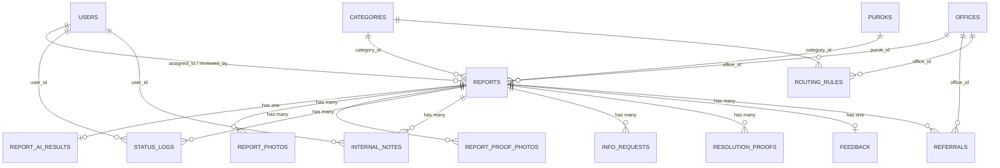

# Database Architecture & Entity Specifications

Complete relational schema specification for the SQLite (development) and MySQL (production target) databases of **Barangay-Reporting-System-1**.

> [!NOTE]
> Fields marked with **`(planned, Task N)`** represent target refactoring items defined in [**`docs/TASKS.md`**](file:///C:/githubFiles/Barangay-Reporting-System-1/docs/TASKS.md) that do not yet exist in the committed migrations. All other fields reflect the current active schema.

---

## 1. Relational Entity Overview



---

## 2. Table Specifications

### `users`
- `id` (bigint unsigned, PK)
- `name` (string)
- `email` (string, unique)
- `password` (string, hashed)
- `role` (enum: `admin`, `staff`, default: `staff`)
- `is_active` (boolean, default: true)
- `timestamps`

### `puroks`
- `id` (bigint unsigned, PK)
- `name` (string, unique)
- `timestamps`

### `categories`
- `id` (bigint unsigned, PK)
- `name` (string)
- `slug` (string, unique)
- `risk_weight` (integer, default: 1)
- `default_office_id` (foreignId `offices`, nullable)
- `sla_hours` (unsigned integer, nullable)
- `question_schema` (json, nullable) — Dynamic questions schema
- `is_active` (boolean, default: true)
- `timestamps`

### `offices`
- `id` (bigint unsigned, PK)
- `name` (string)
- `type` (enum: `internal`, `external`, default: `internal`)
- `description` (text, nullable)
- `contact` (string, nullable)
- `default_assignee_id` (foreignId `users`, nullable)
- `is_internal` (boolean, default: true)
- `is_active` (boolean, default: true)
- `timestamps`

### `routing_rules`
- `id` (bigint unsigned, PK)
- `category_id` (foreignId `categories`, cascade)
- `office_id` (foreignId `offices`, cascade)
- `within_authority` (boolean, default: true) — Controls Mode A vs. Mode B
- `jurisdiction_note` (text, nullable)
- `timestamps`

### `reports` (Primary Aggregate)
- `id` (bigint unsigned, PK)
- `tracking_code` (string, unique, indexed) — Format: `BRG-XXXXXX`
- `description` (text)
- `staff_description` (text, nullable) — Staff edited text
- `category_id` (foreignId `categories`, nullable)
- `resident_category_id` (foreignId `categories`, nullable) — Original snapshot
- `purok_id` (foreignId `puroks`, nullable)
- `resident_purok_id` (foreignId `puroks`, nullable) — Original snapshot
- `landmark` (string, nullable)
- `resident_landmark` (string, nullable) — Original snapshot
- `lat` (decimal 10,7, nullable)
- `lng` (decimal 10,7, nullable)
- `status` (string, indexed) — Canonical 12 statuses: `submitted`, `under_review`, `routed`, `in_progress`, `needs_info`, `awaiting_confirmation`, `resolved`, `reopened`, `emergency_flagged`, `referred`, `merged`, `no_action`.
- `no_action_reason` (string, indexed, nullable) — Reason code for `no_action` (`not_barangay_matter`, `emergency_redirected`, `cannot_resolve`, `invalid_report`, `resident_unreachable`).
- `urgency` (enum: `Low`, `Medium`, `High`, `Critical`, nullable)
- `priority_score` (integer, default: 0, indexed)
- `summary` (text, nullable)
- `is_emergency` (boolean, default: false, indexed)
- `people_at_risk` (boolean, default: false) — Safety danger checkbox
- `is_ongoing` (boolean, default: false)
- `is_recurring` (boolean, default: false)
- `answers` (json, nullable) — Resident responses to category questions
- `photo_path` (string, nullable) — Primary initial photo
- `photo_mismatch` (boolean, default: false)
- `reporter_name` (string, nullable) — Staff-only (PII)
- `reporter_contact` (string, nullable) — Staff-only (PII)
- `reporter_email` (string, nullable) — Staff-only (PII)
- `preferred_contact` (enum: `email`, `phone`, `none`, default: `none`)
- `is_anonymous` (boolean, default: false)
- `consent_at` (timestamp, nullable) — Mandatory privacy consent
- `office_id` (foreignId `offices`, nullable)
- `assigned_to` (foreignId `users`, nullable)
- `reviewed_by` (foreignId `users`, nullable)
- `reviewed_at` (timestamp, nullable)
- `due_at` (timestamp, nullable) — SLA deadline
- `escalated_at` (timestamp, nullable)
- `resolved_at` (timestamp, nullable)
- `resolution_confirmed_at` (timestamp, nullable)
- `reopened_count` (unsigned integer, default: 0)
- `merged_into_id` (foreignId `reports`, nullable)
- `ai_status` (enum: `pending`, `done`, `failed`, default: `pending`)
- `timestamps`

### `report_ai_results`
- `id` (bigint unsigned, PK)
- `report_id` (foreignId `reports`, cascade, unique)
- `suggested_category` (string, nullable)
- `suggested_urgency` (string, nullable)
- `summary` (text, nullable)
- `photo_description` (text, nullable)
- `photo_mismatch` (boolean, default: false)
- `emergency_flag` (boolean, default: false)
- `key_facts` (json, nullable)
- `confidence` (float, nullable)
- `raw_response` (json, nullable)
- `model` (string, nullable)
- `error` (text, nullable)
- `timestamps`

### `status_logs`
- `id` (bigint unsigned, PK)
- `report_id` (foreignId `reports`, cascade)
- `user_id` (foreignId `users`, nullable) — Null for resident/system actions
- `office_id` (foreignId `offices`, nullable)
- `from_status` (string, nullable)
- `to_status` (string)
- `no_action_reason` (string, nullable) — Reason code recorded on transition to `no_action`
- `note` (text, nullable)
- `visible_to_resident` (boolean, default: true)
- `created_at` (timestamp)

### `report_proof_photos`
- `id` (bigint unsigned, PK)
- `report_id` (foreignId `reports`, cascade)
- `photo_path` (string)
- `original_name` (string, nullable)
- `file_size_bytes` (bigint unsigned, nullable)
- `mime_type` (string, nullable)
- `timestamps`

### `referrals`
- `id` (bigint unsigned, PK)
- `report_id` (foreignId `reports`, cascade)
- `office_id` (foreignId `offices`, cascade)
- `referral_number` (string, unique, indexed) — Format: `REF-YYYY-NNNN`
- `referral_text` (text, nullable) — Drafted letter text
- `status` (enum: `prepared`, `sent`, `acknowledged`, `action_taken`, `closed`)
- `outcome` (enum: `resolved`, `declined`, `no_response`, nullable)
- `prepared_by` (foreignId `users`, nullable)
- `follow_up_owner_id` (foreignId `users`, nullable)
- `sent_at` (timestamp, nullable)
- `follow_up_at` (timestamp, nullable) — Default `sent_at + 7 days`
- `timestamps`

### `info_requests`
- `id` (bigint unsigned, PK)
- `report_id` (foreignId `reports`, cascade)
- `requested_by` (foreignId `users`)
- `question` (text)
- `response` (text, nullable)
- `responded_at` (timestamp, nullable)
- `timestamps`

### `resolution_proofs`
- `id` (bigint unsigned, PK)
- `report_id` (foreignId `reports`, cascade)
- `user_id` (foreignId `users`)
- `note` (text, nullable)
- `timestamps`

### `feedback`
- `id` (bigint unsigned, PK)
- `report_id` (foreignId `reports`, cascade, unique)
- `rating` (tinyint unsigned) — 1 to 5 stars
- `comment` (text, nullable)
- `timestamps`

### `duplicate_suggestions`
- `id` (bigint unsigned, PK)
- `report_id` (foreignId `reports`, cascade)
- `candidate_id` (foreignId `reports`, cascade)
- `score` (float)
- `decision` (enum: `pending`, `merged`, `rejected`, default: `pending`)
- `decided_by` (foreignId `users`, nullable)
- `timestamps`

### `emergency_contacts`
- `id` (bigint unsigned, PK)
- `name` (string)
- `number` (string)
- `type` (string)
- `is_active` (boolean, default: true)
- `sort_order` (integer, default: 0)
- `timestamps`

### `sensitive_places`
- `id` (bigint unsigned, PK)
- `name` (string)
- `type` (string)
- `lat` (decimal 10,7)
- `lng` (decimal 10,7)
- `timestamps`

### `internal_notes`
- `id` (bigint unsigned, PK)
- `report_id` (foreignId `reports`, cascade)
- `user_id` (foreignId `users`, cascade)
- `body` (text)
- `timestamps`

### `audit_logs`
- `id` (bigint unsigned, PK)
- `user_id` (foreignId `users`, nullable)
- `action` (string)
- `model` (string)
- `model_id` (unsigned bigint)
- `old_values` (json, nullable)
- `new_values` (json, nullable)
- `created_at` (timestamp)

---

## 3. JSON Field Schemas

### `categories.question_schema`
```json
[
  {
    "key": "water_depth",
    "label": "Estimated water depth",
    "type": "select",
    "options": ["Ankle-deep", "Knee-deep", "Waist-deep", "Submerged"],
    "required": true
  }
]
```

### `reports.answers`
```json
{
  "water_depth": "Knee-deep"
}
```

### `report_ai_results.key_facts`
```json
[
  "Blocked concrete culvert along main road",
  "Dirty stagnant runoff overflowing onto sidewalk"
]
```
