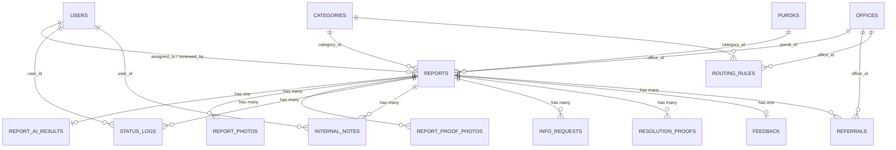

# Database Architecture & Entity Specifications

Complete relational schema specification for the SQLite (development) and MySQL (production target) databases of **Barangay-Reporting-System-1**.

> [!NOTE]
> Fields marked with **`(planned, Task N)`** represent target refactoring items defined in [**`docs/TASKS.md`**](file:///C:/githubFiles/Barangay-Reporting-System-1/docs/TASKS.md) that do not yet exist in the committed migrations. All other fields reflect the current active schema.

---

## 1. Relational Entity Overview



---

## 2. Table Specifications

### `users`
- `id` (bigint unsigned, PK)
- `name` (string)
- `email` (string, unique)
- `password` (string, hashed)
- `role` (string(20): `admin`, `staff`, `agency`; default: `staff`) — coarse access tier ONLY. `personnel` is NOT a role.
- `office_id` (foreignId `offices`, nullable) — required for `agency` users (points to an external office with `is_external = true`); null for `admin` and `staff`.
- `is_active` (boolean, default: true)
- `must_change_password` (boolean, default: false)
- `last_login_at` (timestamp, nullable)
- `email_verified_at` (timestamp, nullable) — required for active agency portal access.
- `timestamps`

> **Note on Position and Access Control**:
> - `Position` is **never** stored directly on `users` as `position_id` to prevent dual-source-of-truth drift. Instead, `User::position()` is a `hasOneThrough(Position::class, Personnel::class, 'user_id', 'id', 'id', 'position_id')` relationship through the assignable `personnel` record.
> - Barangay positions (e.g. `punong_barangay`, `barangay_secretary`, `lupon_member`, `barangay_tanod`, `kagawad_peace_order`) do not dictate permissions on their own. Permissions derive strictly from `role` (where `admin` has all permissions) plus permission presets (`staff_full`, `case_encoder`, `case_reviewer`, `reports_analyst`) or explicit user permissions.
> - Agency users do not have a position or permission preset; their access is scoped strictly to external referrals assigned to their `office_id`.

### `puroks`
- `id` (bigint unsigned, PK)
- `name` (string, unique)
- `timestamps`

### `categories`
- `id` (bigint unsigned, PK)
- `name` (string)
- `slug` (string, unique)
- `risk_weight` (integer, default: 1)
- `default_office_id` (foreignId `offices`, nullable)
- `sla_hours` (unsigned integer, nullable)
- `question_schema` (json, nullable) — Dynamic questions schema
- `is_active` (boolean, default: true)
- `timestamps`

### `offices`
- `id` (bigint unsigned, PK)
- `name` (string)
- `type` (enum: `internal`, `external`, default: `internal`)
- `description` (text, nullable)
- `contact` (string, nullable)
- `default_assignee_id` (foreignId `users`, nullable)
- `is_internal` (boolean, default: true)
- `is_active` (boolean, default: true)
- `timestamps`

### `routing_rules`
- `id` (bigint unsigned, PK)
- `category_id` (foreignId `categories`, cascade)
- `office_id` (foreignId `offices`, cascade)
- `within_authority` (boolean, default: true) — Controls Mode A vs. Mode B
- `jurisdiction_note` (text, nullable)
- `timestamps`

### `reports` (Primary Aggregate)
- `id` (bigint unsigned, PK)
- `tracking_code` (string, unique, indexed) — Format: `BRG-XXXXXX`
- `description` (text)
- `staff_description` (text, nullable) — Staff edited text
- `category_id` (foreignId `categories`, nullable)
- `resident_category_id` (foreignId `categories`, nullable) — Original snapshot
- `purok_id` (foreignId `puroks`, nullable)
- `resident_purok_id` (foreignId `puroks`, nullable) — Original snapshot
- `landmark` (string, nullable)
- `resident_landmark` (string, nullable) — Original snapshot
- `lat` (decimal 10,7, nullable)
- `lng` (decimal 10,7, nullable)
- `status` (string, indexed) — Canonical 12 statuses: `submitted`, `under_review`, `routed`, `in_progress`, `needs_info`, `awaiting_confirmation`, `resolved`, `reopened`, `emergency_flagged`, `referred`, `merged`, `no_action`.
- `no_action_reason` (string, indexed, nullable) — Reason code for `no_action` (`not_barangay_matter`, `emergency_redirected`, `cannot_resolve`, `invalid_report`, `resident_unreachable`).
- `urgency` (enum: `Low`, `Medium`, `High`, `Critical`, nullable)
- `priority_score` (integer, default: 0, indexed)
- `summary` (text, nullable)
- `is_emergency` (boolean, default: false, indexed)
- `people_at_risk` (boolean, default: false) — Safety danger checkbox
- `is_ongoing` (boolean, default: false)
- `is_recurring` (boolean, default: false)
- `answers` (json, nullable) — Resident responses to category questions
- `photo_path` (string, nullable) — Primary initial photo
- `photo_mismatch` (boolean, default: false)
- `reporter_name` (string, nullable) — Staff-only (PII)
- `reporter_contact` (string, nullable) — Staff-only (PII)
- `reporter_email` (string, nullable) — Staff-only (PII)
- `preferred_contact` (enum: `email`, `phone`, `none`, default: `none`)
- `is_anonymous` (boolean, default: false)
- `consent_at` (timestamp, nullable) — Mandatory privacy consent
- `consent_recorded_by` (foreignId `users`, nullable) — Staff officer certifying verbal consent on phone hotline intake
- `office_id` (foreignId `offices`, nullable)
- `assigned_to` (foreignId `users`, nullable)
- `reviewed_by` (foreignId `users`, nullable)
- `reviewed_at` (timestamp, nullable)
- `due_at` (timestamp, nullable) — SLA deadline
- `escalated_at` (timestamp, nullable)
- `resolved_at` (timestamp, nullable)
- `resolution_confirmed_at` (timestamp, nullable)
- `reopened_count` (unsigned integer, default: 0)
- `merged_into_id` (foreignId `reports`, nullable)
- `ai_status` (enum: `pending`, `done`, `failed`, default: `pending`)
- `timestamps`

### `report_ai_results`
- `id` (bigint unsigned, PK)
- `report_id` (foreignId `reports`, cascade, unique)
- `suggested_category` (string, nullable)
- `suggested_urgency` (string, nullable)
- `summary` (text, nullable)
- `photo_description` (text, nullable)
- `photo_mismatch` (boolean, default: false)
- `emergency_flag` (boolean, default: false)
- `key_facts` (json, nullable)
- `confidence` (float, nullable)
- `raw_response` (json, nullable)
- `model` (string, nullable)
- `error` (text, nullable)
- `timestamps`

### `status_logs`
- `id` (bigint unsigned, PK)
- `report_id` (foreignId `reports`, cascade)
- `user_id` (foreignId `users`, nullable) — Null for resident/system actions
- `office_id` (foreignId `offices`, nullable)
- `from_status` (string, nullable)
- `to_status` (string)
- `no_action_reason` (string, nullable) — Reason code recorded on transition to `no_action`
- `note` (text, nullable)
- `visible_to_resident` (boolean, default: true)
- `created_at` (timestamp)

### `report_proof_photos`
- `id` (bigint unsigned, PK)
- `report_id` (foreignId `reports`, cascade)
- `photo_path` (string)
- `original_name` (string, nullable)
- `file_size_bytes` (bigint unsigned, nullable)
- `mime_type` (string, nullable)
- `timestamps`

### `referrals`
- `id` (bigint unsigned, PK)
- `report_id` (foreignId `reports`, cascade)
- `office_id` (foreignId `offices`, cascade)
- `referral_number` (string, unique, indexed) — Format: `REF-YYYY-NNNN`
- `referral_text` (text, nullable) — Drafted letter text
- `status` (enum: `prepared`, `sent`, `acknowledged`, `action_taken`, `closed`)
- `outcome` (enum: `resolved`, `declined`, `no_response`, nullable)
- `prepared_by` (foreignId `users`, nullable)
- `follow_up_owner_id` (foreignId `users`, nullable)
- `sent_at` (timestamp, nullable)
- `follow_up_at` (timestamp, nullable) — Default `sent_at + referral.follow_up_days` (3 days, Secretary Q12; was 7)
- `timestamps`

### `info_requests`
- `id` (bigint unsigned, PK)
- `report_id` (foreignId `reports`, cascade)
- `requested_by` (foreignId `users`)
- `question` (text)
- `response` (text, nullable)
- `responded_at` (timestamp, nullable)
- `timestamps`

### `resolution_proofs`
- `id` (bigint unsigned, PK)
- `report_id` (foreignId `reports`, cascade)
- `user_id` (foreignId `users`)
- `note` (text, nullable)
- `timestamps`

### `feedback`
- `id` (bigint unsigned, PK)
- `report_id` (foreignId `reports`, cascade, unique)
- `rating` (tinyint unsigned) — 1 to 5 stars
- `comment` (text, nullable)
- `timestamps`

### `duplicate_suggestions`
- `id` (bigint unsigned, PK)
- `report_id` (foreignId `reports`, cascade)
- `candidate_id` (foreignId `reports`, cascade)
- `score` (float)
- `decision` (enum: `pending`, `merged`, `rejected`, default: `pending`)
- `decided_by` (foreignId `users`, nullable)
- `timestamps`

### `emergency_contacts`
- `id` (bigint unsigned, PK)
- `name` (string)
- `number` (string)
- `type` (string)
- `is_active` (boolean, default: true)
- `sort_order` (integer, default: 0)
- `timestamps`

### `sensitive_places`
- `id` (bigint unsigned, PK)
- `name` (string)
- `type` (string)
- `lat` (decimal 10,7)
- `lng` (decimal 10,7)
- `timestamps`

### `internal_notes`
- `id` (bigint unsigned, PK)
- `report_id` (foreignId `reports`, cascade)
- `user_id` (foreignId `users`, cascade)
- `body` (text)
- `timestamps`

### `audit_logs`
- `id` (bigint unsigned, PK)
- `user_id` (foreignId `users`, nullable)
- `action` (string)
- `model` (string)
- `model_id` (unsigned bigint)
- `old_values` (json, nullable)
- `new_values` (json, nullable)
- `created_at` (timestamp)

---

## 3. Phase 0 Foundation Tables

### `fiscal_years`
- `id` (bigint unsigned, PK)
- `year` (integer, unique)
- `label` (string)
- `starts_on` (date)
- `ends_on` (date)
- `status` (enum: `active`, `inactive`, `closed`, `locked`, default: `inactive`)
- `is_locked` (boolean, default: false)
- `closed_at` (timestamp, nullable)
- `closed_by` (foreignId -> users, nullable)
- `close_note` (text, nullable)
- `timestamps`

### `number_sequences`
- `id` (bigint unsigned, PK)
- `fiscal_year_id` (foreignId -> fiscal_years, cascade)
- `type` (string, indexed) — e.g. `case`, `referral`, `summons`
- `last_number` (integer unsigned, default: 0)
- `timestamps`
- Unique: `['fiscal_year_id', 'type']`

### `positions`
- `id` (bigint unsigned, PK)
- `name` (string)
- `code` (string, unique) — e.g. `punong_barangay`, `barangay_secretary`
- `sort_order` (integer, default: 0)
- `is_signatory_default` (boolean, default: false)
- `is_confirmed` (boolean, default: false)
- `source_question` (string, nullable)
- `timestamps`

### `personnel`
- `id` (bigint unsigned, PK)
- `user_id` (foreignId -> users, nullable)
- `position_id` (foreignId -> positions)
- `full_name` (string)
- `contact_number` (string, nullable)
- `email` (string, nullable)
- `term_start` (date, nullable)
- `term_end` (date, nullable)
- `is_signatory` (boolean, default: false)
- `signature_path` (string, nullable)
- `is_active` (boolean, default: true)
- `notes` (text, nullable)
- `timestamps`

### `signatory_assignments`
- `id` (bigint unsigned, PK)
- `document_type` (string, indexed) — e.g. `summons`, `referral_letter`, `case_endorsement`, `settlement_agreement`
- `role_label` (string) — e.g. `Prepared by`, `Approved by`, `Presided by`
- `position_id` (foreignId -> positions)
- `sort_order` (integer, default: 0)
- `is_confirmed` (boolean, default: false)
- `source_question` (string, nullable)
- `timestamps`

### `permissions` & `permission_user`
- `permissions`:
  - `id` (bigint unsigned, PK)
  - `slug` (string, unique) — e.g. `cases.view`, `settings.manage`
  - `label` (string)
  - `group` (string)
  - `timestamps`
- `permission_user`:
  - `permission_id` (foreignId -> permissions, cascade)
  - `user_id` (foreignId -> users, cascade)
  - PK: `['permission_id', 'user_id']`

### `report_templates` & `generated_reports`
- `report_templates`:
  - `id` (bigint unsigned, PK)
  - `key` (string, unique)
  - `title` (string)
  - `description` (text, nullable)
  - `source` (string) — e.g. `cases`, `referrals`, `reports`
  - `columns` (json)
  - `filters` (json, nullable)
  - `orientation` (enum: `portrait`, `landscape`, default: `portrait`)
  - `signatory_document_type` (string, nullable)
  - `is_active` (boolean, default: true)
  - `is_confirmed` (boolean, default: false)
  - `timestamps`
- `generated_reports`:
  - `id` (bigint unsigned, PK)
  - `report_template_id` (foreignId -> report_templates, cascade)
  - `fiscal_year_id` (foreignId -> fiscal_years, cascade)
  - `title` (string)
  - `format` (enum: `pdf`, `xlsx`, `csv`)
  - `file_path` (string)
  - `parameters` (json, nullable)
  - `generated_by` (foreignId -> users)
  - `timestamps`

### `agency_registrations` & `agency_invitations`
- `agency_registrations`:
  - `id` (bigint unsigned, PK)
  - `user_id` (foreignId -> users, cascade)
  - `office_id` (foreignId -> offices, nullOnDelete, nullable)
  - `agency_name_claimed` (string)
  - `position_title` (string)
  - `contact_number` (string)
  - `id_document_path` (string)
  - `status` (enum: `pending`, `approved`, `rejected`, `suspended`, default: `pending`)
  - `is_office_admin` (boolean, default: false)
  - `reviewed_by` (foreignId -> users, nullable)
  - `reviewed_at` (timestamp, nullable)
  - `decision_note` (text, nullable)
  - `timestamps`
- `agency_invitations`:
  - `id` (bigint unsigned, PK)
  - `office_id` (foreignId -> offices, cascade)
  - `email` (string)
  - `token_hash` (string, unique)
  - `invited_by` (foreignId -> users)
  - `expires_at` (timestamp)
  - `accepted_at` (timestamp, nullable)
  - `timestamps`

### `case_types`
- `id` (bigint unsigned, PK)
- `name` (string)
- `slug` (string, unique)
- `description` (text, nullable)
- `sort_order` (integer, default: 0)
- `is_active` (boolean, default: true)
- `is_confirmed` (boolean, default: false)
- `source_question` (string, nullable)
- `timestamps`

### `parties`
- `id` (bigint unsigned, PK)
- `full_name` (string, indexed)
- `alias` (string, nullable)
- `birth_date` (date, nullable)
- `sex` (enum: `male`, `female`, `other`, nullable)
- `civil_status` (string, nullable)
- `occupation` (string, nullable)
- `contact_number` (string, nullable)
- `email` (string, nullable)
- `address_line` (string, nullable)
- `purok_id` (foreignId -> puroks, nullOnDelete, nullable)
- `home_barangay` (string, default: `Calarian`)
- `home_city` (string, default: `Zamboanga City`)
- `residency_status` (enum: `resident`, `non_resident`, `transient`, `unverified`, default: `unverified`)
- `residency_basis` (string, nullable)
- `residency_verified_by` (foreignId -> users, nullable)
- `residency_verified_at` (timestamp, nullable)
- `id_type` (string, nullable)
- `id_number` (string, nullable)
- `extra` (json, nullable)
- `timestamps`

### `cases` (`BarangayCase`)
- `id` (bigint unsigned, PK)
- `case_number` (string, unique) — e.g. `CASE-2026-00001`
- `fiscal_year_id` (foreignId -> fiscal_years)
- `case_type_id` (foreignId -> case_types)
- `source` (enum: `direct`, `report_escalation`, default: `direct`)
- `source_report_id` (foreignId -> reports, nullOnDelete, nullable)
- `title` (string)
- `narrative` (text)
- `filed_on` (date)
- `incident_date` (date, nullable)
- `incident_location` (string, nullable)
- `purok_id` (foreignId -> puroks, nullOnDelete, nullable)
- `status` (string, indexed, default: `filed`)
- `encoded_by` (foreignId -> users)
- `assigned_to` (foreignId -> users, nullOnDelete, nullable)
- `settled_on` (date, nullable)
- `settlement_terms` (text, nullable)
- `outcome_note` (text, nullable)
- `is_confidential` (boolean, default: false)
- `timestamps`

### `case_parties`
- `id` (bigint unsigned, PK)
- `case_id` (foreignId -> cases, cascade)
- `party_id` (foreignId -> parties, cascade)
- `role` (enum: `complainant`, `respondent`, `witness`, `representative`)
- `residency_at_filing` (string, default: `resident`)
- `representative_name` (string, nullable)
- `notes` (text, nullable)
- `timestamps`
- Unique: `['case_id', 'party_id', 'role']`

### `case_status_logs`
- `id` (bigint unsigned, PK)
- `case_id` (foreignId -> cases, cascade)
- `user_id` (foreignId -> users, nullOnDelete, nullable)
- `from_status` (string, nullable)
- `to_status` (string)
- `note` (text, nullable)
- `created_at` (timestamp)

### `case_notes`
- `id` (bigint unsigned, PK)
- `case_id` (foreignId -> cases, cascade)
- `user_id` (foreignId -> users, cascade)
- `type` (enum: `internal`, `investigation`, `hearing_summary`, default: `internal`)
- `body` (text)
- `timestamps`

### `case_field_configs`
- `id` (bigint unsigned, PK)
- `entity` (enum: `case`, `party`)
- `field_key` (string)
- `label` (string)
- `is_required` (boolean, default: false)
- `is_visible` (boolean, default: true)
- `applies_to` (string, default: `all`)
- `sort_order` (integer, default: 0)
- `is_confirmed` (boolean, default: false)
- `source_question` (string, nullable)
- `timestamps`
- Unique: `['entity', 'field_key']`

### `summons`
- `id` (bigint unsigned, PK)
- `case_id` (foreignId -> cases, cascade)
- `respondent_case_party_id` (foreignId -> case_parties, cascade)
- `sequence_no` (integer unsigned) — 1, 2, 3 ... (no limit; Revision 2)
- `summons_number` (string, unique)
- `issued_on` (date)
- `issued_by` (foreignId -> users)
- `hearing_at` (datetime)
- `venue` (string)
- `served_by_personnel_id` (foreignId -> personnel, nullable)
- `served_on` (date, nullable)
- `service_result` (enum: `pending`, `served_personal`, `served_substituted`, `refused`, `unserved`, default: `pending`) — **to be changed (Revision 2) to `pending`, `received`, `refused`, `not_found`, `other`** to match the secretary's wording (Q21)
- `attendance` (enum: `pending`, `appeared`, `failed_to_appear`, default: `pending`)
- `remarks` (text, nullable)
- `voided_at` (timestamp, nullable)
- `void_note` (text, nullable)
- `override_note` (text, nullable)
- `timestamps`

### `hearings`
- `id` (bigint unsigned, PK)
- `case_id` (foreignId -> cases, cascade)
- `summons_id` (foreignId -> summons, nullOnDelete, nullable)
- `scheduled_at` (datetime)
- `venue` (string)
- `presided_by_personnel_id` (foreignId -> personnel, nullable)
- `status` (enum: `scheduled`, `in_progress`, `concluded`, `rescheduled`, `cancelled`, default: `scheduled`)
- `outcome_note` (text, nullable)
- `timestamps`

### `escalation_destinations`
- `id` (bigint unsigned, PK)
- `name` (string)
- `description` (text, nullable)
- `contact_person` (string, nullable)
- `contact_email` (string, nullable)
- `contact_phone` (string, nullable)
- `address` (text, nullable)
- `sort_order` (integer, default: 0)
- `is_active` (boolean, default: true)
- `is_confirmed` (boolean, default: false)
- `source_question` (string, nullable)
- `timestamps`

### `case_escalations`
- `id` (bigint unsigned, PK)
- `case_id` (foreignId -> cases, cascade)
- `escalation_destination_id` (foreignId -> escalation_destinations)
- `escalated_by` (foreignId -> users)
- `decided_by_personnel_id` (foreignId -> personnel, nullable)
- `reason` (text)
- `override_note` (text, nullable)
- `summons_count_at_time` (integer unsigned, default: 0)
- `referral_id` (foreignId -> referrals, nullOnDelete, nullable)
- `escalated_at` (timestamp)
- `timestamps`

### Fiscal Year Binding on Reports & Referrals
- `reports.fiscal_year_id` (foreignId -> fiscal_years, nullable)
- `referrals.fiscal_year_id` (foreignId -> fiscal_years, nullable)

### Placeholder Configuration Pattern
All baseline configurable records (`settings`, `positions`, `signatory_assignments`, `case_types`, `case_field_configs`, `escalation_destinations`, `report_templates`) include:
- `is_confirmed` (boolean, default: false)
- `source_question` (string, nullable)
This enables the 5-step interactive setup wizard (`/setup`) to audit, highlight, and confirm municipality-specific configurations.

---

## 4. JSON Field Schemas

### `categories.question_schema`
```json
[
  {
    "key": "water_depth",
    "label": "Estimated water depth",
    "type": "select",
    "options": ["Ankle-deep", "Knee-deep", "Waist-deep", "Submerged"],
    "required": true
  }
]
```

### `reports.answers`
```json
{
  "water_depth": "Knee-deep"
}
```

### `report_ai_results.key_facts`
```json
[
  "Blocked concrete culvert along main road",
  "Dirty stagnant runoff overflowing onto sidewalk"
]
```

---

## 5. Planned Schema Changes (Revision 2, not yet migrated)

Applied by the lead as migrations `2026_11_23_0002NN_` before workstreams branch (`docs/TASKS.md` / `docs/DECISIONS.md`), and by WS6 later.

| Table | Planned Column / Schema Change | Target Type & Rules | Task Alignment |
| :--- | :--- | :--- | :--- |
| `summons` | `service_result` | `string(20)` (`pending`, `received`, `refused`, `not_found`, `other`) | (planned, Task 7) |
| `cases` | `record_type` | `string(20) default 'complaint'` (`blotter`, `complaint`) | (planned, Task 7) |
| `cases` | `complaint_started_on` | `date, nullable` (start date for mediation clock) | (planned, Task 7) |
| `cases` | `endorsed_to_pangkat_on` | `date, nullable` (start date for conciliation clock) | (planned, Task 7) |
| `cases` | `conciliation_extension_days` | `unsigned tinyint, default 0` (max 15) | (planned, Task 7) |
| `cases` | `pangkat_chairman_personnel_id` | `foreignId personnel, nullable` | (planned, Task 7) |
| `cases` | `settlement_amount` | `decimal(12,2), nullable` | (planned, Task 7) |
| `case_types` | `is_confidential_default` | `boolean, default false` (pre-ticks for BCPC/VAWC) | (planned, Task 7) |
| `case_types` | `uses_kp_timeline` | `boolean, default true` (false for non-KP types) | (planned, Task 7) |
| `case_escalations` | `requested_by_case_party_id` | `foreignId case_parties, nullable` | (planned, Task 7) |
| `case_escalations` | `requested_on` | `date, nullable` | (planned, Task 7) |
| `case_escalations` | `cfa_number` | `string(60), nullable` | (planned, Task 7) |
| `case_escalations` | `signed_by_personnel_id` | `foreignId personnel, nullable` (Pangkat Chairman) | (planned, Task 7) |
| `escalation_destinations` | `office_id` | `foreignId offices, nullable` | (planned, Task 7) |
| `referral_attachments` (new) | `id, referral_id fk cascade, label, path, uploaded_by fk, timestamps` | Table on private disk | (planned, Task 7) |
| `cases` | `import_batch_id` | `foreignId import_batches, nullable` | (planned, WS6) |
| `import_batches` (new) | `id, user_id, filename, status, mapping json, stats json, timestamps` | Table for legacy import | (planned, WS6) |
| `import_rows` (new) | `id, batch_id, row_number, raw json, mapped json, status, errors json, case_id, timestamps` | Table for row-level import | (planned, WS6) |

Party `age` and `reason_in_barangay` are stored in existing `parties.extra` JSON (no migration required).

---

## 6. Voice Prototype Schema (WS7)

Schema changes for the voice reporting prototype (record and transcribe). Implemented in migration `2026_12_01_700001_create_report_audios_and_add_source_to_reports.php`.

### `report_audios` (New Table)
Stores voice recording files, technical audio metadata, transcription state, and staff verification tracking:

| Column | Type | Attributes / Rules | Purpose |
| :--- | :--- | :--- | :--- |
| `id` | `bigint unsigned` | PK, auto-increment | Primary key. |
| `report_id` | `bigint unsigned` | FK -> `reports.id`, nullable, on delete cascade | Associated report (null while resident is drafting). |
| `token` | `uuid` | Unique, indexed | Cryptographically random UUID token for streaming URL and unattached matching. |
| `origin` | `string(20)` | `resident` or `staff` | Intake channel origin. |
| `disk_path` | `string` | Stored on `private` disk | Path in `storage/app/private/audio/`. |
| `mime` | `string(100)` | e.g. `audio/webm`, `audio/mp4`, `audio/ogg` | Audio container format. |
| `size_bytes` | `unsigned int` | Max limit enforced | Audio file size in bytes. |
| `duration_seconds` | `unsigned smallint` | Max `voice.max_seconds` (default 60) | Recording duration in seconds. |
| `transcript` | `text`, nullable | Machine text, immutable | Verbatim machine transcript text from Gemini; never overwritten. |
| `unverified_draft` | `boolean`, default `false` | Flag | True if transcript is unverified and cannot be used as primary report description. |
| `transcript_language` | `string(20)`, nullable | e.g. `en`, `fil`, `ceb`, `cbk` | Language detected by transcription model. |
| `transcript_status` | `string(30)` | `pending`, `done`, `needs_verification`, `failed`, `mock` | Current transcription pipeline state. |
| `extracted_data` | `json`, nullable | Non-contact extraction | Persists non-contact candidate fields (`description`, `category`, `purok`, `landmark`, `emergency`) for unattached audio. |
| `ai_description` | `text`, nullable | Original AI description | Stores verbatim AI problem statement to compute "Edited by resident" marker. |
| `provenance` | `json`, nullable | Audit mapping | Stores submit-time tracking JSON: `{field_name: {filled: bool, edited: bool}}`. Never stores contact values. |
| `error` | `text`, nullable | Nullable | Error or timeout message if status is `failed`. |
| `transcribed_at` | `timestamp`, nullable | Nullable | Timestamp when AI transcription completed. |
| `verified_by` | `bigint unsigned`, nullable | FK -> `users.id`, nullable | Staff user who verified the uncertain audio. |
| `verified_at` | `timestamp`, nullable | Nullable | Timestamp when staff verified the audio. |
| `uploaded_by` | `bigint unsigned`, nullable | FK -> `users.id`, nullable | Staff user if logged via phone form; null for residents. |
| `expires_at` | `timestamp`, nullable | Indexed | Retention expiry timestamp based on `voice.audio_retention_days` or 24h for unattached. |
| `timestamps` | `timestamp` | `created_at`, `updated_at` | Standard Eloquent timestamps. |

### `reports.source` and `reports.consent_recorded_by` (Column Additions)
- Added to `reports` table:
  - Column: `source`
  - Type: `string(20)`, default `'web'`
  - Allowed values: `'web'` (resident typed web submission), `'voice'` (resident voice recording), `'phone_log'` (staff hotline phone intake).
  - Column: `consent_recorded_by` (migration `2026_12_02_800001_add_consent_recorded_by_to_reports_table.php`)
  - Type: `foreignId('users')`, nullable, on delete null
  - Purpose: Tracks the authorized staff user ID who certified caller verbal consent during hotline phone intake.

### Voice Settings Keys (`settings` table placeholders)
- `voice.enabled` (boolean, default `true`): Master switch for voice intake endpoints.
- `voice.max_seconds` (integer, default `120`): Max duration in seconds.
- `voice.audio_retention_days` (integer, default `90`): Retention period in days (counted from report closure for attached audio; 24h for unattached audio).
- `voice.demo_sample_enabled` (boolean, default `false`): UI button for demo sample audio.
- `voice.extract_contact_from_audio` (boolean, default `true`): Staff channel setting to extract spoken caller contact.
- `voice.resident_extract_contact` (boolean, default `false`): Resident channel setting to extract caller contact (default false).
- `voice.resident_recording_enabled` (boolean, default `true`): Toggles recorder on resident report form.
- `voice.daily_analyze_limit` (integer, default `100`): Max AI voice analyses per day before fallback to manual entry.
