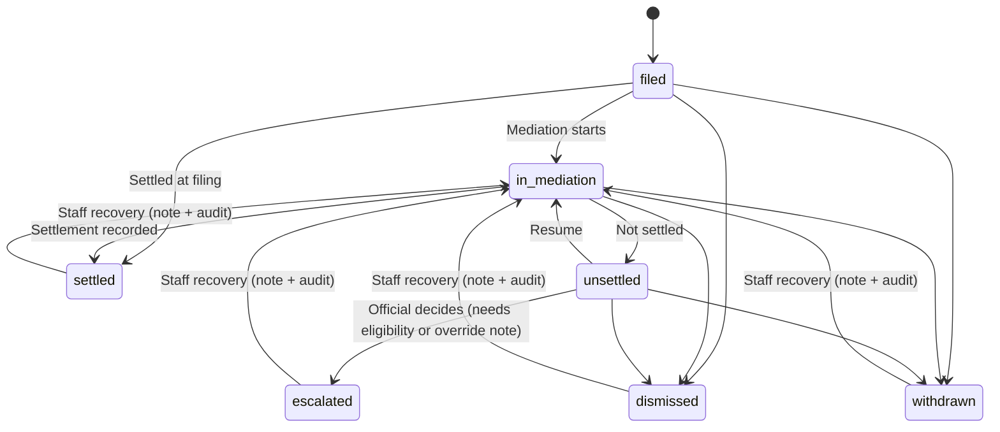

# SPEC ADDENDUM

Fills the gaps in `PHASE0_FOUNDATION_TASK.md` and `TEAM_WORKSTREAMS.md`. **Where this file conflicts with those two, this file wins.** The lead copies it to `docs/SPEC_ADDENDUM.md`.

Contents: 1 Ownership fixes and Phase 0 additions, 2 Permission map, 3 Case lifecycle diagram, 4 Report definitions, 5 Draft texts, 6 Validation rules, 7 Confidential cases, 8 UI states and colours, 9 Email and file storage, 10 Extra features (items previously missing), 11 Consolidated checklist for Phase 0.

---

## 1. Ownership fixes and Phase 0 additions

### 1.1 Fixes to overlaps
| Issue | Decision |
| :--- | :--- |
| WS1 and WS5 both edited `Admin\ReferralController` | **WS5 owns `Admin\ReferralController` entirely**, including the fiscal-year filter on `index`. WS1 does not touch it |
| Report intake stamping was unowned | **Phase 0** stamps `fiscal_year_id` in `ReportController@store` (one line, via `FiscalYearService::forNewRecord()`) and in `ReferralService`. No workstream edits intake |
| WS1 existing-file edits | WS1 may edit only `Admin\ReportController@index`, `@exportCsv` and `Admin\DashboardController@index` (year filter, plus the case KPI cards in section 10.4) |

### 1.2 Schema changes to add to Phase 0 Step 2
| Change | Detail |
| :--- | :--- |
| `cases.is_confidential` | **Default `false`** (replaces the earlier default `true`). See section 7 |
| `agency_registrations.is_office_admin` | `bool default false` |
| New table `agency_invitations` | `office_id fk offices`, `email str`, `token_hash str unique`, `invited_by fk users`, `expires_at dt`, `accepted_at dt ?`, timestamps |

WS3 adds its own migration later (range `2026_12_01_30NNNN_`) for `parties.merged_into_id fk parties ?` and `parties.merged_at dt ?` (section 10.6).

### 1.3 Permissions to add to Phase 0 Step 9
Add `cases.view_confidential` and `backups.manage` to the seeded permission list. `case_encoder` and `staff_full` presets do **not** include them. Admin has everything by definition.

### 1.4 Service stubs to add to Phase 0 Step 4
| Stub | Signature | Owner |
| :--- | :--- | :--- |
| `OverdueService` | `forCase(BarangayCase $case): array` returning `['is_overdue' => bool, 'days_overdue' => int, 'deadline_on' => ?string, 'rule' => ?string]`. Stub returns not overdue | WS4 |
| `GlobalSearchService` | `search(string $q, User $by): array` returning groups `['reports' => [], 'referrals' => [], 'cases' => [], 'parties' => [], 'personnel' => []]`. Stub returns empty groups | WS1 |
| `ReferralService` | `dueForFollowUp(): Collection` (referrals with `follow_up_at <= today` and status not `closed`). Stub returns an empty collection | WS5 |

### 1.5 Routes to add to Phase 0 Step 6 (stubs)
| Route name | URL | File | Owner | Permission |
| :--- | :--- | :--- | :--- | :--- |
| `admin.search` | GET `/admin/search` | `settings.php` | WS1 | `auth`, `role:staff`, `throttle:30,1` |
| `admin.backups.index` | GET `/admin/settings/backups` | `settings.php` | WS1 | `backups.manage` |
| `admin.backups.run` | POST `/admin/settings/backups/run` | `settings.php` | WS1 | `backups.manage` |
| `admin.backups.download` | GET `/admin/settings/backups/{file}` | `settings.php` | WS1 | `backups.manage` |
| `admin.secretary` | GET `/admin/secretary` | `case_actions.php` | WS4 | `cases.view` |
| `admin.parties.merge.create` / `.store` | GET/POST `/admin/parties/{party}/merge` | `cases.php` | WS3 | `cases.edit` |
| `agency.team.index` | GET `/agency/team` | `agency.php` | WS5 | agency office admin |
| `agency.team.invite` / `.revoke` / `.deactivate` | POST under `/agency/team` | `agency.php` | WS5 | agency office admin |
| `agency.invite.show` / `.accept` | GET/POST `/agency/invite/{token}` | `agency.php` | WS5 | public, `throttle:5,1` |
| `verification.notice` / `.verify` / `.send` | Laravel defaults | `agency.php` | WS5 | `auth` |

Add nav entries: "Secretary dashboard" (under Dashboard, `cases.view`), "Backups" (under Settings, `backups.manage`), "Team" (agency layout, office admin only). Add `<x-ui.global-search>` to the admin header (a text box that submits to `admin.search`).

### 1.6 Phase 0 Step 5 addition
`User` implements `MustVerifyEmail`. Staff and admin accounts created by an administrator get `email_verified_at = now()`. Only agency users need verification; `agency.active` checks it.

---

## 2. Permission map (replaces every `role:admin` in the route table)

Rule: every non-public admin route uses `auth` + `role:staff` (this admits staff and admin) **plus** the permission below. Admins pass every permission through `Gate::before`. Existing legacy routes (`admin.php`, `staff.php`, `engine.php`) are unchanged.

| Routes | Permission |
| :--- | :--- |
| `admin.settings.general.*`, `admin.numbering.*`, `admin.pending.*` | `settings.manage` |
| `admin.fiscal-years.*` | `fiscal_year.manage` |
| `admin.templates.*` | `templates.manage` |
| `admin.case-types.*`, `admin.case-fields.*`, `admin.escalation-destinations.*` | `settings.manage` |
| `admin.backups.*` | `backups.manage` |
| `year.switch`, `account.password.*`, `admin.search` | any authenticated user |
| `admin.personnel.*`, `admin.positions.*`, `admin.signatories.*` | `personnel.manage` |
| `admin.users.*` | `users.manage` |
| `admin.reports-center.index/show/history` | `reports_center.view` |
| `admin.reports-center.export` | `reports_center.export` |
| `admin.cases.index/show`, `admin.parties.index/show/search` | `cases.view` (and section 7 for confidential cases) |
| `admin.cases.create/store`, `admin.reports.convert-to-case` | `cases.create` |
| `admin.cases.edit/update/status/assign/notes.store`, `admin.parties.edit/update`, `admin.parties.merge.*` | `cases.edit` |
| `admin.cases.summons.*`, `admin.cases.hearings.*`, `admin.hearings.index` | `cases.summons` |
| `admin.cases.settlement.store` | `cases.edit` |
| `admin.cases.escalations.*` | `cases.escalate` |
| `admin.secretary` | `cases.view` |
| `admin.agencies.*` | `agencies.manage` |
| `admin.referrals.send`, `admin.referrals.messages.store` | `referrals.manage` |
| `agency.referrals.*`, `agency.team.*` | `role:agency` + `agency.active` (team actions also need office admin) |
| Existing dashboard and audit log | `role:admin` unchanged (permissions `dashboard.view` and `audit.view` are defined for later) |

---

## 3. Case lifecycle diagram (DRAFT, pending barangay confirmation)

Goes into `WORKFLOW.md` as "Case Lifecycle". The transition table is in `PHASE0_FOUNDATION_TASK.md` section 9.



Rule reminders: the system **flags** eligibility (non-voided summons count reaches `cases.summons_limit`), it never changes status by itself. Every transition needs a note and writes `case_status_logs` and an audit entry.

---

## 4. Report definitions (Reports Center, WS2)

### 4.1 JSON shape
`report_templates.columns`:
```json
[{"key": "case_number", "label": "Case No.", "type": "string", "align": "left"}]
```
Allowed `type`: `string`, `int`, `date`, `datetime`, `badge`, `percent`. Allowed `align`: `left`, `center`, `right`.

`report_templates.filters`:
```json
[
  {"key": "fiscal_year_id", "type": "fiscal_year", "default": "viewing"},
  {"key": "date_from", "type": "date"},
  {"key": "date_to", "type": "date"},
  {"key": "purok_id", "type": "select", "source": "puroks"},
  {"key": "status", "type": "multiselect", "source": "case_statuses"}
]
```
Allowed `type`: `fiscal_year`, `date`, `select`, `multiselect`. Allowed `source`: `puroks`, `categories`, `case_types`, `case_statuses`, `report_statuses`, `referral_statuses`, `offices`, `positions`.

### 4.2 The seven reports
| Key | Source | Filters | Columns / layout | Grouping and totals | Signatory type |
| :--- | :--- | :--- | :--- | :--- | :--- |
| `problem_reports_summary` | reports | fiscal year, date range, purok, category, status | Category, Purok, Status, Count, Avg days to resolve | Totals per category and per status; grand total | `monthly_report` |
| `referral_register` | referrals | fiscal year, date range, office, status | Referral No., Date prepared, Date sent, Office, Category, Status, Outcome, Follow-up date | Count per office and per status | `monthly_report` |
| `case_summary` | cases | fiscal year, date range, case type, status, purok | Case No., Filed on, Case type, Complainant residency, Respondent residency, Status, Summons count, Outcome | Count by case type and by status; resident vs non-resident party counts; settlement rate | `monthly_report` |
| `summons_log` | summons | fiscal year, date range, case type, service result | Summons No., Case No., Respondent (name), Issued on, Hearing date, Service result, Attendance, Voided | Count per service result; count per case | `summons` |
| `kp_accomplishment` (**draft layout**) | cases | fiscal year, month | Case type, Cases filed, Settled, Unsettled, Escalated, Dismissed, Withdrawn, Pending | One row per case type; totals row | `monthly_report` |
| `personnel_list` | personnel | position, status | Name, Position, Term start, Term end, Signatory, Status | Count per position | `annual_report` |
| `year_over_year` | reports, referrals, cases | two or more fiscal years | Metric, FY A, FY B, Change, Change % | Metrics: reports filed, reports resolved, referrals sent, cases filed, cases settled | `annual_report` |

Case reports with row-level data list only the cases the requesting user may see (section 7). Aggregate counts include every case.

---

## 5. Draft texts

Every text here is a **DRAFT** shown with the draft watermark or "pending confirmation" badge until the barangay supplies its own wording. Variables in braces are replaced at render time.

### 5.1 Privacy notice (`privacy.notice_text`)
> **Data Privacy Notice (draft)**
> {barangay.name} collects personal information in this system to receive, process, and keep records of complaints and community concerns, as allowed by the Data Privacy Act of 2012 (Republic Act No. 10173).
> **What we record:** names, contact details, address, and details of the complaint, for complainants, respondents, and witnesses.
> **Who can see it:** only authorized barangay personnel who need it to handle the matter. We do not sell or publish this information.
> **How long we keep it:** to be confirmed by the barangay.
> **Your rights:** you may ask to see or correct your information, or ask how it is handled, by contacting the Barangay Secretary at {barangay.contact_number}.
> By continuing, you confirm that you have read this notice.

### 5.2 Response templates (seed rows)
| Title | Kind | Body |
| :--- | :--- | :--- |
| Report received | `public_note` | Your report {tracking_code} has been received and is being reviewed by barangay staff. You can follow its progress on the tracking page. |
| Assigned to an office | `public_note` | Your report {tracking_code} has been assigned to {office}. Updates will appear on the tracking page. |
| Need more details | `info_request` | We need a little more information to act on report {tracking_code}. Please describe the exact location or a nearby landmark, and when the problem started. |
| Referred to another office | `public_note` | Report {tracking_code} is outside the barangay's authority. We have sent it to {office}. Their reference is shown on this page. |
| No further action | `public_note` | After review, the barangay cannot act further on report {tracking_code}. The reason is shown on this page. |
| Hearing reminder | `case_notice` | This is a reminder that a hearing for case {case_number} is scheduled on {date} at {time}, {venue}. |

Allowed variables: `{tracking_code}`, `{office}`, `{date}`, `{time}`, `{venue}`, `{case_number}`, `{barangay.name}`.

### 5.3 Emails
All emails go through `NotificationService` (delivery logged in `notification_logs`). They contain **no** reporter or party personal data, no case narrative, and no photos. Footer on every email: "This is an automated message from {barangay.name}. Please do not reply."

| # | Trigger | To | Subject | Body (draft) |
| :--- | :--- | :--- | :--- | :--- |
| 1 | Agency registers | Applicant | Verify your email | Please confirm your email to continue your registration. {verification_link} |
| 2 | Registration submitted | Applicant | We received your request | An administrator will review your request. You will receive another email when it is decided. |
| 3 | Registration submitted | Users with `agencies.manage` | New agency registration pending | A new agency registration is waiting for approval: {agency_name}. Review it here: {url} |
| 4 | Approved | Applicant | Your access was approved | Your access to the {barangay.name} agency portal has been approved. You can log in here: {url} |
| 5 | Rejected | Applicant | Your request could not be approved | Your request could not be approved. Reason: {decision_note}. You may contact the barangay office for help. |
| 6 | Suspended | Agency user | Your access was suspended | Your access has been suspended. Please contact the barangay office. |
| 7 | Referral sent | Agency users of the office | New referral {referral_number} | A new referral has been sent to your office. Log in to view it: {url} |
| 8 | Agency update or message | Referral's follow-up owner | Update on referral {referral_number} | There is a new update from {agency_name}. View it here: {url} |
| 9 | Invitation | Invitee | You were invited to the agency portal | {inviter_name} invited you to join the agency portal for {agency_name}. This link is valid for 7 days: {url} |
| 10 | Hearing reminder (**feature off**) | Party with email | Hearing reminder | Case {case_number}: hearing on {date} at {time}, {venue}. |

### 5.4 Printable summons (wording, draft)
> **SUMMONS** (Case No. {case_number})
> To: {respondent_full_name}, {respondent_address}
> You are hereby summoned to appear before the Punong Barangay or the designated Lupon member of {barangay.name}, {barangay.city}, on {hearing_date} at {hearing_time}, at {venue}, for a hearing on the complaint filed by {complainant_names} concerning {case_type}.
> Please bring any document or witness relevant to your response. Failure to appear may be recorded and may affect how the case proceeds.
> Issued on {issued_on}.
> *(signature block from `SignatoryResolver`, document type `summons`)*
> Received by: ____________________  Date: ____________

### 5.5 Case endorsement letter (wording, draft)
> {date}
> The {destination_name}
> **Subject: Endorsement of Case No. {case_number}**
> Respectfully endorsed for your appropriate action is Case No. {case_number}, filed on {filed_on}, concerning {case_type}. The barangay issued {summons_count} summons and conducted mediation efforts between {first_summons_date} and {last_summons_date}. The matter was not settled at the barangay level.
> The case summary and summons record are attached. The parties are listed in the attachment. This document is confidential.
> Respectfully,
> *(signature block, document type `case_endorsement`)*

---

## 6. Validation rules

Dynamic required/visible rules for party, case and summons fields come from `case_field_configs`. The table gives the **static limits** that always apply.

| Form | Field | Rule |
| :--- | :--- | :--- |
| Setup, general settings | barangay name | required, max 120 |
| | contact number | optional, Philippine format `^(\+63\|0)[0-9\s\-]{9,13}$` |
| | email | optional, valid email, max 150 |
| | seal image | PNG/JPG, max 2 MB, at least 100 x 100 px |
| Administrator / user | email | required, valid, unique, max 150 |
| | password | min 10, must differ from email |
| | permissions | each must exist in `permissions` |
| Fiscal year | year | integer 2000 to 2100, unique |
| | close / reopen note | min 10, max 500 |
| Numbering | format | max 60, only letters, digits, `-`, `/`, `_`, `.` and the tokens `{YEAR}`, `{YY}`, `{SEQ:n}` with n from 1 to 8; must contain `{SEQ:n}` |
| Position | name | required, max 80; code unique, lowercase letters and underscores |
| Personnel | full name | required, max 120 |
| | contact number, email | same as above |
| | term end | on or after term start |
| | signature image | PNG, max 1 MB |
| | deactivate note | required, min 5, max 500 |
| Response template | title / body | title max 120; body max 3000; only allowed variables |
| Case | title | required, max 150 (prefilled as "Case type: Complainant vs Respondent", editable) |
| | narrative | required, min 20, max 5000 |
| | filed on | date, not in the future |
| | incident date | date, not after `filed_on` |
| | incident location | max 255 |
| | status change note | required, min 5, max 1000 |
| Party | full name | required, max 120 |
| | birth date | before today; age 0 to 120 |
| | contact number | Philippine format above |
| | residency status | `resident`, `non_resident`, `unverified` |
| | residency basis | one of the configured options or free text max 200 |
| | id number | max 60 |
| Summons | respondent | must be a respondent of the same case |
| | hearing at | on or after the issue date |
| | override note | required when the limit is reached; min 10, max 500 |
| | venue | max 120 |
| | served on | not after today, not before the issue date |
| | void note | required, min 5, max 500 |
| Hearing | scheduled at | required; not in the past when created |
| | outcome note | required when recording an outcome, min 5 |
| Settlement | settled on | on or after `filed_on`, not in the future |
| | terms | required, min 10, max 3000 |
| | agreement file | PDF/JPG/PNG, max 5 MB, stored on the private disk |
| Escalation | reason | required, min 10, max 1000 |
| | override note | required below the limit, min 10, max 500 |
| | destination, decided by | must be active |
| Agency registration | agency name | required, max 150 |
| | full name / position | max 120 / max 100 |
| | email | unique among users |
| | ID document | JPG/PNG/PDF, max 5 MB, private disk, random file name |
| | password | min 10 |
| | consent | must be accepted |
| Agency update | note | required for "action taken", "decline", and "close"; min 5, max 1000 |
| Agency message | body | required, max 1000 |

All uploads are checked by real MIME type, renamed to a random UUID, and never served from a public URL (section 9).

---

## 7. Confidential cases

- `cases.is_confidential` defaults to `false`. The case form (users with `cases.edit`) has a checkbox **Mark as confidential**.
- **Visibility rule.** A user may see a case if: they are an admin; or the case is not confidential and they have `cases.view`; or the case is confidential and they are its encoder, its assignee, or have `cases.view_confidential`.
- A confidential case the user may not see is **invisible**: it is excluded from lists, search, party profiles, secretary dashboard counts for that user, and returns 404 on direct access. Implement once as an Eloquent scope `BarangayCase::visibleTo(User $user)` and use it everywhere.
- **Access log.** Opening a case page writes an audit entry `case.viewed` (at most one per user per case per 60 minutes). On the case page, the Timeline tab shows an admin-only panel **Access log** (who, when) for confidential cases.
- Reports Center: aggregate figures include all cases; row-level lists (for example `summons_log`) include only cases the requester may see.
- Agency users never see cases. They only see referrals addressed to their office.

---

## 8. UI states and colours

### 8.1 Badge colours (tokens from `CONVENTIONS.md`)
| Domain | Value | Colour |
| :--- | :--- | :--- |
| Case status | `filed` | blue |
| | `in_mediation` | gold |
| | `settled` | green |
| | `unsettled` | red outline |
| | `escalated` | red solid |
| | `dismissed` | grey |
| | `withdrawn` | grey outline |
| Residency | `resident` | green |
| | `non_resident` | blue |
| | `unverified` | gold |
| Summons service | `pending` / `other` | grey |
| | `received` | green |
| | `refused` | red |
| | `not_found` | gold |
| Attendance | `pending` | grey |
| | `appeared` | green |
| | `no_show` | red |
| | `rescheduled` | gold |
| Hearing | `scheduled` | blue |
| | `held` | green |
| | `cancelled` | grey |
| | `reset` | gold |
| Fiscal year | `upcoming` | grey |
| | `active` | green |
| | `closed` | dark grey with lock icon |
| Agency registration | `pending` | gold |
| | `approved` | green |
| | `rejected` | red |
| | `suspended` | grey |
| Referral | `prepared` | grey |
| | `sent` | blue |
| | `acknowledged` | gold |
| | `action_taken` | green |
| | `closed` | dark ink |
| Summons counter | below limit | blue |
| | one remaining | gold |
| | eligible | red |
| Pending confirmation | any unconfirmed item | gold with dashed border |

### 8.2 Standard behaviour
- **Loading:** submit buttons disable and show a spinner while saving; long exports show "Preparing your file".
- **Errors:** field errors under the field in red; a top flash for general errors; unexpected errors show a friendly 500 page with no stack trace.
- **Empty states:** icon, one sentence, and the primary action when the user has permission.
- **Long lists:** search box plus pagination (25 rows by default, 20 for cases); no unbounded tables.
- **Destructive actions** (void, deactivate, reject, suspend, close year) use a confirmation modal that names the consequence; most also require a note.
- **Unsaved changes:** long forms (new case) warn before leaving.
- **Permission errors:** a custom 403 page ("You do not have access to this page. Ask the administrator."); resources that must stay hidden return 404.
- **Responsive:** staff screens are desktop first but must not scroll horizontally at 375 px; wide tables scroll inside their own container.
- **Flash messages** dismiss after 5 seconds.

---

## 9. Email and file storage

### 9.1 Email
- `.env.example` must list `MAIL_MAILER` (`log` in development, `smtp` in production), `MAIL_HOST`, `MAIL_PORT`, `MAIL_USERNAME`, `MAIL_PASSWORD`, `MAIL_ENCRYPTION`, `MAIL_FROM_ADDRESS`, `MAIL_FROM_NAME="Barangay Calarian"`, `QUEUE_CONNECTION=database`.
- Wizard step 1 warns if `MAIL_MAILER=log` (agency verification and decisions cannot be delivered).
- Mail views live in `resources/views/emails/`; each workstream creates its own from section 5.3 (WS5 for emails 1 to 9, WS4 for email 10).

### 9.2 Private disk
Add to `config/filesystems.php`:
```php
'private' => [
    'driver' => 'local',
    'root' => storage_path('app/private'),
    'visibility' => 'private',
    'throw' => true,
],
```
| Folder on the private disk | Contents | Served through |
| :--- | :--- | :--- |
| `agency-docs/` | Agency ID or endorsement uploads | `admin.agencies.document` (needs `agencies.manage`) |
| `case-files/` | Settlement agreements and case attachments | A case-scoped download route that applies `visibleTo()` |
| `signatures/` | Personnel signature images | Embedded as base64 in print views only |
| `backups/` | Backup archives | `admin.backups.download` (needs `backups.manage`) |

The public disk is used only for the barangay seal and resident-uploaded report photos (existing behaviour). Private files are never linked through `storage:link`.

---

## 10. Extra features (previously missing)

### 10.1 Secretary dashboard (WS4) `/admin/secretary`
Permission `cases.view`. Cards, each with a number and a **View all** link: **Today's hearings** (list), **Hearings in the next 7 days**, **Summons awaiting a service record** (issued more than 2 days ago, service still pending), **Cases eligible to escalate**, **Overdue cases** (`OverdueService`), **Referrals awaiting follow-up** (`ReferralService::dueForFollowUp()`), **High-priority open problem reports**. Case cards respect `visibleTo()`; hearings and follow-ups always show current items, the rest follow the viewing fiscal year. Empty state per card.

### 10.2 Global search (WS1) `/admin/search?q=`
Header search box. Minimum 2 characters, throttled. Searches: report tracking code, referral number, case number, party names (needs `cases.view`, respects `visibleTo()`), personnel names (needs `personnel.manage`). Results grouped (max 5 per group, **See all** link to the matching list with the query prefilled). Never searches report descriptions or reporter details.

### 10.3 Overdue indicators (WS4)
`OverdueService::forCase()`: a case with status `filed`, `in_mediation` or `unsettled` is overdue when `cases.mediation_deadline_days` is set and `filed_on + days < today`; the settlement deadline (`cases.settlement_deadline_days`) applies when status is `in_mediation` or `unsettled`. Empty settings mean never overdue. The result carries the rule that was breached. WS3's case list shows a red **Overdue N d** badge from this contract; WS4's dashboard lists them.

### 10.4 Admin dashboard case KPIs (WS1)
When `cases.enabled`: cards Open cases, Cases filed this fiscal year, Settled this fiscal year, Eligible to escalate, Average days to settle, Overdue cases; charts Cases by type (bar), Party residency split (doughnut), Cases per month (line), using the existing Chart.js setup. All follow the viewing fiscal year and count all cases (aggregates only).

### 10.5 Backup and restore (WS1)
- `php artisan app:backup`: dumps the database (`mysqldump` on MySQL, file copy on SQLite), adds `storage/app/private` and `storage/app/public`, writes `backup-YYYYMMDD-HHMMSS.zip` to the private `backups/` folder, keeps the latest 14, and writes an audit entry (success or failure). Scheduled daily at 02:00 in `routes/console.php`.
- `/admin/settings/backups` (`backups.manage`): list (date, size, status), buttons **Run backup now** and **Download**.
- `php artisan app:restore {file} --force`: command-line only; puts the app into maintenance mode, restores, runs migrations, then brings the app up. Document the steps in `TESTING.md`. No restore button in the UI.
- Operations note: copy the latest archive to an external drive or another machine weekly.
- Tests: archive contains the expected entries; retention prunes to 14.

### 10.6 Merge duplicate parties (WS3)
`/admin/parties/{id}/merge` (needs `cases.edit`). Steps: choose the person to keep (search); preview both side by side with a "keep this value" choice per field (empty fields default to the other person's value); list affected cases; required note; checkbox "I understand this cannot be undone". Effect in one transaction: re-point `case_parties` to the kept person (if the kept person already has the same role in the same case, drop the duplicate link); fill empty fields; set `merged_into_id` and `merged_at` on the other person, who then disappears from search and the directory but is retained; write an audit entry with old values. Buttons: **Preview merge**, **Merge people**, **Cancel**.

### 10.7 Agency team (WS5) `/agency/team`
The first approved user of an office becomes its **office admin** (`is_office_admin`); an administrator can change this. Office admins see **Team**: table of users in their office (name, position, email, status); buttons **Invite colleague** (email, link valid 7 days), **Revoke invite**, **Deactivate user** (not themselves). The invitee opens `/agency/invite/{token}`, sees the agency name locked and the registration form (ID upload optional because an approved colleague vouches), and still lands in the **Pending** tab flagged "Invited by {name}" for administrator approval. Tokens are stored hashed, single use, throttled.

### 10.8 Lupon and Pangkat (deferred)
Lupon member assignment, Pangkat constitution, and the formal KP stage sequence are **not built** in this round. They wait for the answers to Q16, Q21 and Q25. Hooks that already exist: `hearings.presided_by_personnel_id`, positions `lupon_chairperson` and `lupon_secretary`, and the draft lifecycle. If the answers show a different process, bring it to the lead as a design change.

---

## 11. Consolidated checklist for Phase 0 (additions)

- [ ] Schema: `cases.is_confidential` default `false`; `agency_registrations.is_office_admin`; table `agency_invitations`.
- [ ] Permissions: add `cases.view_confidential`, `backups.manage`.
- [ ] Stubs: `OverdueService`, `GlobalSearchService`, `ReferralService::dueForFollowUp`.
- [ ] `BarangayCase::visibleTo(User)` scope (real, not a stub).
- [ ] Routes and nav from section 1.5; `<x-ui.global-search>` in the header.
- [ ] `User implements MustVerifyEmail`; staff and admin pre-verified.
- [ ] Private disk in `config/filesystems.php`; mail keys in `.env.example`.
- [ ] Stamp `fiscal_year_id` in `ReportController@store`.
- [ ] Seed: privacy notice setting, six response templates, `referral.follow_up_days`.
- [ ] Permission map from section 2 applied to every new route file.
- [ ] Case lifecycle diagram added to `WORKFLOW.md`.
- [ ] Copy `PLACEHOLDERS.md`, `SPEC_ADDENDUM.md`, `ACADEMIC_DOCS_UPDATE.md` into `docs/`.
