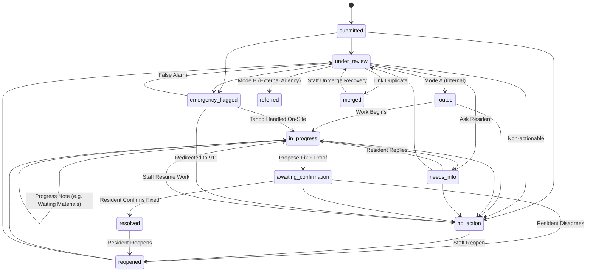

# Lifecycle, Statuses & State Machine Workflow

> **Canonical Source of Truth**: This document is the single authoritative source of truth for the report lifecycle, status definitions, allowed state transitions, and SLA behavior in the Barangay Problem Reporting and Management System. Any changes to system statuses must be updated here first.

---

## 1. Lifecycle Stages

1. **Intake**: Resident submits a report via the single-card form and receives an immediate unique tracking code (`BRG-XXXXXX`). The report is persisted immediately in status `submitted`. Submissions never hang waiting for external APIs.
2. **AI Triage (Background)**: An asynchronous listener invokes `GeminiService::analyze()`. Extracted data (suggested category, urgency, executive summary, photo audit, emergency flags) is saved to `report_ai_results`. If Gemini times out (30s) or fails, the report remains fully actionable with `ai_status = failed`.
3. **Branching**:
   - **Emergency Path**: If flagged as an emergency or crime, routing and priority scoring are bypassed; emergency hotlines are shown to the resident, Captain/tanods are alerted, and the report is pinned to the top of the queue.
   - **Standard Path**: Normal triage, duplicate radius checking, and priority calculation proceed.
4. **Staff Review**: Staff open `/admin/reports/{id}` to review a 3-way comparative card (Resident vs. AI vs. Final). The "Confirm and route" action is gated until category and urgency have been manually reviewed. Duplicates are suggested; only staff may execute a merge.
5. **Routing & Jurisdiction**:
   - **Mode A (Within Authority)**: Assigned to an internal barangay committee or personnel with an SLA deadline. Status moves to `routed`.
   - **Mode B (Beyond Authority)**: Generates a formal endorsement referral (`REF-YYYY-NNNN`) to an external agency with scheduled follow-ups. Status moves to `referred`.
   - **No Action**: If invalid, out of jurisdiction, or unreachable, moved to `no_action` with a required reason code and explanation.
6. **Action & Execution**: Assigned staff log progress updates (e.g., "Work started", "Inspection scheduled"). If material delays occur, staff log a progress note (`waiting_materials`) under `in_progress` without altering the status. If clarification is needed, status moves to `needs_info`.
7. **Resolution & Resident Verification**: Staff attach up to 5 resolution photos and a closing note, moving the case to `awaiting_confirmation`. The resident tracks the report, reviews the proof, submits a 1–5 star rating, and either **Confirms Fixed** (`resolved`) or **Reopens Case** (`reopened`).

---

## 2. Status Directory (12 Target Statuses)

| Status | Meaning | Who Acts Next | Resident Sees | SLA Clock |
| :--- | :--- | :--- | :--- | :--- |
| **`submitted`** | Received, untouched by staff | Staff | Submitted | **Open** |
| **`under_review`** | Staff has opened and is reviewing | Staff | Under Review | **Open** |
| **`routed`** | Office assigned, work not yet started | Office / Staff | Routed | **Open** |
| **`in_progress`** | Active field work underway | Office / Staff | In Progress (with progress notes) | **Open** |
| **`needs_info`** | Staff asked resident for clarification | Resident | Question response prompt | **Open** |
| **`awaiting_confirmation`** | Fix proposed with photo proof | Resident | Confirm Fixed / Reopen + 1–5 rating | **Open** |
| **`resolved`** | Resident verified fix as complete | Nobody (can reopen) | Resolved, proof gallery, rating | **Closed** |
| **`reopened`** | Resident disputed resolution | Staff | Reopened (investigating further) | **Open** |
| **`emergency_flagged`** | Critical safety emergency or crime | Captain / Tanod | 911 hotline alert banner | **Special** (bypasses SLA score) |
| **`referred`** | Transferred to external agency | External Agency | Referred (Agency name, dates, notes) | **Closed** (for barangay SLA) |
| **`merged`** | Duplicate linked into parent report | Nobody | Merged notice with primary link | **Closed** |
| **`no_action`** | Barangay takes no further action | Nobody (staff may reopen) | Closed: No Further Action + reason | **Closed** |

> [!NOTE]
> - **`on_hold` Removed**: "Waiting on materials" is recorded as a progress-update note under `in_progress`, keeping the core status list focused.
> - **`out_of_scope` & `closed` Merged**: Unified into `no_action` with mandatory reason codes.

---

## 3. Canonical Transition Table

| From Status | Allowed Target Statuses | Notes & Constraints |
| :--- | :--- | :--- |
| **`submitted`** | `under_review`, `routed`, `needs_info`, `referred`, `merged`, `no_action`, `emergency_flagged` | Initial state. |
| **`under_review`** | `routed`, `needs_info`, `referred`, `merged`, `no_action`, `emergency_flagged` | Staff triage in progress. |
| **`routed`** | `in_progress`, `needs_info`, `referred`, `awaiting_confirmation`, `resolved`, `no_action`, `emergency_flagged` | Office assigned. |
| **`in_progress`** | `in_progress`, `needs_info`, `referred`, `awaiting_confirmation`, `resolved`, `no_action`, `emergency_flagged` | Self-transition records a progress note without altering status. |
| **`needs_info`** | `under_review`, `routed`, `in_progress`, `needs_info`, `referred`, `awaiting_confirmation`, `resolved`, `no_action`, `emergency_flagged` | Self-transition records additional inquiry without altering status. |
| **`awaiting_confirmation`** | `resolved`, `in_progress`, `reopened`, `no_action`, `emergency_flagged` | Resident confirmation gate. |
| **`resolved`** | `in_progress`, `reopened` | Terminal resolution unless disputed or resumed. |
| **`reopened`** | `under_review`, `routed`, `in_progress`, `needs_info`, `referred`, `merged`, `no_action`, `emergency_flagged` | Increments `reopened_count`. |
| **`referred`** | `routed`, `in_progress`, `needs_info`, `resolved`, `merged`, `no_action` | Case remains tracked under external referrals. |
| **`emergency_flagged`** | `no_action`, `under_review`, `in_progress` | Default exit is `no_action` (`reason: emergency_redirected`); `under_review` for false alarms; `in_progress` (staff-only) if tanods handled it on-site. |
| **`merged`** | `under_review` | Staff-only recovery path for accidental merges (requires note). |
| **`no_action`** | `reopened`, `in_progress` | Staff-only (requires recorded note and security audit log). |

---

## 4. `no_action` Reason Codes & Storage

Every transition to `no_action` requires both a **standard reason code** and a **mandatory free-text explanation** visible to the resident.

### Allowed Reason Codes
1. `not_barangay_matter`: Issue falls outside municipal/barangay authority and cannot be referred.
2. `emergency_redirected`: Immediate life safety concern redirected to 911 / police / CDRRMO.
3. `cannot_resolve`: Valid concern that cannot be remediated due to insurmountable technical/legal barriers.
4. `invalid_report`: Spam, incomprehensible submission, or test report.
5. `resident_unreachable`: Necessary clarification was requested (`needs_info`), but reporter provided no valid contact or response within threshold.

### Storage Architecture
- Stored in a **dedicated indexed column** on `reports`: `reports.no_action_reason` (nullable string).
- Recorded in the immutable audit row in **`status_logs`**: `status_logs.no_action_reason` and `status_logs.note`.

---

## 5. State Machine Diagram

---

## 6. Priority Scoring & Duplicate Calculation Rules

### Priority Score Formula
The numerical priority score ($0 \text{ to } 100+$) is computed dynamically by `PriorityService`:

$$\text{Priority Score} = (\text{Urgency Points} \times w_1) + (\text{Category Risk Weight} \times w_2) + (\text{Sensitive Place Proximity} \times w_3) + (\text{Supporting Reports} \times w_4) + (\text{Age in Days} \times w_5) + \text{Signal Modifiers}$$

- **Urgency Points**: Low = 1, Medium = 2, High = 3, Critical = 4.
- **Sensitive Places**: Multiplier applied if coordinates fall within 200m of schools, hospitals, or daycares.
- **Signal Modifiers**: $+10$ points each for `is_ongoing = true`, `people_at_risk = true`, or `is_recurring = true`.
- **Emergency Exemption**: Emergency-flagged reports bypass scoring and pin straight to the top of the queue.

### Duplicate Detection Thresholds
- **Distance Radius**: Within $100\text{–}150\text{ meters}$ using the Haversine geospatial formula ($300\text{m}$ for public `/api/nearby-reports`).
- **Temporal Window**: Open reports submitted within the last $7\text{ to }14\text{ days}$.
- **Matching Rule**: Matches must share the same `category_id` and meet a text similarity threshold. Matches populate `duplicate_suggestions`; merges are strictly executed by officials.

---

## 7. Referral Conventions & External Jurisdiction Handling

When an incident falls outside barangay authority (Mode B), the system routes it to the external referral workflow:

- **Referral Sequence Format**: Each referral receives a unique tracking number in the format `REF-YYYY-NNNN` (e.g. `REF-2026-0001`).
- **Default Follow-Up Interval**: Automatically scheduled for `sent_at + 7 days` (configured in `config/reports.php`).
- **Formal Letter Structure**: A printable formal endorsement letter is generated with:
  - Official Barangay Calarian seal and institutional header.
  - Date and unique `REF-YYYY-NNNN` identifier.
  - Recipient external agency/utility office and designated contact.
  - Incident narrative, geo-coordinates, purok, and nearest landmark.
  - Follow-up owner (defaults to the staff member who prepared the referral).
- **Resident Privacy During Referral**: The resident tracking page displays only the recipient agency name, transmission status, and public notes (`visible_to_resident = true`). Staff names, official email addresses, and internal notes are never exposed.
- **SLA Clock Effect**: When a report transitions to `referred`, the internal barangay SLA clock stops (`Closed` for barangay SLA) while the external agency handles the matter. If the external agency cannot remediate, staff transition the case to `no_action` with reason `not_barangay_matter` or re-route internally.
