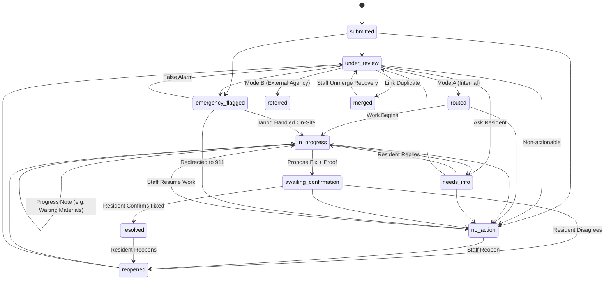
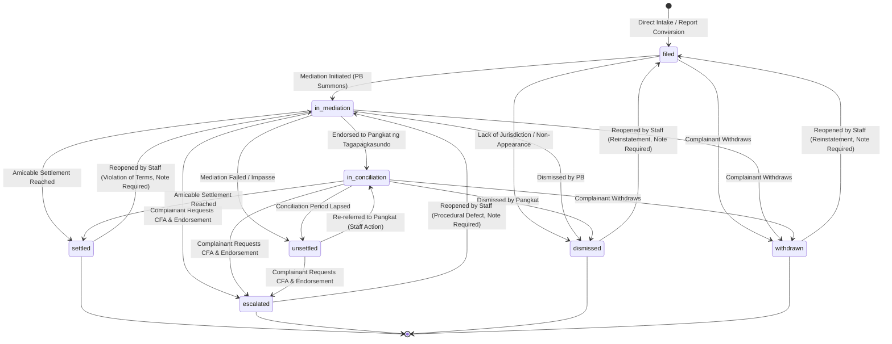
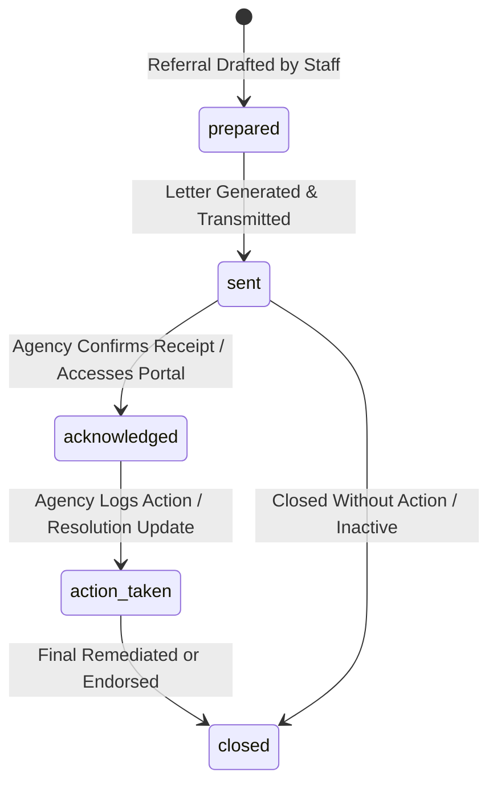

# Lifecycle, Statuses & State Machine Workflow

> **Canonical Source of Truth**: This document is the single authoritative source of truth for the incident report lifecycle, the external referral lifecycle, and the barangay case lifecycle, including status definitions, allowed state transitions, SLA behavior, and statutory caveats in the Barangay Problem Reporting and Management System. Any changes to system statuses must be updated here first.

---

## 1. Lifecycle Stages (Incident Reports)

1. **Intake**: Resident submits a report via the single-card form and receives an immediate unique tracking code (`BRG-XXXXXX`). The report is persisted immediately in status `submitted`. Submissions never hang waiting for external APIs.
2. **AI Triage (Background)**: An asynchronous listener invokes `GeminiService::analyze()`. Extracted data (suggested category, urgency, executive summary, photo audit, emergency flags) is saved to `report_ai_results`. If Gemini times out (30s) or fails, the report remains fully actionable with `ai_status = failed`.
3. **Branching**:
   - **Emergency Path**: If flagged as an emergency or crime, routing and priority scoring are bypassed; emergency hotlines are shown to the resident, Captain/tanods are alerted, and the report is pinned to the top of the queue.
   - **Standard Path**: Normal triage, duplicate radius checking, and priority calculation proceed.
4. **Staff Review**: Staff open `/admin/reports/{id}` to review a 3-way comparative card (Resident vs. AI vs. Final). The "Confirm and route" action is gated until category and urgency have been manually reviewed. Duplicates are suggested; only staff may execute a merge.
5. **Routing & Jurisdiction**:
   - **Mode A (Within Authority)**: Assigned to an internal barangay committee or personnel with an SLA deadline. Status moves to `routed`.
   - **Mode B (Beyond Authority)**: Generates a formal endorsement referral (`REF-YYYY-NNNN`) to an external agency with scheduled follow-ups. Status moves to `referred`.
   - **No Action**: If invalid, out of jurisdiction, or unreachable, moved to `no_action` with a required reason code and explanation.
6. **Action & Execution**: Assigned staff log progress updates (e.g., "Work started", "Inspection scheduled"). If material delays occur, staff log a progress note (`waiting_materials`) under `in_progress` without altering the status. If clarification is needed, status moves to `needs_info`.
7. **Resolution & Resident Verification**: Staff attach up to 5 resolution photos and a closing note, moving the case to `awaiting_confirmation`. The resident tracks the report, reviews the proof, submits a 1–5 star rating, and either **Confirms Fixed** (`resolved`) or **Reopens Case** (`reopened`).

---

## 2. Status Directory (Incident Reports - 12 Target Statuses)

| Status | Meaning | Who Acts Next | Resident Sees | SLA Clock |
| :--- | :--- | :--- | :--- | :--- |
| **`submitted`** | Received, untouched by staff | Staff | Submitted | **Open** |
| **`under_review`** | Staff has opened and is reviewing | Staff | Under Review | **Open** |
| **`routed`** | Office assigned, work not yet started | Office / Staff | Routed | **Open** |
| **`in_progress`** | Active field work underway | Office / Staff | In Progress (with progress notes) | **Open** |
| **`needs_info`** | Staff asked resident for clarification | Resident | Question response prompt | **Open** |
| **`awaiting_confirmation`** | Fix proposed with photo proof | Resident | Confirm Fixed / Reopen + 1–5 rating | **Open** |
| **`resolved`** | Resident verified fix as complete | Nobody (can reopen) | Resolved, proof gallery, rating | **Closed** |
| **`reopened`** | Resident disputed resolution | Staff | Reopened (investigating further) | **Open** |
| **`emergency_flagged`** | Critical safety emergency or crime | Captain / Tanod | 911 hotline alert banner | **Special** (bypasses SLA score) |
| **`referred`** | Transferred to external agency | External Agency | Referred (Agency name, dates, notes) | **Closed** (for barangay SLA) |
| **`merged`** | Duplicate linked into parent report | Nobody | Merged notice with primary link | **Closed** |
| **`no_action`** | Barangay takes no further action | Nobody (staff may reopen) | Closed: No Further Action + reason | **Closed** |

> [!NOTE]
> - **`on_hold` Removed**: "Waiting on materials" is recorded as a progress-update note under `in_progress`, keeping the core status list focused.
> - **`out_of_scope` & `closed` Merged**: Unified into `no_action` with mandatory reason codes.

---

## 3. Canonical Transition Table (Incident Reports)

| From Status | Allowed Target Statuses | Notes & Constraints |
| :--- | :--- | :--- |
| **`submitted`** | `under_review`, `routed`, `needs_info`, `referred`, `merged`, `no_action`, `emergency_flagged` | Initial state. |
| **`under_review`** | `routed`, `needs_info`, `referred`, `merged`, `no_action`, `emergency_flagged` | Staff triage in progress. |
| **`routed`** | `in_progress`, `needs_info`, `referred`, `awaiting_confirmation`, `resolved`, `no_action`, `emergency_flagged` | Office assigned. |
| **`in_progress`** | `in_progress`, `needs_info`, `referred`, `awaiting_confirmation`, `resolved`, `no_action`, `emergency_flagged` | Self-transition records a progress note without altering status. |
| **`needs_info`** | `under_review`, `routed`, `in_progress`, `needs_info`, `referred`, `awaiting_confirmation`, `resolved`, `no_action`, `emergency_flagged` | Self-transition records additional inquiry without altering status. |
| **`awaiting_confirmation`** | `resolved`, `in_progress`, `reopened`, `no_action`, `emergency_flagged` | Resident confirmation gate. |
| **`resolved`** | `in_progress`, `reopened` | Terminal resolution unless disputed or resumed. |
| **`reopened`** | `under_review`, `routed`, `in_progress`, `needs_info`, `referred`, `merged`, `no_action`, `emergency_flagged` | Increments `reopened_count`. |
| **`referred`** | `routed`, `in_progress`, `needs_info`, `resolved`, `merged`, `no_action` | Case remains tracked under external referrals. |
| **`emergency_flagged`** | `no_action`, `under_review`, `in_progress` | Default exit is `no_action` (`reason: emergency_redirected`); `under_review` for false alarms; `in_progress` (staff-only) if tanods handled it on-site. |
| **`merged`** | `under_review` | Staff-only recovery path for accidental merges (requires note). |
| **`no_action`** | `reopened`, `in_progress` | Staff-only (requires recorded note and security audit log). |

---

## 4. `no_action` Reason Codes & Storage

Every transition to `no_action` requires both a **standard reason code** and a **mandatory free-text explanation** visible to the resident.

### Allowed Reason Codes
1. `not_barangay_matter`: Issue falls outside municipal/barangay authority and cannot be referred.
2. `emergency_redirected`: Immediate life safety concern redirected to 911 / police / CDRRMO.
3. `cannot_resolve`: Valid concern that cannot be remediated due to insurmountable technical/legal barriers.
4. `invalid_report`: Spam, incomprehensible submission, or test report.
5. `resident_unreachable`: Necessary clarification was requested (`needs_info`), but reporter provided no valid contact or response within threshold.

### Storage Architecture
- Stored in a **dedicated indexed column** on `reports`: `reports.no_action_reason` (nullable string).
- Recorded in the immutable audit row in **`status_logs`**: `status_logs.no_action_reason` and `status_logs.note`.

---

## 5. State Machine Diagram (Incident Reports)

---

## 6. Priority Scoring & Duplicate Calculation Rules

### Priority Score Formula
The numerical priority score ($0 \text{ to } 100+$) is computed dynamically by `PriorityService`:

$$\text{Priority Score} = (\text{Urgency Points} \times w_1) + (\text{Category Risk Weight} \times w_2) + (\text{Sensitive Place Proximity} \times w_3) + (\text{Supporting Reports} \times w_4) + (\text{Age in Days} \times w_5) + \text{Signal Modifiers}$$

- **Urgency Points**: Low = 1, Medium = 2, High = 3, Critical = 4.
- **Sensitive Places**: Multiplier applied if coordinates fall within 200m of schools, hospitals, or daycares.
- **Signal Modifiers**: $+10$ points each for `is_ongoing = true`, `people_at_risk = true`, or `is_recurring = true`.
- **Emergency Exemption**: Emergency-flagged reports bypass scoring and pin straight to the top of the queue.

### Duplicate Detection Thresholds
- **Distance Radius**: Within $100\text{–}150\text{ meters}$ using the Haversine geospatial formula ($300\text{m}$ for public `/api/nearby-reports`).
- **Temporal Window**: Open reports submitted within the last $7\text{ to }14\text{ days}$.
- **Matching Rule**: Matches must share the same `category_id` and meet a text similarity threshold. Matches populate `duplicate_suggestions`; merges are strictly executed by officials.

---

## 7. Referral Conventions & External Jurisdiction Handling

When an incident falls outside barangay authority (Mode B), the system routes it to the external referral workflow:

- **Referral Sequence Format**: Each referral receives a unique tracking number in the format `REF-YYYY-NNNN` (e.g. `REF-2026-0001`), where `YYYY` is the active fiscal year [D].
- **Default Follow-Up Interval**: Automatically scheduled for `sent_at + referral.follow_up_days` (default **3 days** per Barangay Secretary answer [A Q12], configured in dynamic settings `referral.follow_up_days` with fallback to `config/reports.php`).
- **Formal Letter Structure**: A printable formal endorsement letter is generated with:
  - Official Barangay Calarian seal and institutional header.
  - Date and unique `REF-YYYY-NNNN` identifier.
  - Recipient external agency/utility office and designated contact.
  - Incident narrative, geo-coordinates, purok, and nearest landmark.
  - Follow-up owner (defaults to the staff member who prepared the referral).
  - Signature block generated dynamically via `SignatoryResolver::forDocument('referral_letter')` [D]. Left blank if unresolved.
  - Watermark: Renders a visible **`DRAFT`** watermark while unconfirmed by officials.
- **Resident Privacy During Referral**: The resident tracking page displays only the recipient agency name, transmission status, and public notes (`visible_to_resident = true`). Staff names, official email addresses, and internal notes are never exposed.
- **SLA Clock Effect**: When a report transitions to `referred`, the internal barangay SLA clock stops (`Closed` for barangay SLA) while the external agency handles the matter. If the external agency cannot remediate, staff transition the case to `no_action` with reason `not_barangay_matter` or re-route internally.

---

## 8. Barangay Case Lifecycle (Katarungang Pambarangay & Blotter)

> [!WARNING]
> Statutory timelines have not been verified against the Katarungang Pambarangay rules. All deadline calculations reflect the Secretary's administrative working guidelines [A Q20, Q25].

> [!IMPORTANT]
> **Independent State Machine & Core Governance Mandate**:
> 1. The Barangay Case lifecycle operates entirely independently from the public incident report lifecycle. Cases originate either via direct walk-in complaints or blotter entries recorded at the barangay hall (`source = 'direct'`), or via administrative escalation of an existing civil report (`source = 'report_escalation'`).
> 2. **"The AI suggests, the rules route, the officials decide."** Neither summons issuance, hearing attendance, deadline expiration, nor Certificate to File Action (CFA) generation ever triggers an automatic status transition. All status changes require explicit action by authorized personnel.

### 8.1 State Machine Diagram (Cases)

### 8.2 Lifecycle Stages & Statutory Deadlines

1. **Intake & Docketing (`filed`)**:
   - Case is recorded with record type `blotter` or `complaint` [A Q18].
   - Docket number format: `{MM}-{SEQ:3}-{YEAR}` [A Q9] (e.g., `11-001-2026`).
   - Blotter-only records stay at `filed` indefinitely without summons, hearings, or deadline countdowns, until upgraded to a formal complaint.
2. **Mediation Stage (`in_mediation`)**:
   - Presided over by the Punong Barangay (PB).
   - Mediation clock: **15 working days** [A Q25] starting from `complaint_started_on` [P] (or `filed_on`).
   - Summons are issued and hearings scheduled. Summons are counted for **information only** (no 3-summons cap or automated cutoff) [A Q20].
   - If agreement is reached, transitions to `settled`. If unresolved within 15 working days, official endorses case to Pangkat.
3. **Conciliation Stage (`in_conciliation`)**:
   - Presided over by the Pangkat ng Tagapagkasundo.
   - Conciliation clock: **15 working days** [A Q25] starting from `endorsed_to_pangkat_on`.
   - Conciliation extension: One extension of up to 15 working days (max 30 working days total conciliation) may be granted by the Pangkat [A Q25].
4. **Resolution or Impasse (`settled` / `unsettled`)**:
   - `settled`: Terms recorded, signed settlement uploaded, executed.
   - `unsettled`: Mediation/conciliation elapsed without settlement. Complainant may request escalation.
5. **Escalation & Endorsement (`escalated`)**:
   - Complainant decides whether and when to escalate [A Q23].
   - Official issues Certification to File Action (CFA) signed by the Pangkat Chairman [A Q5] (or PB if mediation stage).
   - Case is endorsed to court, prosecutor, or PNP [A Q18].
   - Case papers and attachments are dispatched to agency via `ReferralService::createFromCase` [A Q29, P].

### 8.3 Case Status Directory

| Status Slug | Label | Stage Meaning | Next Allowed Statuses | SLA / Deadline Clock |
| :--- | :--- | :--- | :--- | :--- |
| **`filed`** | Filed | Docketed case awaiting initial action. Blotter entries rest here. | `in_mediation`, `dismissed`, `withdrawn` | Inactive for blotter; Active for complaint |
| **`in_mediation`** | In Mediation | Under active mediation before Punong Barangay. Summons and hearings issued. | `in_conciliation`, `settled`, `unsettled`, `escalated`, `dismissed`, `withdrawn` | **15 working days** |
| **`in_conciliation`** | In Conciliation | Under conciliation before Pangkat ng Tagapagkasundo. | `settled`, `unsettled`, `escalated`, `dismissed`, `withdrawn` | **15 working days** (+15d ext) |
| **`settled`** | Settled | Amicable settlement signed and binding. Terminal. | `in_mediation` (Reopened by staff with note) | **Closed** |
| **`unsettled`** | Unsettled | Proceedings concluded without consensus. Awaiting complainant decision. | `escalated`, `in_conciliation` | **Closed** (Awaiting action) |
| **`escalated`** | Escalated | CFA issued; case endorsed to PNP, Prosecutor, or Court. Terminal. | `in_mediation` (Reopened by staff with note) | **Closed** |
| **`dismissed`** | Dismissed | Dismissed for lack of interest, lack of jurisdiction, or non-appearance. Terminal. | `filed` (Reopened by staff with note) | **Closed** |
| **`withdrawn`** | Withdrawn | Complainant submitted voluntary withdrawal. Terminal. | `filed` (Reopened by staff with note) | **Closed** |

### 8.4 Special Case Types & Timeline Exemptions

- Case types with `uses_kp_timeline = false` (e.g. administrative matters, urgent child protection referrals) do not run the 15-working-day mediation clock [P].
- Case types with `is_confidential_default = true` (e.g. BCPC, VAWC matters) automatically pre-tick the `is_confidential` flag during intake [A Q7, C6].

### 8.5 Working Days & Deadline Calculation Rules

- Deadlines use the `App\Support\WorkingDays` calculation engine [D].
- Excludes Saturdays, Sundays, and official non-working holidays loaded dynamically from setting `calendar.holidays` [D].
- Warning indicators:
  - **Normal**: "Day X of 15" (slate badge).
  - **Due soon**: 3 or fewer working days remaining (gold badge `cases.deadline_warning_days = 3`).
  - **Overdue**: Working day count exceeded (red badge "Overdue X d").
  - **Ready for next step**: Impasse reached or deadline passed without settlement (slate badge).

### 8.6 Summons & Hearing Governance

- **Summons Counting**: Summons are numbered sequentially for administrative tracking (`sequence_no`), but there is **no maximum summons limit** [A Q20]. The system does not lock or force status changes based on summons count.
- **Service Results**: Built values: `served_personal`, `served_substituted`, `refused`, `unserved`. Target normalized values: `pending`, `received`, `refused`, `not_found`, `other` [A Q21, R10].
- **Hearing Outcomes**: Attendance recorded as `appeared`, `failed_to_appear`, or `pending`. Hearing status tracked as `scheduled`, `in_progress`, `concluded`, `rescheduled`, `cancelled` [R11].
- **Voiding**: Any issued summons may be voided by authorized staff only with a **mandatory written explanation note**. Voiding decrements active summons display and logs an audit entry.

### 8.7 Intake Flow & Docketing Rules

1. **Record Type Selection**: Staff selects **Blotter-only** (`blotter`) or **Formal Complaint** (`complaint`) as the first input field [A Q18, C3].
2. **Party Search & Verification**: Staff searches existing persons by name or contact before creating new parties. Residency status is verified using Barangay ID, household list, government ID, or Purok leader confirmation [A Q16].
3. **Duplicate Warnings**:
   - **Person duplicates**: Matches on normalized name and contact number display existing person cards.
   - **Case duplicates**: Matches where both complainant and respondent match an existing open case within 30 days trigger a prominent warning: "Case #XX-XXX already filed between these parties on YYYY-MM-DD. Open existing or save anyway?" [A Q2, C8]. Staff decide whether to proceed.
4. **Docket Numbering**: Formatted as `{MM}-{SEQ:3}-{YEAR}` (e.g. `11-001-2026`) via `NumberingService::next('case', $fiscalYear)`. Sequence resets every fiscal year [A Q9].
5. **Confidentiality**: Pre-ticked if case type defaults to confidential [A Q7]. Stamped with active fiscal year.
6. **Transaction**: Intake persists case, parties, initial narrative, and audit log in a single atomic database transaction.

### 8.8 Report to Case Conversion

- A civil incident report in `under_review` or `routed` may be converted to a case by staff with permission `cases.create`.
- **Status Independence**: The report and the resulting case maintain distinct, decoupled lifecycles. The report transitions to `routed` or `no_action` (`reason: converted_to_case`), while the new case starts at `filed`.
- **Cross-links**: `reports.case_id` and `cases.source_report_id` record the reciprocal relationship.
- **Privacy & PII**: Reporter details are not automatically copied to case parties without explicit staff confirmation, protecting resident anonymity where requested.

### 8.9 Settlement Agreement Capture

- Accessible via the **Record Settlement** action when status is `in_mediation` or `in_conciliation`.
- Required fields:
  - `settled_on`: Date agreement was signed [A Q24].
  - `terms`: Detailed narrative of agreed stipulations [A Q24].
  - `settlement_amount`: Optional monetary settlement figure (decimal 12,2).
  - `agreement_file`: Signed amicable settlement agreement PDF/image upload (stored on private disk).
- Personnel recording: Authorized staff member or Punong Barangay.
- Execution: `CaseStatusService::transition($case, 'settled', $note, $user)`.

### 8.10 Escalation & CFA Generation Flow

1. **Trigger**: Complainant formally requests escalation after failed conciliation or mediation impasse [A Q22, Q23].
2. **Form Data**: Destination agency (PNP, Prosecutor, MTCC), Complainant requesting, Request date, Reason code, and Pangkat Chairman signatory.
3. **Validation**: If mediation or conciliation deadline has not elapsed, system shows a soft advisory warning ("15 working days not yet completed. Proceed anyway?"). Officials decide.
4. **Printables**: Generates printable Certification to File Action (CFA) signed by Pangkat Chairman [A Q5] and Endorsement Letter signed by Punong Barangay.
5. **Agency Handoff**: If `case_referral_handoff` feature flag is active, calls `ReferralService::createFromCase()`, creating an external referral with case documents attached for agency portal pickup [A Q29, C7].

### 8.11 Canonical Case Transition Matrix

| From Status | Allowed Target Statuses | Required Permission Slug | Note / Input Required | Audit Log Written |
| :--- | :--- | :--- | :--- | :--- |
| **`filed`** | `in_mediation` | `cases.summons` | Summons date & hearing schedule | Yes (`case.mediated`) |
| **`filed`** | `dismissed` | `cases.edit` | Mandatory dismissal reason | Yes (`case.dismissed`) |
| **`filed`** | `withdrawn` | `cases.edit` | Signed withdrawal notice / note | Yes (`case.withdrawn`) |
| **`in_mediation`** | `in_conciliation` | `cases.edit` | Pangkat endorsement date | Yes (`case.conciliated`) |
| **`in_mediation`** | `settled` | `cases.edit` | Settlement terms, date, signed PDF | Yes (`case.settled`) |
| **`in_mediation`** | `unsettled` | `cases.edit` | Reason for mediation impasse | Yes (`case.unsettled`) |
| **`in_mediation`** | `escalated` | `cases.escalate` | CFA details, destination, complainant | Yes (`case.escalated`) |
| **`in_mediation`** | `dismissed` | `cases.edit` | Mandatory dismissal reason | Yes (`case.dismissed`) |
| **`in_mediation`** | `withdrawn` | `cases.edit` | Complainant withdrawal note | Yes (`case.withdrawn`) |
| **`in_conciliation`**| `settled` | `cases.edit` | Settlement terms, date, signed PDF | Yes (`case.settled`) |
| **`in_conciliation`**| `unsettled` | `cases.edit` | Conciliation impasse note | Yes (`case.unsettled`) |
| **`in_conciliation`**| `escalated` | `cases.escalate` | CFA details, destination, complainant | Yes (`case.escalated`) |
| **`in_conciliation`**| `dismissed` | `cases.edit` | Dismissal reason | Yes (`case.dismissed`) |
| **`in_conciliation`**| `withdrawn` | `cases.edit` | Complainant withdrawal note | Yes (`case.withdrawn`) |
| **`unsettled`** | `escalated` | `cases.escalate` | CFA details, destination, complainant | Yes (`case.escalated`) |
| **`unsettled`** | `in_conciliation` | `cases.edit` | Re-referral to Pangkat explanation | Yes (`case.reconciliated`)|
| **`settled`** | `in_mediation` | `cases.edit` | Mandatory reopening note (breach) | Yes (`case.reopened`) |
| **`escalated`** | `in_mediation` | `cases.edit` | Mandatory reopening note (defect) | Yes (`case.reopened`) |
| **`dismissed`** | `filed` | `cases.edit` | Mandatory reinstatement explanation | Yes (`case.reinstated`)|
| **`withdrawn`** | `filed` | `cases.edit` | Mandatory reinstatement explanation | Yes (`case.reinstated`)|

### 8.12 Confirmation Status Table

| Item / Rule | Status | Source Tag | Caveat / Note |
| :--- | :--- | :--- | :--- |
| 15 working days mediation | Confirmed by Secretary | **[A Q20, Q25]** | Statutory timelines have not been verified against Katarungang Pambarangay rules. |
| 15 working days conciliation | Confirmed by Secretary | **[A Q25]** | Statutory timelines have not been verified against Katarungang Pambarangay rules. |
| Conciliation extension max 15d | Confirmed by Secretary | **[A Q25]** | "Another 15 to 30 days" per Secretary. |
| Complainant requests CFA | Confirmed by Secretary | **[A Q22, Q23]** | Complainant chooses whether to escalate. |
| Pangkat Chairman signs CFA | Confirmed by Secretary | **[A Q5]** | Verified against official signatory practices. |
| Docket format `{MM}-{SEQ:3}-{YEAR}` | Confirmed by Secretary | **[A Q9]** | Sequence resets each calendar fiscal year. |
| Summons count is info-only | Confirmed by Secretary | **[A Q20]** | No automatic cutoff after 3 summons. |
| Mediation clock start date | Proposal | **[P]** | Proposed: `complaint_started_on` date (defaults to `filed_on`). |
| Non-KP cases skip clock | Proposal | **[P]** | `case_types.uses_kp_timeline = false`. |
| Pangkat Chairman per case | Follow-up Question | **[P]** | Follow-up question for Secretary tomorrow. |

### 8.13 Code Alignment (`App\Support\CaseStatus`)

| Status in Section 8.3 | In `CaseStatus` (Built) | Target Constant in Phase 0.5 | Note |
| :--- | :--- | :--- | :--- |
| `filed` | `CaseStatus::FILED` | `CaseStatus::FILED = 'filed'` | Matches built code. |
| `in_mediation` | `CaseStatus::IN_MEDIATION` | `CaseStatus::IN_MEDIATION = 'in_mediation'` | Matches built code. |
| `in_conciliation`| **Missing** | `CaseStatus::IN_CONCILIATION = 'in_conciliation'` | To be added in Phase 0.5 migration/code. |
| `settled` | `CaseStatus::SETTLED` | `CaseStatus::SETTLED = 'settled'` | Matches built code. |
| `unsettled` | `CaseStatus::UNSETTLED` | `CaseStatus::UNSETTLED = 'unsettled'` | Matches built code. |
| `escalated` | `CaseStatus::ESCALATED` | `CaseStatus::ESCALATED = 'escalated'` | Matches built code. |
| `dismissed` | `CaseStatus::DISMISSED` | `CaseStatus::DISMISSED = 'dismissed'` | Matches built code. |
| `withdrawn` | `CaseStatus::WITHDRAWN` | `CaseStatus::WITHDRAWN = 'withdrawn'` | Matches built code. |

---

## 9. Referral Lifecycle (External Agency Portal)

External referrals dispatched to partner agencies (PNP, CSWDO, City Engineer, Utilities) follow a dedicated lifecycle tracked in `referrals` and `referral_updates`:

1. **`prepared`**: Referral created by staff from report review Mode B or case escalation. Tracking number `REF-YYYY-NNNN` reserved.
2. **`sent`**: Letter finalized, signed via `SignatoryResolver`, and transmitted via agency email / portal. Follow-up reminder scheduled for `sent_at + 3 days` [A Q12].
3. **`acknowledged`**: Partner agency logs into portal (`/agency/referrals/{id}`), views case/report details, and downloads case papers [A Q29].
4. **`action_taken`**: Agency posts progress notes or remediation milestones via `agency.referrals.updates.store` [A Q29].
5. **`closed`**: Work completed or referred back to barangay. Handled in consultation with barangay staff.

---

## 10. Fiscal Year Effects & Boundary Rules

1. **Finalized Definition**: A fiscal year corresponds to one calendar year (January 1 to December 31) [A Q8].
2. **Locked Year Immutability (`FiscalYearGuard`)**:
   - When a fiscal year is set to `status = 'locked'` or `is_locked = true`, all records associated with that fiscal year become strictly immutable.
   - Any attempt to update, transition status, delete, or add summons/hearings/updates to a locked year's case or report throws `FiscalYearLockedException` and is aborted by `FiscalYearGuard`.
3. **Roll-over Mechanics**:
   - The Barangay Secretary or Admin activates the new fiscal year via `/admin/fiscal-years`.
   - Only one fiscal year may have `status = 'active'` at any given time.
   - Ongoing cases in `in_mediation` or `in_conciliation` remain open and editable in their originating fiscal year until concluded, but do not block the activation of the new fiscal year.
4. **Numbering Sequence Restart**:
   - `NumberingService` resets sequence numbers to `001` at the commencement of each fiscal year.
   - Sequence uniqueness is scoped strictly to `(fiscal_year_id, type)`.
   - Imported historical records (WS6) retain their original docket numbers and do not consume active fiscal year sequences.

---

## 11. Staff Screens & Status-to-Action Mapping

To ensure operational consistency across UI redesigns (queue filters, action panels, and review workspaces), staff actions are strictly bound to report lifecycle states:

| Report Status | Staff's Operational Job | Primary Action | Secondary / Exception Actions |
| :--- | :--- | :--- | :--- |
| **`submitted`** | Initial intake & comparative triage (Resident vs. AI). | **Confirm and Route** (verifies category, urgency, office); *for reports with unverified audio, shows **Listen and verify** as primary action prior to routing* | Ask reporter for info (`needs_info`), Flag emergency, Take no action (`no_action`), Mark duplicate (`merged`). |
| **`under_review`** | In-depth triage, jurisdiction verification, and assignment. | **Route Internally** or **Prepare Referral** | Ask reporter for info, Take no action, Flag emergency, Mark duplicate. |
| **`needs_info`** | Awaiting resident clarification response. | **Review Clarification** (resumes to `under_review`) | Re-route internally, Take no action with `resident_unreachable`, Re-ask info. |
| **`routed`** | Formal assignment dispatch to Tanods / maintenance crew. | **Start Work** (transitions to `in_progress`) | Re-assign office or personnel, Prepare referral, Ask info, Take no action. |
| **`in_progress`** | Active field inspection, repairs, or municipal coordination. | **Propose Resolution** (requires proof photos & notes) | Add progress milestone note (self-transition), Ask info, Refer upward, Take no action. |
| **`awaiting_confirmation`** | Awaiting resident satisfaction rating or 14-day SLA expiry. | **Confirm Resolution** (transitions to `resolved`) | Reopen upon resident dispute (`reopened`), Resume work (`in_progress`). |
| **`resolved`** | Archived completed incident record. | **View Resolution Dossier** | Reopen on recurrence or dispute (`reopened` or `in_progress`). |
| **`reopened`** | Investigate unresolved or recurring failure. | **Resume Work** (transitions to `in_progress`) | Re-route internally, Ask info, Take no action with explanation. |
| **`referred`** | Monitor external agency action and 3-day follow-up. | **Log Agency Update** (milestone or portal message) | Re-route internally (`routed`), Resolve upon agency fix (`resolved`), Take no action (`not_barangay_matter`). |
| **`merged`** | Consolidated secondary duplicate incident. | **View Canonical Parent** | Staff-only recovery unmerge (`under_review`). |
| **`no_action`** | Non-actionable report with mandatory reason code. | **View Reason & Justification** | Reopen/recover report (`in_progress` or `reopened`). |
| **`emergency_flagged`** | High-priority safety coordination with 911 / CDRRMO. | **Dispatch Emergency Response** (`in_progress`) | Transfer to review (`under_review`), Conclude redirection (`no_action` with `emergency_redirected`). |

---

## 12. Voice Report Handling (Planned Prototype)

### 12.1 Lifecycle Integration & Transcript Statuses
Voice intake adds an asynchronous audio recording or file upload to reports (`reports.source` of `voice` or `phone_log`), with audio records stored in `report_audios`. Transcript status is tracked via `report_audios.transcript_status`:
- `pending`: Audio uploaded/recorded; awaiting Gemini transcription.
- `done`: Clean, high-confidence transcript generated; automatically populated into description for user review before submission.
- `needs_verification`: Speech was unclear, only partially understood, empty, or spoken in a dialect not reliably parsed (e.g. Chavacano/mixed Bisaya).
- `failed`: Technical error, network timeout, or invalid transcription response.
- `mock`: Generated canned transcript in local demo/test mode (`voice.mock_transcription` enabled).

### 12.2 Human-in-the-Loop Verification Gate
**Core Rule**: **If the audio is uncertain or the AI cannot understand it, nothing is guessed and the decision goes to staff.**
- **No Guessed Text**: When `transcript_status` is `needs_verification` or `failed`, the system never inserts guessed text into the report description. A partial transcript, if any, is stored solely as an "unverified draft".
- **Report Acceptance**: The report is never blocked. It enters `submitted` with `source = voice` or `phone_log`. If the reporter typed nothing, a system placeholder description is stored: `"Voice report - transcript unavailable; staff to listen to the recording"`.
- **Review Gate**: The report is flagged as "needs staff verification". On the review page, a prominent banner appears: *"Voice report needs verification. Listen to the recording and confirm or enter what was said before routing."*
- **Action Blocking**: "Confirm and route" and all forward transitions are strictly blocked until an authorized staff member listens to the audio and either confirms the unverified draft or inputs the corrected text (stored as the staff description; the resident's original input is never overwritten). The verifier's user ID and timestamp (`verified_by`, `verified_at`) are logged.
- **No New Statuses**: Voice verification is implemented strictly within the existing human-in-the-loop review gate. It adds **no new report status** and **no automatic transition**.
- **Queue Representation**: On the report queue, reports needing audio verification display a small microphone indicator beside the tracking code and a Next Action hint (`Verify audio`), without increasing row height or requiring an extra table column.
